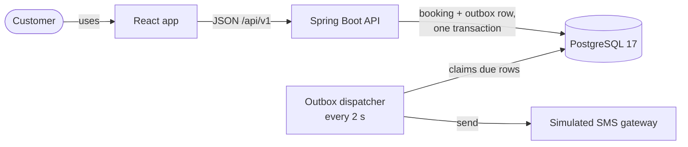

# BranchBook

Branch appointment booking for a South African bank: customers choose a branch, a service and a time, and receive
a simulated SMS confirmation that cannot be lost.

> **Fynbos Bank is fictional.** This repository is an engineering assessment submitted to Capitec Bank. It is not
> affiliated with Capitec Bank or any other bank. Every branch, person and phone number in it is made up, and no
> real message is ever sent.

## Status

| | |
|---|---|
| Stage | Milestone M2 complete: the slot rules and the availability API, on top of M1's schema, catalogue and branch API. The API contract is committed and the web app's types are generated from it. Booking comes next (M3). |
| Design | The whole design is on one [architecture page](https://claude.ai/artifact/X4b1pc9RSCboanuXBSn6oX), checked against the code at the end of every milestone |
| Run locally | `make up`, then open http://localhost:8080 |
| Hosted demo | Optional, in AWS Cape Town, defined in AWS CDK ([ADR-0006](docs/adr/0006-hosted-demo-on-aws-with-cdk.md)) |
| Deployment | Every push to `main` is tested and deployed to AWS Cape Town through OpenID Connect, with no stored keys ([ADR-0007](docs/adr/0007-continuous-deployment-from-main.md), [infra/README.md](infra/README.md)) |

This README grows with each milestone. Sections marked *planned* describe what is coming, not what exists yet.

## The brief

> "Create a system (front end and back end) for customers to schedule branch appointments and communicates a
> simulated confirmation of the appointment."

## How the brief maps to the system

| Brief | What BranchBook does | Where | Proven by (*planned*) |
|---|---|---|---|
| for customers | No login. A customer opens an appointment with its reference and the last four digits of the mobile number used to book. | `/manage`, `GET /api/v1/appointments/{reference}` | `AppointmentApiIT.getWithWrongLast4Returns404NotForbidden` |
| to schedule | A four-step booking flow: branch, service, date, slot. Slots respect trading hours, public holidays, a two-hour lead time, a 30-day horizon and each service's capacity. | `/book`, `POST /api/v1/appointments` | `SlotCalendarTest.excludesSlotsStartingWithinTwoHoursOfNow`, `ConcurrentBookingIT.twentyRacersForOneSeatProduceExactlyOne201` |
| branch appointments | Six fictional branches in six provinces, each with its own trading hours and per-service capacity. | Flyway reference data | `SlotCalendarTest.saturdayFortyFiveMinuteLastStartIs1145`, `PublicHolidayCalendarTest.sundayHoliday9Aug2026IsObservedOnMonday10Aug` |
| communicates a simulated confirmation | The booking transaction writes the SMS to an outbox table. A dispatcher delivers it through a simulated gateway with retries, and the confirmation page shows its status live. | `/appointments/:reference` | `ConfirmationOutboxIT.bookingAndPendingMessagesCommitAtomically` |
| front end and back end | A React 19 app served by one Spring Boot jar, over PostgreSQL 17. | `make up` | `book-appointment.spec.ts` (*planned*, M6) |

## What makes it correct

- **Double booking is impossible.** PostgreSQL exclusion constraints reject an overlapping seat, even from code
  that bypasses the application, which a raw-SQL test proves today. A fixed lock order makes the race outcome
  deterministic; a 20-thread test that proves exactly one booking wins is planned for M5
  ([ADR-0002](docs/adr/0002-double-booking-prevention.md)).
- **Retries are safe.** An `Idempotency-Key` is the first thing the booking transaction records, so a double-click
  or a mobile-network retry returns the same booking.
- **The confirmation cannot be lost.** It commits with the booking and is delivered by a background dispatcher
  with retries. A cancellation supersedes a confirmation that has not been sent
  ([ADR-0003](docs/adr/0003-transactional-outbox-for-confirmations.md)).
- **It is built for South Africa.** It knows public holidays, including the rule that a Sunday holiday moves to
  Monday. Times are stored in UTC and shown in South African Standard Time, and mobile numbers are normalised.
- **It collects as little as possible.** A name and a mobile number. Logs and error bodies contain no personal
  data ([SECURITY.md](SECURITY.md)).

Every rule, with the test that proves it, is in [docs/domain-rules.md](docs/domain-rules.md).

## Architecture at a glance

<a href="https://claude.ai/artifact/X4b1pc9RSCboanuXBSn6oX">
  <picture>
    <source media="(prefers-color-scheme: dark)" srcset="docs/assets/architecture-page-dark.png">
    
  </picture>
</a>

The whole design is on one page: **[BranchBook architecture](https://claude.ai/artifact/X4b1pc9RSCboanuXBSn6oX)**. It
covers the booking transaction, the confirmation outbox, the data and domain models, the API, the South African
rules, testing and the AWS deployment, with diagrams. It is checked against the code at the end of every milestone:
each section is marked built, partly built or planned, and anything built differently from the plan is listed with
its reason.



One deployable and one database, packaged by capability (`catalogue`, `scheduling`, `booking`, `notification`)
with boundaries enforced by architecture tests. The full picture is in [docs/architecture.md](docs/architecture.md).

## Technology

| Layer | Choice |
|---|---|
| Back end | Java 25 LTS, Spring Boot 4.1, Spring Data JPA, Flyway |
| Database | PostgreSQL 17 with `btree_gist` |
| Front end | React 19, TypeScript (strict), Vite, TanStack Query, react-hook-form with zod |
| API contract | OpenAPI 3.1, generated from the controllers by springdoc and committed; the web app's types are generated from it ([ADR-0005](docs/adr/0005-committed-openapi-contract.md)) |
| Tests | JUnit, Testcontainers on real PostgreSQL, ArchUnit, Vitest, Playwright |
| Delivery | Docker Compose locally, GitHub Actions, AWS CDK for the optional hosted demo |

### Versions

Recorded when the project was scaffolded (M0). Dependabot proposes updates weekly.

| Component | Version | Pinned in |
|---|---|---|
| Java | 25 LTS; Eclipse Temurin 25.0.4.1 in the image | `api/pom.xml`, `Dockerfile` |
| Spring Boot | 4.1.1, with Spring Framework 7.0.9 and Spring Security 7.1.1 | `api/pom.xml` |
| Hibernate ORM, Flyway | 7.4.5, 12.4.0 | managed by Spring Boot |
| PostgreSQL | 17.11; JDBC driver 42.7.13 | `compose.yaml`, `TestcontainersConfiguration` |
| JUnit, Testcontainers | 6.0.3, 2.0.5 | managed by Spring Boot |
| ArchUnit | 1.5.1 | `api/pom.xml` |
| springdoc-openapi | 3.2.0 | `api/pom.xml` |
| Maven | 3.10.0, checksum-verified by the wrapper | `api/.mvn/wrapper/maven-wrapper.properties` |
| Node.js | 24; 24.22.1 in the build image | `.nvmrc`, `Dockerfile` |
| React | 19.3.1 | `web/package-lock.json` |
| TypeScript | 6.0.3 | `web/` and `infra/` lockfiles |
| Vite, Vitest | 8.3.5, 5.0.5 | `web/package-lock.json` |
| openapi-typescript, openapi-fetch | 7.13.0, 0.17.0 | `web/package-lock.json` |
| ESLint | 10.13.0 | `web/` and `infra/` lockfiles |
| AWS CDK | `aws-cdk-lib` 2.274.0, CLI 2.1146.1 | `infra/package.json` |

## Scope

The plan is about 35 focused hours, split into tiers so that a short week still ships something complete.

| Tier | Contents |
|---|---|
| Tier 1: never cut | Booking with every proof, lookup and the confirmation page, the read-only `/manage` lookup, the SMS outbox and dispatcher, the simulated inbox, the lookup rate limit, race tests, smoke scripts, the main end-to-end test |
| Tier 2: if time allows | Cancellation, retrying a failed message from the inbox, demo data, custom metrics |
| Tier 3: cut by default | The email channel, a per-recipient SMS cap, more end-to-end tests, a README animation |

Deliberately out of scope, each with its reason in the ADRs: customer login, staff screens, rescheduling, reminders,
real SMS or email providers, a message broker, microservices and Kubernetes manifests.

## Getting started

### Run it

Docker is the only prerequisite.

```bash
git clone https://github.com/KatlehoKomeke/Appointment-Booking-System.git
cd Appointment-Booking-System
make up       # build the image, start the app and PostgreSQL, wait until both are healthy
make smoke    # check the running app over HTTP
make down     # stop everything and delete the local database
```

`make up` prints the address: http://localhost:8080 unless you change it. If port 8080 is taken, choose another
with `APP_PORT=18080 make up`, or in a `.env` file copied from [.env.example](.env.example). Without make, run
`docker compose up --build --wait`.

### Try the API

Swagger UI at http://localhost:8080/swagger-ui.html lists every operation and lets you call it. From a terminal,
the slots for a home loan consultation at Rustenburg on a Saturday:

```bash
curl 'http://localhost:8080/api/v1/branches/RUS/availability?service=HOME&date=2026-10-31'
```

```json
{
  "branchCode": "RUS",
  "serviceCode": "HOME",
  "date": "2026-10-31",
  "timezone": "Africa/Johannesburg",
  "generatedAt": "2026-10-25T13:18:55+02:00",
  "closedReason": null,
  "holidayName": null,
  "slots": [
    { "startsAt": "2026-10-31T08:00:00+02:00", "endsAt": "2026-10-31T08:45:00+02:00", "seatsAvailable": 2 },
    { "startsAt": "2026-10-31T08:45:00+02:00", "endsAt": "2026-10-31T09:30:00+02:00", "seatsAvailable": 2 },
    { "startsAt": "2026-10-31T09:30:00+02:00", "endsAt": "2026-10-31T10:15:00+02:00", "seatsAvailable": 2 },
    { "startsAt": "2026-10-31T10:15:00+02:00", "endsAt": "2026-10-31T11:00:00+02:00", "seatsAvailable": 2 },
    { "startsAt": "2026-10-31T11:00:00+02:00", "endsAt": "2026-10-31T11:45:00+02:00", "seatsAvailable": 2 }
  ]
}
```

Rustenburg closes at 12:00 on Saturdays, so the last 45-minute slot starts at 11:00. Every time carries the
branch's offset, `+02:00`. Pick a date in the next 30 days; any other is refused with
`422 DATE_OUTSIDE_BOOKING_WINDOW`. The endpoints and their errors are listed in [api/README.md](api/README.md).

### Develop it

Development also needs JDK 25 and Node 24.

```bash
make hooks     # once per clone: scan every commit for secrets, and flag major ones for an architecture-page check
make dev-api   # the API on port 8080, with a throwaway PostgreSQL in Docker
make dev-web   # the web app on port 5173 with hot reload, calling the API
make test      # every check CI runs on the API and the web app
make help      # every other task
```

Each part has its own guide: [api/README.md](api/README.md), [web/README.md](web/README.md) and
[infra/README.md](infra/README.md).

## Repository layout

```text
api/                     Spring Boot application: the API, the confirmation dispatcher, and serving the web app
web/                     React app
infra/                   AWS CDK app for the hosted demo
docs/                    architecture, decision records, domain rules, error codes
scripts/smoke.sh         HTTP smoke test of a running instance
Dockerfile, compose.yaml the image and the local stack behind `make up`
Makefile                 one entry point for every task
```

## Assumptions

- **Branch trading hours are representative,** not Capitec's official hours: weekdays 08:00 to 17:00, Saturdays
  08:00 to 13:00, Sundays closed unless a branch opts in. They are data, so they can change per branch.
- **Each service has a fixed duration** of 15, 30 or 45 minutes, and a capacity per branch: the number of
  consultants who can see customers at the same time.
- **Bookings close two hours before a slot,** and open 30 days ahead.
- **Public holidays are seeded for 2026 and 2027.** See [Reference data](#reference-data).
- **A customer is identified by their mobile number.** There are no accounts in this version.

## Reference data

Flyway seeds the catalogue of the fictional Fynbos Bank
([V3__reference_data.sql](api/src/main/resources/db/migration/V3__reference_data.sql)). The names and street
addresses are made up; no migration contains personal data.

| Branch | Code | Province | Sundays | Why it is there |
|---|---|---|---|---|
| Bellville Kingsway | `BEL` | Western Cape | Closed | |
| Gqeberha Baywater | `GQE` | Eastern Cape | Closed | Offers no home loans |
| Polokwane Savannah | `POL` | Limpopo | Closed | One seat per service, so a race for the last seat is easy to show |
| Rustenburg Bojanala | `RUS` | North West | Closed | Closes at 12:00 on Saturdays |
| Sandton Summit Mall | `SAN` | Gauteng | 09:00 to 13:00 | Three seats for FICA and credit consultations |
| Umhlanga Ridge | `UMH` | KwaZulu-Natal | 09:00 to 13:00 | |

Every branch trades 08:00 to 17:00 on weekdays and 08:00 to 13:00 on Saturdays, with two seats per service unless
the table says otherwise. The six services are a FICA update and a card replacement (15 minutes), opening an
account, a credit consultation and deceased-estate help (30 minutes), and a home loan consultation (45 minutes).
Each lists the documents to bring.

**Public holidays.** Every branch closes on public holidays.

- The dates in law are seeded for 2026 and 2027
  ([V4__public_holidays_2026_2027.sql](api/src/main/resources/db/migration/V4__public_holidays_2026_2027.sql)):
  Schedule 1 of the Public Holidays Act, and 4 November 2026, which the President declared a public holiday for the
  local government elections.
- When a holiday falls on a Sunday, the Monday after it is a holiday too (section 2(1) of the Act). These Mondays
  are derived in code, not stored: 10 August 2026, 22 March 2027 and 27 December 2027. A holiday on a Saturday
  moves nowhere.
- Coverage ends on 31 December 2027. Adding 2028 is one new migration, not a code change.

## Documentation

| Document | Contents |
|---|---|
| [Architecture page](https://claude.ai/artifact/X4b1pc9RSCboanuXBSn6oX) | The whole design, including the parts not built yet, with the build status of every section and each departure from the plan |
| [docs/architecture.md](docs/architecture.md) | How it is built: containers, modules, the booking transaction, the confirmation, the data model |
| [docs/adr](docs/adr/README.md) | Architecture decision records |
| [docs/domain-rules.md](docs/domain-rules.md) | Every business rule, where it is enforced and the test that proves it |
| [docs/errors.md](docs/errors.md) | Every API error code, when it happens and what the customer sees |
| [docs/openapi.yaml](docs/openapi.yaml) | The API contract, generated from the code and checked by a test |
| [infra/README.md](infra/README.md) | The AWS CDK app: what exists in AWS, how GitHub connects without keys, first-time setup |
| [SECURITY.md](SECURITY.md) | Secrets, personal information and vulnerability reporting |
| [CONTRIBUTING.md](CONTRIBUTING.md) | Workflow, commit conventions and the documentation standard |

## Security and privacy

No secret is ever stored in this repository. Every commit is scanned for secrets by a pre-commit hook, and every
push by a CI workflow. Hosted environments receive credentials only at runtime from AWS Secrets Manager. All data
is synthetic. The details are in [SECURITY.md](SECURITY.md).

## AI assistance

I used an AI assistant (Claude, by Anthropic) for research, for design review and for drafting documentation. Every
decision is recorded with its reasoning in [docs/adr](docs/adr/README.md). Nothing is committed that I have not
reviewed and cannot explain. The final version of this section will give concrete examples of suggestions I
accepted and rejected.

## Licence

[MIT](LICENSE)
