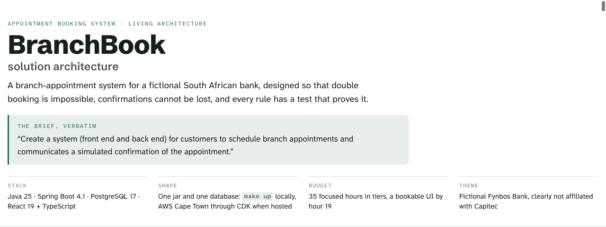

# BranchBook

Branch appointment booking for a South African bank: customers choose a branch, a service and a time, and receive
a simulated SMS confirmation that cannot be lost.

[](https://github.com/KatlehoKomeke/Appointment-Booking-System/actions/workflows/ci.yml) [](https://github.com/KatlehoKomeke/Appointment-Booking-System/actions/workflows/secret-scan.yml) [](https://github.com/KatlehoKomeke/Appointment-Booking-System/actions/workflows/deploy.yml)

> **Fynbos Bank is fictional.** This repository is an engineering assessment submitted to Capitec Bank. It is not
> affiliated with Capitec Bank or any other bank. Every branch, person and phone number in it is made up, and no
> real message is ever sent.


One Spring Boot jar over PostgreSQL 17, delivered by GitHub Actions to AWS. Solid parts are built; dashed parts are planned, with their milestone ([key](docs/assets/diagrams/README.md#key)).

## Status

| Area | Today |
|---|---|
| Stage | Milestones M0 to M3 and M5 built: booking in one transaction that also writes the confirmation SMS, lookup with the reference and the last four digits, and a dispatcher that delivers the SMS through a simulated gateway, with the race proofs. The web app's screens (M4) are being built. |
| Design | The whole design, including planned work, is on the [architecture page](https://claude.ai/artifact/X4b1pc9RSCboanuXBSn6oX); its header names the commit it was last checked against. The repository records what is built and wins where the two disagree. |
| Run locally | `make up`, then open http://localhost:8080 |
| Hosted demo | Not hosted yet. Planned after M6 in AWS Cape Town (af-south-1), defined in AWS CDK ([ADR-0006](docs/adr/0006-hosted-demo-on-aws-with-cdk.md)). Today AWS holds the deploy role, a budget and a release record, and no part of the application ([infra/README.md](infra/README.md)). |
| Deployment | Every push to `main` deploys `BranchbookRelease`, a release record in af-south-1 that holds the deployed commit, through OpenID Connect with no stored keys, after the CDK app's own tests pass ([ADR-0007](docs/adr/0007-continuous-deployment-from-main.md), [docs/delivery.md](docs/delivery.md)). The application's CI runs alongside and does not gate it yet. |

### Milestones

| Milestone | Scope | Status |
|---|---|---|
| M0 | Scaffold, `make up`, CI, continuous deployment | Built |
| M1 | Schema and named constraints, reference data, public holidays, branch API, ArchUnit rules | Built |
| M2 | `SlotCalendar`, the availability API, the committed OpenAPI contract | Built |
| M3 | Booking transaction with idempotency, the PENDING confirmation SMS in the same transaction, lookup with the last four digits and its rate limit | Built |
| M4 | Booking UI: the five-step flow, the confirmation page, read-only `/manage` | Next |
| M5 | The dispatcher and simulated SMS gateway, delivery status, the simulated inbox, the race and idempotency proofs | Built |
| M6 | Tier 2 if time allows, UI states and accessibility, web and end-to-end tests, CI completion | Planned |
| M7 | Final documentation pass, clean-clone rehearsal, release tag | Planned |
| AWS | Hosted demo: deploy role, budget and release record built; DNS, data and app stacks after M6 | Partly built |

## The full design

<a href="https://claude.ai/artifact/X4b1pc9RSCboanuXBSn6oX"><picture>
  <source media="(prefers-color-scheme: dark)" srcset="docs/assets/architecture-page-dark.png">
  
</picture></a>

**[BranchBook architecture](https://claude.ai/artifact/X4b1pc9RSCboanuXBSn6oX)** holds the whole design, including planned work: each section is marked built, partly built or planned, with every departure from the plan.

## Reviewing this repository

1. **This page** (2 min): Status, Milestones, the brief map and the guarantees.
2. **[docs/architecture.md](docs/architecture.md)** (5 min): the system, one real request, the modules, the booking transaction, the schema.
3. **[docs/delivery.md](docs/delivery.md)** (3 min): from a commit to AWS, what each workflow proves, the known gaps.
4. **[infra/README.md](infra/README.md)** (3 min): what exists in AWS, how GitHub reaches it without keys, who can change what.
5. **The code behind the claims** (2 min): [V2__schema.sql](api/src/main/resources/db/migration/V2__schema.sql), [SchemaConstraintIT](api/src/test/java/za/co/fynbos/branchbook/SchemaConstraintIT.java), [SlotCalendar](api/src/main/java/za/co/fynbos/branchbook/scheduling/domain/SlotCalendar.java),
   [BookAppointmentHandler](api/src/main/java/za/co/fynbos/branchbook/booking/application/BookAppointmentHandler.java), [ArchitectureTest](api/src/test/java/za/co/fynbos/branchbook/ArchitectureTest.java), [account-stack.test.ts](infra/test/account-stack.test.ts).

Every document, with its status: [docs/README.md](docs/README.md). Decisions: [docs/adr](docs/adr/README.md). Policies: [SECURITY.md](SECURITY.md) and [CONTRIBUTING.md](CONTRIBUTING.md). The UI design: [web/README.md](web/README.md#ui-design). To run it: [Getting started](#getting-started).

## The brief

> "Create a system (front end and back end) for customers to schedule branch appointments and communicates a
> simulated confirmation of the appointment."

## How the brief maps to the system

| Brief | What BranchBook does, and the tests that prove it |
|---|---|
| for customers | No login. A customer opens an appointment with its reference and the last four digits of the mobile number used to book: `GET /api/v1/appointments/{reference}` today, and the read-only `/manage` page in M4.<br>**Proof:** [`AppointmentApiIT.getWithWrongLast4Returns404NotForbidden`](api/src/test/java/za/co/fynbos/branchbook/booking/api/AppointmentApiIT.java) (proven), [`AppointmentApiIT.sixthWrongLast4WithinHourReturns429`](api/src/test/java/za/co/fynbos/branchbook/booking/api/AppointmentApiIT.java) (proven) |
| to schedule | `POST /api/v1/appointments` books today; the web app's five-step flow (branch, service, date and time, your details, review) arrives in M4. Slots respect trading hours, public holidays, a two-hour lead time, a 30-day horizon and each service's capacity.<br>**Proof:** [`ConcurrentBookingIT.twentyRacersForOneSeatProduceExactlyOne201`](api/src/test/java/za/co/fynbos/branchbook/booking/application/ConcurrentBookingIT.java) (proven), [`SlotCalendarTest.excludesSlotsStartingWithinTwoHoursOfNow`](api/src/test/java/za/co/fynbos/branchbook/scheduling/domain/SlotCalendarTest.java) (proven), [`AppointmentApiIT.postWhenSlotFullReturns409WithThreeAlternatives`](api/src/test/java/za/co/fynbos/branchbook/booking/api/AppointmentApiIT.java) (proven) |
| branch appointments | Six fictional branches in six provinces, each with its own trading hours and per-service capacity, seeded by Flyway ([Reference data](#reference-data)).<br>**Proof:** [`SlotCalendarTest.saturdayFortyFiveMinuteLastStartIs1145`](api/src/test/java/za/co/fynbos/branchbook/scheduling/domain/SlotCalendarTest.java) (proven), [`PublicHolidayCalendarTest.sundayHoliday9Aug2026IsObservedOnMonday10Aug`](api/src/test/java/za/co/fynbos/branchbook/catalogue/domain/PublicHolidayCalendarTest.java) (proven) |
| communicates a simulated confirmation | The booking transaction writes the SMS to an outbox table, so it commits with the booking or not at all. A dispatcher delivers it through a simulated gateway, retrying after 2, 4, 8 and 16 seconds, and the confirmation page shows its status live (M4).<br>**Proof:** [`ConfirmationOutboxIT.bookingAndPendingMessagesCommitAtomically`](api/src/test/java/za/co/fynbos/branchbook/notification/application/ConfirmationOutboxIT.java) (proven), [`NotificationDispatcherIT.retriesWithBackoffThenMarksFailedAfterFiveAttempts`](api/src/test/java/za/co/fynbos/branchbook/notification/application/NotificationDispatcherIT.java) (proven), [`BookAppointmentIT.failureAfterTheSmsIsWrittenRollsTheSmsBackWithTheBooking`](api/src/test/java/za/co/fynbos/branchbook/booking/application/BookAppointmentIT.java) (proven) |
| front end and back end | A React 19 app served by one Spring Boot jar, over PostgreSQL 17; `make up` starts both.<br>**Proof:** `book-appointment.spec.ts` (planned, M6); today CI's `stack` job starts the image with PostgreSQL and runs [smoke.sh](scripts/smoke.sh) |

## What makes it correct

- **Double booking is impossible.** *Built.* Exclusion constraints reject an overlapping seat from any code path
  (BR-8), and booking takes the lowest free seat under a row lock in a fixed lock order (BR-7, BR-22): twenty racers
  for one seat give exactly one booking, and `make demo-409` shows it ([ADR-0002](docs/adr/0002-double-booking-prevention.md)).
- **Retries are safe.** *Built (BR-12).* An `Idempotency-Key` replays the same booking for 24 hours, even for two
  retries that arrive together, and the same key with other details is refused.
- **The confirmation cannot be lost.** *Built.* The SMS commits with the booking or not at all (BR-16), and a
  dispatcher delivers it with retries, one transaction per message (BR-17, [ADR-0003](docs/adr/0003-transactional-outbox-for-confirmations.md)).
- **A reference cannot be guessed or fished for.** *Built (BR-11, BR-13).* Eight random characters without
  look-alikes, plus the mobile number's last four digits; every mismatch is the same 404, and five wrong tries block
  the reference until an hour after the first.
- **It is built for South Africa.** *Partly built.* Public holidays with the Sunday-to-Monday rule (BR-3) and
  normalised mobile numbers (BR-19) are built; times are stored in UTC, sent with +02:00, and shown in SAST by the
  web app from M4 (BR-20).
- **It collects as little as possible.** *Built for the API; the form arrives in M4.* A name and a mobile number,
  and a test checks that neither reaches the application's log or PostgreSQL's (BR-19, [SECURITY.md](SECURITY.md)).

Every rule, with its status and the test that proves it, is in [docs/domain-rules.md](docs/domain-rules.md).

## How it is built

One Spring Boot jar serves the React app and the REST API, over PostgreSQL 17. It is packaged by capability
(`catalogue`, `scheduling` and `booking` built, `notification` partly built), with up to four layers each (`api`,
`application`, `domain`, `infrastructure`). ArchUnit fails the build on a cycle between modules, a controller that
reaches a database adapter, or a transaction opened outside the application layer ([docs/architecture.md](docs/architecture.md)).

## How it is tested and delivered


- **Before a commit:** an opt-in pre-commit hook (`make hooks`) refuses secret-bearing files and runs gitleaks.
- **On every push to `main`:** `ci` (the API, the web app, and the stack under Docker Compose with a smoke test),
  `secret-scan` and `deploy` start side by side; `infra` joins when `infra/` changes. Pull requests run `ci`,
  `secret-scan` and, for `infra/` changes, `infra`.
- **Deploying:** `deploy` runs the CDK app's tests, signs in through OpenID Connect, deploys `BranchbookRelease` and
  reads the recorded commit back. No application is hosted yet.
- **Not gated yet:** `deploy` does not wait for `ci`, and `main` requires no passing checks (it refuses only force-pushes and deletion) ([known gaps](docs/delivery.md#known-gaps)). Each numbered step in the image is explained in [docs/delivery.md](docs/delivery.md#at-a-glance).

## Technology

| Layer | Choice |
|---|---|
| Back end | Java 25 LTS, Spring Boot 4.1, Spring Data JPA, Flyway |
| Database | PostgreSQL 17 with `btree_gist` |
| Front end | React 19, TypeScript (strict), Vite; TanStack Query, react-hook-form with zod (planned, M4) |
| API contract | OpenAPI 3.1, generated from the controllers by springdoc and committed; the web app's types are generated from it ([ADR-0005](docs/adr/0005-committed-openapi-contract.md)) |
| Tests | JUnit, Testcontainers on real PostgreSQL, ArchUnit, Vitest; Playwright (planned, M6) |
| Delivery | Docker Compose locally, GitHub Actions, AWS CDK (the deploy role and release record today; the hosted demo after M6) |

### Versions

Current at M3. `api/pom.xml`, the lockfiles, `Dockerfile` and `compose.yaml` are authoritative; Dependabot proposes updates weekly.

<details><summary>Every pinned version</summary>

| Component | Version | Pinned in |
|---|---|---|
| Java | 25 LTS; Eclipse Temurin 25.0.4.1 in the image | `api/pom.xml`, `Dockerfile` |
| Spring Boot | 4.1.1, with Spring Framework 7.0.9 and Spring Security 7.1.1 | `api/pom.xml` |
| Hibernate ORM, Flyway | 7.4.5, 12.4.0 | managed by Spring Boot |
| libphonenumber | 9.0.41, to tell a mobile number from a landline | `api/pom.xml` |
| Caffeine | 3.2.4, the bounded cache behind the lookup limit | managed by Spring Boot |
| PostgreSQL | 17.11; JDBC driver 42.7.13 | `compose.yaml`, `TestcontainersConfiguration` |
| JUnit, Testcontainers | 6.0.3, 2.0.5 | managed by Spring Boot |
| ArchUnit | 1.5.1 | `api/pom.xml` |
| springdoc-openapi | 3.2.0 | `api/pom.xml` |
| Maven | 3.10.0, checksum-verified by the wrapper | `api/.mvn/wrapper/maven-wrapper.properties` |
| Node.js | 24; 24.22.1 in the build image | `.nvmrc`, `Dockerfile` |
| React | 19.3.1 | `web/package-lock.json` |
| TypeScript | 6.0.3 | `web/` and `infra/` lockfiles |
| Vite, Vitest | 8.3.5, 5.0.5 | `web/package-lock.json` |
| openapi-typescript, openapi-fetch | 7.13.0, 0.17.0 | `web/package-lock.json` |
| ESLint | 10.13.0 | `web/` and `infra/` lockfiles |
| AWS CDK | `aws-cdk-lib` 2.274.0, CLI 2.1146.1 | `infra/package.json` |

</details>

## Scope

The plan is about 35 focused hours, split into tiers so that a short week still ships something complete.

| Tier | Contents |
|---|---|
| Tier 1: never cut | Booking with every proof, lookup and the confirmation page, the read-only `/manage` lookup, the SMS outbox and dispatcher, the simulated inbox, the lookup rate limit, race tests, smoke scripts, the main end-to-end test |
| Tier 2: if time allows | Cancellation, retrying a failed message from the inbox, demo data, custom metrics |
| Tier 3: cut by default | The email channel, a per-recipient SMS cap, more end-to-end tests, a README animation |

Deliberately out of scope, each with its reason in the ADRs: customer login, staff screens, rescheduling, reminders,
real SMS or email providers, a message broker, microservices and Kubernetes manifests.

## Getting started

### Run it

Docker is the only prerequisite.

```bash
git clone https://github.com/KatlehoKomeke/Appointment-Booking-System.git
cd Appointment-Booking-System
make up       # build the image, start the app and PostgreSQL, wait until both are healthy
make smoke    # check the running app over HTTP
make down     # stop everything and delete the local database
```

`make up` prints the address: http://localhost:8080 unless you change it. If port 8080 is taken, choose another
with `APP_PORT=18080 make up`, or in a `.env` file copied from [.env.example](.env.example). Without make, run
`docker compose up --build --wait`.

### Try the API

Swagger UI at http://localhost:8080/swagger-ui.html lists and calls every operation. From a terminal: take the last
bookable date from the server, so the commands never go out of date; list home loan slots at Rustenburg; book 09:30 at
Sandton, which also trades on Sundays, with a new `Idempotency-Key` and a published demo number; and open the booking:

```bash
date=$(curl -s http://localhost:8080/api/v1/branches/SAN | grep -o '"bookableTo":"[0-9-]*"' | cut -d'"' -f4)
curl "http://localhost:8080/api/v1/branches/RUS/availability?service=HOME&date=$date"
curl -X POST http://localhost:8080/api/v1/appointments \
  -H 'Content-Type: application/json' -H "Idempotency-Key: $(uuidgen)" \
  -d '{"branchCode": "SAN", "serviceCode": "FICA", "startsAt": "'"$date"'T09:30:00+02:00",
       "customer": {"firstName": "Nomvula", "lastName": "Dlamini", "mobile": "082 555 0101"}}'
curl http://localhost:8080/api/v1/appointments/APT-VY4A-WNB7 -H 'X-Mobile-Last4: 0101'   # your reference
```

Availability lists each slot's `startsAt`, `endsAt` and `seatsAvailable` at the branch's offset, `+02:00`; a date
outside the next 30 days is `422 DATE_OUTSIDE_BOOKING_WINDOW`. On a public holiday the branch is closed (Rustenburg
also on Sundays), so pick a date that `closedDates` does not list. An earlier run, booking 27 October 2026, returned
`201 Created`, with `Location: /api/v1/appointments/APT-VY4A-WNB7` and, shortened:

```json
{ "reference": "APT-VY4A-WNB7", "status": "CONFIRMED",
  "startsAt": "2026-10-27T09:30:00+02:00", "endsAt": "2026-10-27T09:45:00+02:00",
  "customer": { "firstName": "Nomvula", "lastName": "Dlamini", "mobileMasked": "082 *** 0101" },
  "notifications": [{ "channel": "SMS", "kind": "CONFIRMATION", "status": "PENDING",
    "recipientMasked": "082 *** 0101", "body": "Appt confirmed: FICA update, Sandton Summit, …" }] }
```

The SMS, written in the same transaction as the booking, fits one segment: `Appt confirmed: FICA update, Sandton
Summit, Tue 27 Oct 09:30 SAST. Ref APT-VY4A-WNB7. Bring ID + docs. Manage: http://localhost:8080/manage`. The lookup
returns the same body; other digits get the same `404` as an unknown reference. Every endpoint and error:
[api/README.md](api/README.md), [docs/errors.md](docs/errors.md).

### Develop it

Development also needs JDK 25 and Node 24.

```bash
make hooks     # once per clone: secret scan per commit; architecture-page reminder after a major one
make dev-api   # the API on port 8080, with a throwaway PostgreSQL in Docker
make dev-web   # the web app on port 5173 with hot reload, calling the API
make test      # the API, web and docs checks CI runs; the stack's smoke test is `make up && make smoke`
make help      # every other task
```

Each part has its own guide: [api/README.md](api/README.md), [web/README.md](web/README.md), [infra/README.md](infra/README.md).

## Repository layout

```text
api/                     the Spring Boot application: the API, and serving the web app
web/                     the React app
infra/                   the AWS CDK app: the deploy role, budget and release record today
docs/                    architecture, delivery, decision records, domain rules, error codes, the API contract
docs/assets/diagrams/    the SVG diagrams, their key and their rules
scripts/                 smoke.sh, check-test-refs.sh, major-commits.sh
.github/workflows/       ci, secret-scan, infra, deploy, aws-connection-check
.github/dependabot.yml   weekly dependency updates
.githooks/               pre-commit and post-commit, enabled by make hooks
.gitleaks.toml           the secret-scanning rules shared by the hook and the workflow
Dockerfile, compose.yaml the image (web build, API build, runtime) and the local stack behind make up
Makefile                 one entry point for every task
```

## Assumptions

- **Branch trading hours are representative,** not any real bank's official hours: weekdays 08:00 to 17:00,
  Saturdays 08:00 to 13:00, Sundays closed unless a branch opts in. They are data, so they can change per branch.
- **Each service has a fixed duration** of 15, 30 or 45 minutes, and a capacity per branch: the number of
  consultants who can see customers at the same time.
- **Bookings close two hours before a slot,** and open 30 days ahead.
- **Public holidays are seeded for 2026 and 2027.** See [Reference data](#reference-data).
- **A customer is identified by their mobile number.** There are no accounts in this version.

## Reference data

Flyway seeds the catalogue of the fictional Fynbos Bank
([V3__reference_data.sql](api/src/main/resources/db/migration/V3__reference_data.sql)). The names and street
addresses are made up; no migration contains personal data.

| Branch | Code | Province | Sundays | Why it is there |
|---|---|---|---|---|
| Bellville Kingsway | `BEL` | Western Cape | Closed | |
| Gqeberha Baywater | `GQE` | Eastern Cape | Closed | Offers no home loans |
| Polokwane Savannah | `POL` | Limpopo | Closed | One seat per service, so a race for the last seat is easy to show |
| Rustenburg Bojanala | `RUS` | North West | Closed | Closes at 12:00 on Saturdays |
| Sandton Summit Mall | `SAN` | Gauteng | 09:00 to 13:00 | Three seats for FICA and credit consultations |
| Umhlanga Ridge | `UMH` | KwaZulu-Natal | 09:00 to 13:00 | |

Every branch keeps the hours in [Assumptions](#assumptions), with two seats per service, unless the table says
otherwise. The six services, each with the documents to bring: a FICA update and a card replacement (15 minutes),
opening an account, a credit consultation and deceased-estate help (30 minutes), and a home loan consultation (45).

**Public holidays.** Every branch closes on the public holidays in law for 2026 and 2027: Schedule 1 of the Public
Holidays Act, and 4 November 2026, declared for the local government elections
([V4__public_holidays_2026_2027.sql](api/src/main/resources/db/migration/V4__public_holidays_2026_2027.sql)). A Sunday
holiday also closes the Monday after it (section 2(1)), derived in code: 10 August 2026, 22 March 2027 and 27 December
2027. A Saturday holiday moves nowhere. Coverage ends on 31 December 2027; 2028 is one new migration.

## Security and privacy

No secret is stored here. An opt-in pre-commit hook scans each commit, GitHub push protection checks each push, and
a workflow scans the full history after every push. GitHub Actions reaches AWS through OpenID Connect, so no AWS key
exists; the hosted demo will read database credentials from AWS Secrets Manager (planned, after M6). All data is
synthetic. The details are in [SECURITY.md](SECURITY.md).

## AI assistance

I used an AI assistant (Claude, by Anthropic) for research, for design review and for drafting documentation. Every
decision is recorded with its reasoning in [docs/adr](docs/adr/README.md). Nothing is committed that I have not
reviewed and cannot explain. The final version of this section will give concrete examples of suggestions I
accepted and rejected.

## Licence

[MIT](LICENSE)
