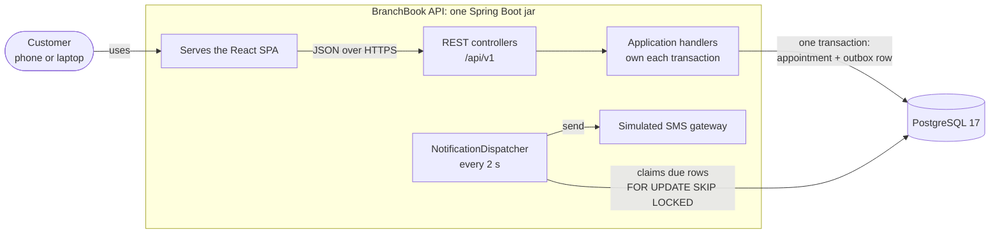
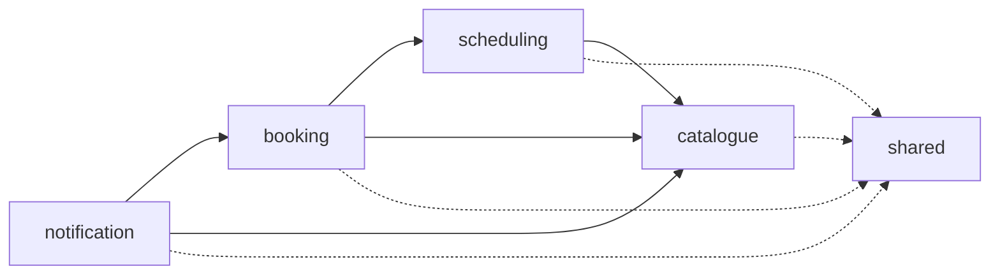
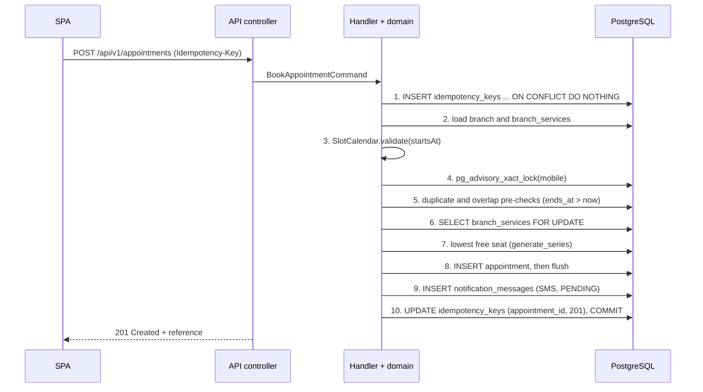
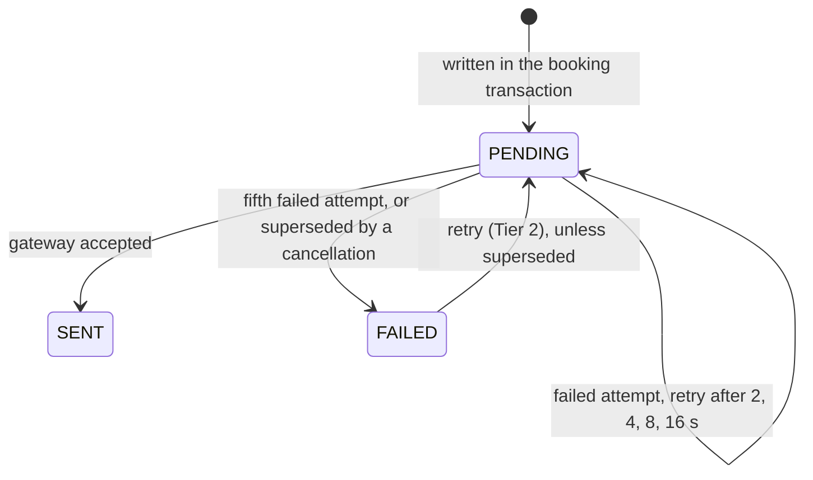
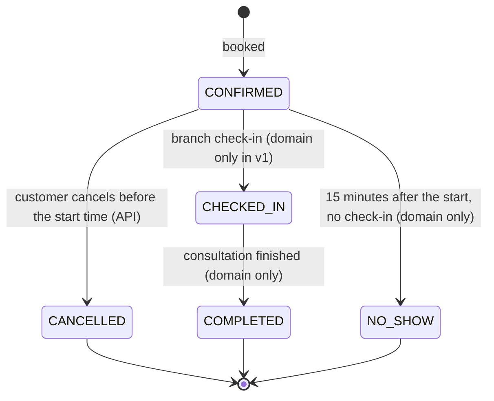
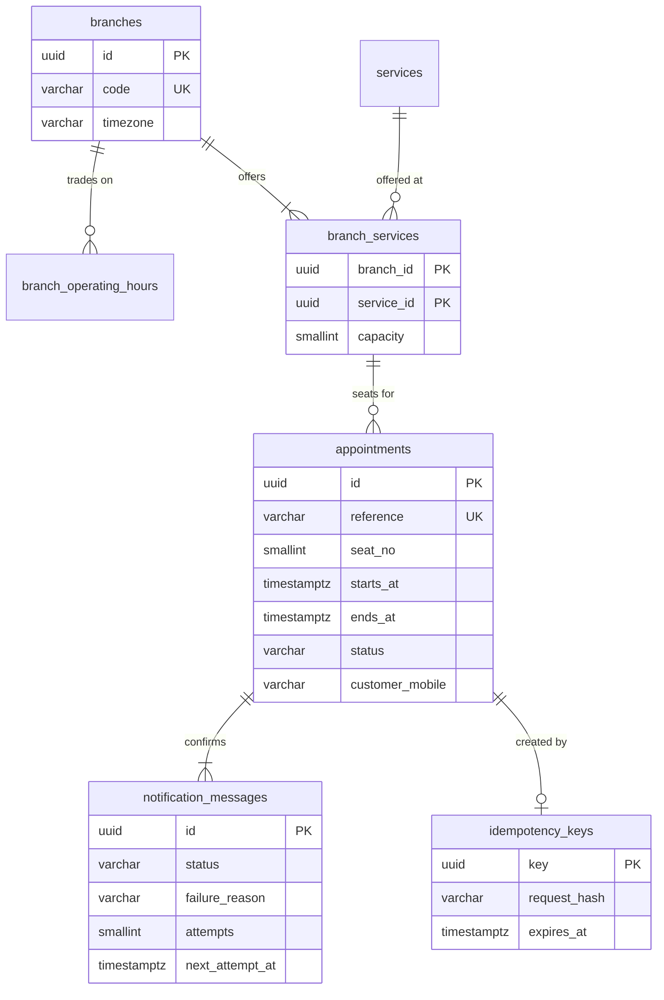

# Architecture

This document explains how BranchBook is built and why. The decisions behind it are recorded one per file in
[docs/adr](adr/README.md); the business rules are in [domain-rules.md](domain-rules.md). The whole design,
including the parts not built yet, is on the [architecture page](https://claude.ai/artifact/X4b1pc9RSCboanuXBSn6oX).

**Status: design complete; milestones M0 to M2 are built.** M0 is the skeleton: one jar that serves the app,
PostgreSQL 17 migrated by Flyway, health probes and security headers. M1 adds the whole schema, the seeded
catalogue, the `catalogue` module with the public-holiday rule, and the shared error and correlation-id handling. M2
adds the `scheduling` module (`SlotCalendar` and the availability API) and the committed OpenAPI contract that the
web app's types are generated from. The other modules arrive milestone by milestone. Diagrams use Mermaid, which GitHub renders in place.

## 1. What the system does

A customer of the fictional Fynbos Bank picks a branch, a service, a date and a time slot, enters a name and a
South African mobile number, and gets a booking reference such as `APT-7K3M-9Q2X`. A simulated SMS confirmation
follows within a few seconds, and its delivery status is visible on the confirmation page. The customer can later
look the appointment up, and cancel it, with the reference and the last four digits of their mobile number.

## 2. System context and containers

- **One deployable, one database.** The jar serves the single-page app, so there is one origin and no CORS.
- **Synchronous on the customer path.** The only asynchronous part is the in-process dispatcher, which reads the
  outbox rows that the booking transaction wrote ([ADR-0003](adr/0003-transactional-outbox-for-confirmations.md)).
- **Real gateways plug in later.** A real SMS provider would be one more implementation of the `MessageGateway` port.

## 3. Modules and the dependency rule

The back end is a modular monolith ([ADR-0001](adr/0001-modular-monolith.md)), packaged by capability.

| Module | Responsibility |
|---|---|
| `catalogue` | Branches, services, weekday trading hours, capacities and public holidays. Read-only at runtime; seeded by Flyway. |
| `scheduling` | `SlotCalendar`, a pure function that computes and validates slots in the branch's time zone, and the availability query. It learns which seats are taken through the `BookedIntervalsPort`, which `booking` implements, so it never reads the appointments table itself. |
| `booking` | The `Appointment` aggregate, the booking transaction, idempotency, lookup and cancellation. |
| `notification` | The outbox, message templates, the dispatcher and the gateway port. |
| `shared` | Problem responses, correlation ids, security headers, the clock and configuration. |

Inside every module the layers are `api` (HTTP only), `application` (use cases; the only layer that opens
transactions), `domain` (plain Java, no Spring imports) and `infrastructure` (adapters). `booking` never imports
`notification`: it defines the `ConfirmationOutbox` port, and `notification` implements it. Four ArchUnit rules in
`ArchitectureTest` enforce this on every build: no cycles between modules, no Spring in any domain package,
controllers never reach the infrastructure layer, and only application code declares transactions.

## 4. The booking transaction

`BookAppointmentHandler.handle` runs ten steps in one `READ COMMITTED` transaction. The order is the design:

- **The database decides; the handler makes the outcome deterministic.** Two `EXCLUDE USING gist` constraints
  make an overlapping seat, or an overlapping booking by one mobile, impossible even for code that bypasses the
  application ([ADR-0002](adr/0002-double-booking-prevention.md)).
- **Fixed lock order.** The locks are taken as idempotency key, then the customer's mobile, then the
  `branch_services` row. Every booking takes them in that order, so two bookings cannot deadlock each other.
- **Retries are safe.** The idempotency row is the first statement, so a double-click or a network retry with the
  same key returns the same booking ([BR-12](domain-rules.md#br-12)).
- **Failures roll back together.** If any step fails, everything rolls back, including the idempotency row, so a
  retry starts clean.

## 5. The simulated confirmation

The dispatcher runs every two seconds on its own single thread. It claims up to 20 due rows per tick, each in its
own transaction with `FOR UPDATE SKIP LOCKED`, so a crash re-sends at most one message and two instances never send
the same message. An appointment's status never depends on delivery: the seat is what the customer booked.

## 6. Appointment lifecycle

Only cancellation is reachable through the API in v1; the staff transitions are modelled and tested so the next
feature, branch check-in, has a correct foundation ([ADR-0004](adr/0004-restraint-no-login-no-id-number.md)).

## 7. Data model

The schema is created by four Flyway migrations, never edited once committed:

| Migration | Contents |
|---|---|
| `V1__enable_btree_gist.sql` | The extension the exclusion constraints need |
| `V2__schema.sql` | The eight tables, with every constraint named and the non-obvious ones commented |
| `V3__reference_data.sql` | Six branches, their hours, six services and the capacities |
| `V4__public_holidays_2026_2027.sql` | The public holidays in law for 2026 and 2027 |

Every constraint is named, because the application maps a violation to an API error by its name.
`SchemaConstraintIT` proves each one fires, using raw SQL that bypasses the application, and fails if a constraint
is added without a test.

`public_holidays` has no foreign key. `PublicHolidayCalendar` in the catalogue module reads it and adds the rule that a
Sunday holiday is observed on the Monday (Public Holidays Act 36 of 1994, s2(1)); `BranchCalendar` combines it with a
branch's trading hours, and the slot calendar builds on that. Customer details live on the appointment; there is
no customers table and no login.

## 8. Time

Every instant is stored as `timestamptz` (UTC). Trading hours are wall-clock times converted through the branch's
IANA time zone (`Africa/Johannesburg`), never by adding two hours by hand. A `java.time.Clock` is injected
everywhere, and SQL binds `:now` from it rather than calling `now()`, so tests control time;
`NativeSqlUsesBoundNowTest` fails if a SQL string reads the database's clock. The API returns offsets explicitly,
for example `2026-10-27T09:30:00+02:00`, and the web app formats times in South African Standard Time whatever the
device's time zone. The containers and CI run in UTC, and CI runs the API's unit and API tests again in
`America/New_York` to prove the slots do not depend on the JVM's zone.

## 9. Personal information

BranchBook stores a first name, a last name and a South African mobile number, nothing more. The full number is
never shown: a caller who has just proved the last four digits sees `082 *** 0101`; everyone else, including the
simulated inbox, sees `082 *** ****`. Logs, metrics and error bodies carry no personal data. Error bodies never
quote the request, and unexpected exceptions are logged with their types and stack frames but not their messages,
which can quote a name or a number. `LogRedactionTest` will check every log of a real booking (M3). See
[SECURITY.md](../SECURITY.md).

## 10. Deployment

Locally, `make up` starts the jar and PostgreSQL with Docker Compose. The optional hosted demo runs in AWS Cape
Town (`af-south-1`) and is defined entirely in AWS CDK under `infra/`
([ADR-0006](adr/0006-hosted-demo-on-aws-with-cdk.md)). Every push to `main` is tested and deployed automatically
by GitHub Actions, which signs in to AWS through OpenID Connect without stored keys
([ADR-0007](adr/0007-continuous-deployment-from-main.md)).
