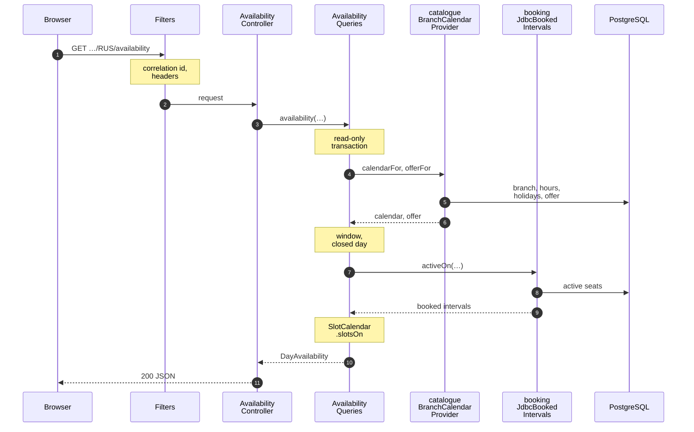
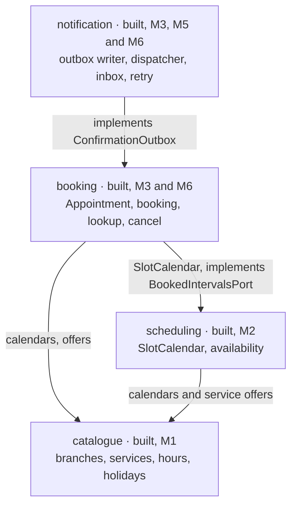
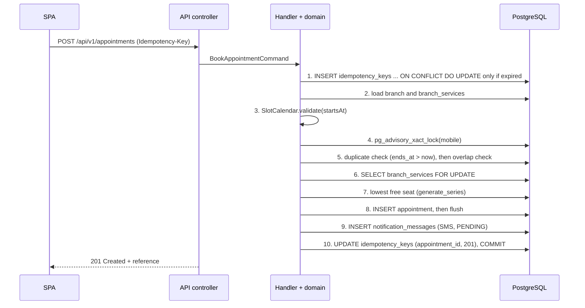
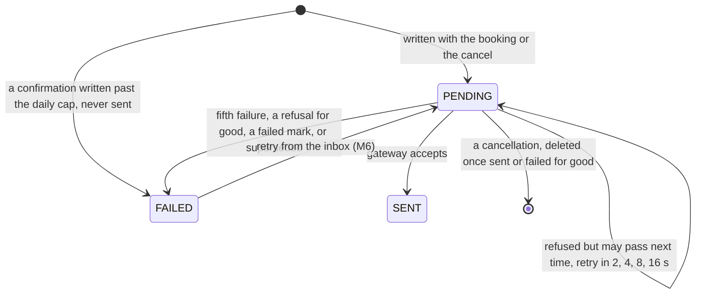
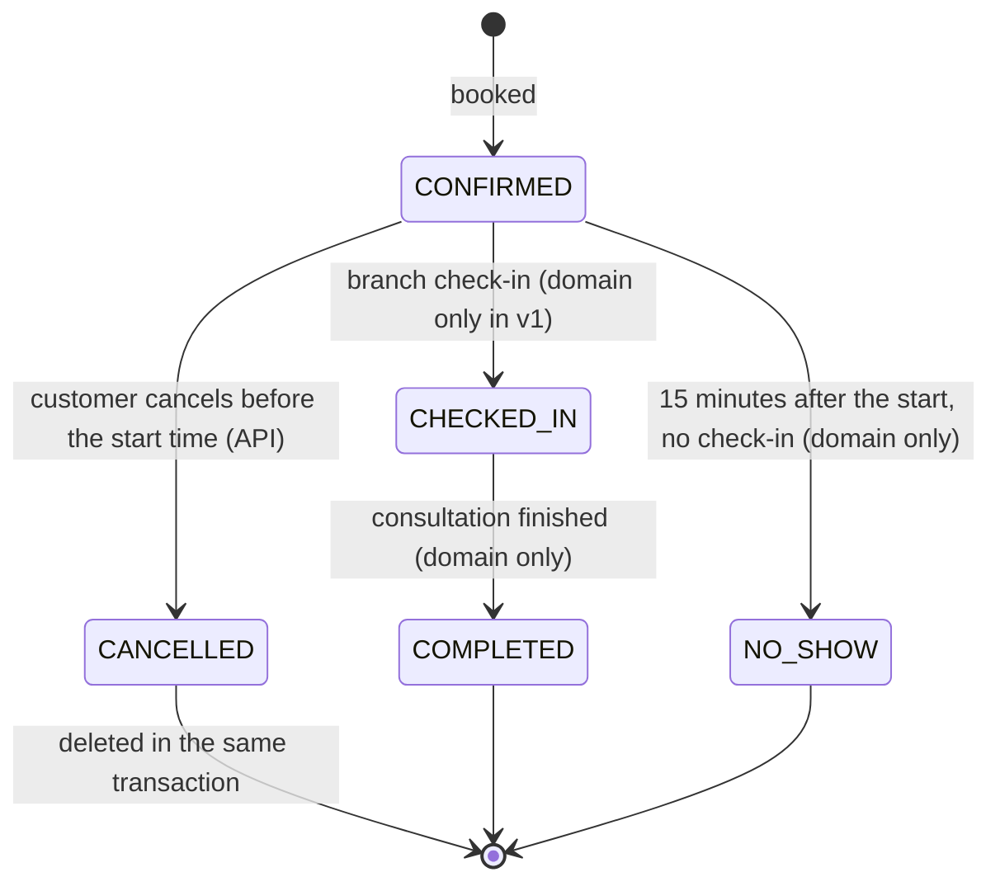

# Architecture

This document explains how BranchBook is built and why. The decisions behind it are recorded one per file in
[docs/adr](adr/README.md); the business rules are in [domain-rules.md](domain-rules.md). The whole design,
including the parts not built yet, is on the [architecture page](https://claude.ai/artifact/X4b1pc9RSCboanuXBSn6oX).

**Status: design complete; milestones M0 to M6 are built, and M7, the final pass before v1.0.0, is under way.** M0
is the skeleton: one jar that serves the app, PostgreSQL 17 migrated by Flyway, health probes and security headers.
M1 adds the whole schema, the seeded catalogue, the `catalogue` module with the public-holiday rule, and the shared
error and correlation-id handling. M2 adds the `scheduling` module (`SlotCalendar` and the availability API) and
the committed OpenAPI contract that the web app's types are generated from. M3 adds the `booking` module's
transaction and lookup, and the part of `notification` that writes and reads the confirmation SMS. M4 adds the web
app's screens: the five-step booking flow, the confirmation page with its live delivery status, `/manage` and the
simulated inbox, built to the [UI design](../web/README.md#ui-design). M5 adds the dispatcher that delivers the SMS
through a simulated gateway, the simulated inbox's API and the concurrent proofs. M6 adds the Tier 2 API: cancelling
an appointment with its cancellation SMS, retrying a failed message from the simulated inbox, demo data for a fresh
compose stack, and two meters on `/actuator/prometheus`, with the web app's screens for them: cancelling from the
appointment page and Retry in the simulated inbox. Each section opens with its status. Diagrams are Mermaid, or SVG
files in [assets/diagrams](assets/diagrams/README.md); solid parts are built and dashed parts are planned, with
their milestone.

**Contents:** [1. What it does](#1-what-the-system-does) ·
[2. System and containers](#2-system-context-and-containers) ·
[2.1 One request](#21-one-request-through-the-jar) ·
[3. Modules](#3-modules-and-the-dependency-rule) ·
[4. The booking transaction](#4-the-booking-transaction) ·
[5. The confirmation](#5-the-confirmation-sms) ·
[6. Appointment lifecycle](#6-appointment-lifecycle) ·
[7. Data model](#7-data-model) ·
[8. Time](#8-time) ·
[9. Personal information](#9-personal-information) ·
[10. Deployment](#10-deployment)

## 1. What the system does

*Status: Built: branches and availability (M1, M2), booking and lookup with the confirmation SMS written as PENDING
(M3), the booking screens (M4), the SMS's delivery (M5), cancellation from the appointment page (M6), and the real
SMS where a deployment asks (after M6).*

A customer of the fictional Fynbos Bank picks a branch, a service, a date and a time slot, enters a name and a
South African mobile number, and gets a booking reference such as `APT-7K3M-9Q2X`. An SMS confirmation follows
within a few seconds, and its delivery status is visible on the confirmation page: simulated locally and for the
published demo numbers, and a real SMS through AWS End User Messaging SMS where a deployment asks, as the hosted
demo does ([5](#5-the-confirmation-sms)). The customer can later
look the appointment up, and cancel it, with the reference and the last four digits of their mobile number. A cancel
deletes the booking at once ([6](#6-appointment-lifecycle)).

## 2. System context and containers

*Status: Built: the jar, the React app's booking screens over its typed API client (M4) and its cancel and retry
screens (M6), the branch, availability, booking and lookup API, the confirmation SMS with its dispatcher and
simulated SMS gateway (M5), the cancel and retry API (M6), the real SMS gateway (after M6), and PostgreSQL 17.*

- **One deployable, one database.** The jar serves the single-page app and the REST API under `/api/v1`, so there
  is one origin and no CORS. Locally it is plain HTTP on `127.0.0.1`; in the hosted demo the load balancer ends
  HTTPS ([10.3](#103-in-aws)).
- **Everything on the customer path is synchronous.** Background work runs in the same jar: `HolidayCoverageCheck`
  at start-up and daily at 06:00 SAST (M2), `IdempotencyKeyPurgeJob` every hour (M3), `RecipientSendLedgerPurgeJob`
  every hour from a minute after start-up, which deletes the daily cap's ledger rows once they are 24 hours old, and
  the dispatcher (M5), which delivers the outbox rows the booking and cancel transactions write
  ([ADR-0003](adr/0003-transactional-outbox-for-confirmations.md)). `RetentionPurgeJob` runs every hour only where a
  deployment switches it on, as the hosted demo does, and deletes each booking within the hour after its appointment
  ends ([runbook](runbook.md#did-the-retention-purge-run)). `DemoDataLoader` runs once after start-up where
  `branchbook.demo-data.enabled` is on, which only compose sets: on an empty database it books three demo
  appointments through the booking handler, and where `branchbook.booking.demo-numbers-only` is on it skips with one
  INFO line, because its numbers are not demo numbers (M6, [api/README.md](../api/README.md#demo-data)).
- **Observable without personal data.** `/actuator/prometheus` serves Spring Boot's meters and two of BranchBook's
  (M6): `appointments_booked_total{outcome}`, every booking request by how it ended, and `outbox_pending`, the
  messages still PENDING after the dispatcher's last tick ([runbook](runbook.md#read-the-metrics)). It is open under
  `make up`. The hosted demo's WAF blocks `/actuator`, and its task serves only health and info
  (`MANAGEMENT_ENDPOINTS_WEB_EXPOSURE_INCLUDE=health,info`).
- **The real gateway sits behind a port.** The dispatcher sends through a `MessageGateway` port: the simulated SMS
  gateway by default, or, where `branchbook.sms.gateway` is `aws`, a router that keeps the published demo block
  simulated and sends every other number a real SMS through AWS End User Messaging SMS ([5](#5-the-confirmation-sms)).

### 2.1 One request through the jar

*Status: Built in M2.* This is `GET /api/v1/branches/RUS/availability`, the call behind the slot grid, as the code
runs it today.

The numbers follow the code:

- **1 to 3.** `GET /api/v1/branches/RUS/availability?service=HOME&date=2026-10-27`. `CorrelationIdFilter` runs first
  and sets `X-Correlation-Id`; the security filters add the Content-Security-Policy and the other headers. The
  controller calls `AvailabilityQueries.availability`, which opens one read-only transaction.
- **4 to 6.** `BranchCalendarProvider.calendarFor` and `offerFor` return the `BranchCalendar` and the
  `ServiceOffer`. `SlotCalendar` then checks the booking window, and the calendar says whether the day is closed.
- **7 to 9.** `BookedIntervalsPort.activeOn`, implemented by `booking`'s `JdbcBookedIntervals`, reads the
  CONFIRMED and CHECKED_IN appointments that day (`AppointmentStatus.ACTIVE_SQL`), and `SlotCalendar.slotsOn`
  counts the free seats in each slot.
- **10 to 11.** The answer is JSON whose times carry the `+02:00` offset.

A refused branch, service or date becomes an RFC 9457 `application/problem+json` body whose `instance` is
`urn:branchbook:request:` followed by the correlation id ([errors.md](errors.md)). `AvailabilityQueries` checks the
branch, then the service, then the booking window, so each request fails with at most one code; on a closed day it
returns no slots without reading the appointments.

## 3. Modules and the dependency rule

*Status: Built. `catalogue`, `scheduling`, `booking` (cancellation from M6) and `shared` are built; `notification`
writes and reads the outbox, delivers it through its dispatcher (M5), and serves the simulated inbox and its retry
(M6).*

The back end is a modular monolith ([ADR-0001](adr/0001-modular-monolith.md)), packaged by capability. Each arrow
reads "depends on".

Every module may use `shared` (config, correlation, problem, security, time, web), and `shared` uses no module.
[ADR-0001](adr/0001-modular-monolith.md) also allows `notification` to use `catalogue`, but it does not need to.

| Module | Status | Responsibility |
|---|---|---|
| `catalogue` | Built (M1, M2) | Branches, services, weekday trading hours, capacities and public holidays. Read-only at runtime; seeded by Flyway. |
| `scheduling` | Built (M2) | `SlotCalendar`, a pure function that computes and validates slots in the branch's time zone, and the availability query. It learns which seats are taken through the `BookedIntervalsPort`, which `booking` implements, so it never reads the appointments table itself. |
| `booking` | Built (M3, M6) | The `Appointment` aggregate, the booking transaction, idempotency, lookup, cancellation, which deletes the appointment (M6), the retention purge of ended appointments, the demo data (M6) and the `appointments_booked_total` counter (M6). |
| `notification` | Built (M3, M5, M6) | The outbox writer, the confirmation and cancellation templates, the read of an appointment's messages, the dispatcher with the `MessageGateway` port and its simulated SMS gateway, the simulated inbox, the retry of a FAILED message (M6), the `outbox_pending` gauge (M6), and the daily cap's ledger, `sms_recipient_sends`, with its hourly purge. It reads nothing from `catalogue`: the booking hands it the branch's and the service's short names with the appointment. |
| `shared` | Built | Problem responses, correlation ids, security headers, the clock and configuration. |

Inside every module the layers are `api` (HTTP only), `application` (use cases; the only layer that opens
transactions), `domain` (plain Java with no Spring imports; `Appointment` carries JPA mapping annotations, a
deliberate trade-off) and `infrastructure` (adapters). A module uses another's `application` and `domain` types
directly: `scheduling` builds on `catalogue`'s `BranchCalendar`, and `booking` runs `scheduling`'s `SlotCalendar`.
`booking` never imports `notification`: it defines the `ConfirmationOutbox` port, and `notification` implements it
as `NotificationOutbox`.

Four ArchUnit rules in
[`ArchitectureTest`](../api/src/test/java/za/co/fynbos/branchbook/ArchitectureTest.java) run on every build:

- `modulesAreFreeOfCycles` requires the top-level packages to be free of cycles. The allowed dependencies form a
  chain, so an import against the arrows closes a cycle and fails the build; `booking` importing `notification`
  would.
- `domainHasNoSpringImports` keeps every `domain` package free of Spring.
- `controllersNeverReachInfrastructure` forbids any `api` package from using an `infrastructure` package.
- `onlyApplicationOpensTransactions` lets only `application` code declare a transaction.

## 4. The booking transaction

*Status: Built in M3. The tables, the two exclusion constraints and the indexes it relies on are from M1
([BR-8](domain-rules.md#br-8), proven). The concurrent proofs, twenty requests for one seat and two requests with
one key, are from M5 ([BR-7](domain-rules.md#br-7), [BR-12](domain-rules.md#br-12),
[BR-22](domain-rules.md#br-22), proven).*

[`BookAppointmentHandler.handle`](../api/src/main/java/za/co/fynbos/branchbook/booking/application/BookAppointmentHandler.java)
runs ten steps in one `READ COMMITTED` transaction. The order is the design:

- **The database decides; the handler makes the outcome deterministic.** Two `EXCLUDE USING gist` constraints
  make an overlapping seat, or an overlapping booking by one mobile, impossible even for code that bypasses the
  application ([ADR-0002](adr/0002-double-booking-prevention.md)).
- **Fixed lock order.** The locks are taken as idempotency key, then the customer's mobile, then the
  `branch_services` row. Every booking takes them in that order, so two bookings cannot deadlock each other.
- **Retries are safe.** The idempotency row is the first statement, so a double-click or a network retry with the
  same key returns the same booking for 24 hours, whether or not the hourly purge has removed the key yet
  ([BR-12](domain-rules.md#br-12)), whether the retries arrive one after another or together. Once that booking is
  cancelled, the key is refused with `422 IDEMPOTENCY_KEY_REUSED` for the rest of its 24 hours and never books again.
- **Failures roll back together.** If any step fails, everything rolls back, including the idempotency row and the
  SMS row, so a retry starts clean.
- **One re-run, then an answer.** A reference collision, a deadlock (`40P01`) or a serialisation failure (`40001`)
  runs the whole transaction once more with a new reference. A second conflict is `503 TRY_AGAIN` with
  `Retry-After: 2`; a second collision means the random source is broken, so it is a `500`. Every session gives up
  on a lock after 2 seconds and on a statement after 5, which is also a `503`.
- **Constraints are recognised by name.** `ConstraintViolationTranslator` reads the SQLSTATE and the constraint's
  name from the driver, never the message, and turns the backstops into the same answers as the checks: a
  seat overlap into `409 SLOT_FULL`, a customer overlap into `409 CUSTOMER_OVERLAP`, a taken reference into a
  re-run. The driver is configured to leave
  the conflicting values out of its messages, and Hibernate's own SQL error log is off.
- **Alternatives come after the rollback.** `SLOT_FULL` offers up to three later free slots that day, searched once
  the transaction has rolled back, so the search holds no lock and sees every booking that committed.

### Lookup

*Status: Built in M3 ([BR-13](domain-rules.md#br-13), proven).*

`GET /api/v1/appointments/{reference}` with `X-Mobile-Last4` opens an appointment again
([BR-13](domain-rules.md#br-13)). An unknown reference, a malformed one and a right one with the wrong digits all
get the same `404`, and the digits are compared in constant time. `LookupAttemptLimiter` counts wrong lookups per
reference in a window that opens with the first wrong lookup and lasts an hour; the fifth blocks the
reference, right digits included, until the window closes. A lookup is admitted and counted as in flight in one
atomic step before the database is read, then released if its digits were right or kept as a failure if not. Lookups that arrive together
therefore cannot all pass a check made before any of them was counted. A customer's own lookups have the right digits,
so they never lead to the hour-long block, though a burst of them can be refused for a second while the others are
checked. Blocking logs one warning that names no reference.

The counts live in memory, in a Caffeine cache bounded to 100,000 references. That is a deliberate trade-off for
one instance, with three consequences:

- **They are per instance.** With several instances each would allow five tries; scaling out would move the
  counts to a shared table or cache. The hosted demo runs one task.
- **A restart forgets them.** At worst an attacker gets five more tries per restart, out of 10,000 combinations.
- **The bound could be flooded.** Evicting one reference's window would take failed lookups of about 100,000
  others, and Caffeine prefers to keep entries that are used often. A per-address limit on lookups at the edge
  would close it; the hosted demo's web application firewall limits only booking and cancel `POST`s per address today.

Because the window is per reference, someone who knows a reference can block its lookup for an hour. A reference
is printed only in the customer's own SMS and pages, and production would bind appointments to a verified identity
instead ([ADR-0004](adr/0004-restraint-no-login-no-id-number.md)).

## 5. The confirmation SMS

*Status: Built in M5 ([BR-17](domain-rules.md#br-17), proven). Built after M6: the real gateway, AWS End User
Messaging SMS where `branchbook.sms.gateway` is `aws`, the per-recipient daily cap with its ledger (V7,
[BR-17](domain-rules.md#br-17), proven), and a cancel that deletes the appointment's confirmations with the
appointment (V6, [BR-24](domain-rules.md#br-24), proven). Built in M3: every booking writes its SMS as a PENDING
row in the booking transaction ([BR-16](domain-rules.md#br-16)). Built in M1: `notification_messages` and its named
constraints, 11 then and 12 since V6, proven by `SchemaConstraintIT`. Built in M6: the cancellation SMS, written in
the cancel's transaction ([BR-16](domain-rules.md#br-16)), and the retry of a FAILED message from the simulated inbox
([BR-17](domain-rules.md#br-17), proven).*

The dispatcher runs every two seconds on its own single thread, `outbox-1`, kept apart from Spring's default
scheduler so the hourly and daily jobs never share it. It claims up to 20 due rows per tick, each in its own
transaction with `FOR UPDATE SKIP LOCKED`, so a crash re-sends at most one message and two instances never send the
same message. The simulated gateway takes 150 ms and refuses every number ending in `0000`, such as the demo number
082 555 0000, so a failed delivery can be shown: about 30 seconds of backoff later it is FAILED. A FAILED row
records why: `DELIVERY_FAILED` after the fifth failed attempt, or on the attempt the gateway refused for good,
`SUPERSEDED_BY_CANCELLATION` when the dispatcher finds a confirmation's appointment still kept as CANCELLED, which
only one cancelled before V6, or by hand, can be, `DISPATCH_ERROR` when recording the outcome of a send fails, so a
poisoned row never loops, or `RECIPIENT_DAILY_CAP` when the daily cap below stopped it before it was ever sent.
A cancellation is not kept once final: its appointment is already gone, so where a confirmation would be marked
SENT or FAILED, the dispatcher deletes it in the same transaction and logs `outbox.deleted`.
`notification_messages` already enforces the shape of this state machine with its named constraints: three
statuses, at most five attempts, a failure reason exactly when FAILED, a sent time exactly when SENT, and no
appointment only for a cancellation. An appointment's status never depends on delivery: the seat is what the
customer booked.

`POST /api/v1/messages/{id}/retry`, which exists only while the simulated inbox is switched on
(`branchbook.inbox.enabled`), resets a FAILED message with `DELIVERY_FAILED` or `DISPATCH_ERROR` to PENDING, due
now, unless it is the confirmation of an appointment that is cancelled or has started; any other message comes back
unchanged, and a final cancellation, already deleted, is `404 MESSAGE_NOT_FOUND`. It locks the message and waits
up to 2 seconds for a send in flight, so it never races the dispatcher or a cancel. Where the inbox is off, the
guarded SQL in the [runbook](runbook.md#replay-a-failed-message) replays a message instead.

**Which gateway sends.** `branchbook.sms.gateway` decides, and one INFO line at start-up names the gateway, the
region and whether a protect configuration and a daily cap are set. `simulated`, the default and what compose,
`make dev-api` and the tests run, sends nothing. Where it is `aws` (`BRANCHBOOK_SMS_GATEWAY=aws`, the hosted demo),
`RoutingSmsGateway` hands every number in the published demo block, 082 555 0000 to 0199, to the simulated gateway,
because anyone may type those numbers and one may belong to a real stranger, and every other number to
`AwsSmsGateway`. That calls `SendTextMessage` of AWS End User Messaging SMS (`pinpoint-sms-voice-v2`) in
af-south-1, as a TRANSACTIONAL message with the deployment's `MaxPrice` and protect configuration, and its
configuration set and origination identity where set, with credentials from the ECS task role. South Africa
supports long and short codes but no sender IDs, so with no origination identity AWS sends over a shared route:
delivery is best effort, and while the AWS account is in the SMS sandbox only verified destination numbers receive
anything. The SDK does not retry, and a call gives up after 10 seconds; a refusal is a fixed code built from the
exception's type and typed reason, such as `AWS_THROTTLED` or `AWS_CONFLICT_DESTINATION_PHONE_NUMBER_NOT_VERIFIED`,
never AWS's message, which can quote the number ([runbook](runbook.md#what-the-aws-codes-mean)). The dispatcher's
backoff and fifth-attempt FAILED apply, as they do to the simulated gateway, to a refusal that sending again may
cure; one it cannot, such as a number the sandbox has not verified, is FAILED on that attempt.

**The per-recipient daily cap.** Where `branchbook.sms.recipient-daily-cap` is above 0
(`BRANCHBOOK_SMS_RECIPIENT_DAILY_CAP`), the outbox first counts the number's rows of the last 24 hours, bound from
the clock, in the cap's ledger, `sms_recipient_sends`, through `ix_sms_recipient_sends_fingerprint`. A row holds only
the instant the SMS was written and HMAC-SHA256 of the number's E.164 form, keyed with
`branchbook.sms.recipient-cap-key` (`BRANCHBOOK_SMS_RECIPIENT_CAP_KEY`, at least 32 characters, or start-up stops);
where the key is blank, a random one is made at start-up, one WARN says so, and every count starts again at each
restart. The hosted demo's key is the `branchbook/sms-cap-key` secret in Secrets Manager. Each SMS written below the
cap adds a row in the same transaction, and the row outlives its message, so a confirmation a cancel deleted, or a
cancellation the dispatcher deleted, still counts for its 24 hours; `RecipientSendLedgerPurgeJob` deletes the rows
once they are 24 hours old and logs `cap_ledger.purged count=N`. At or above the cap the new message is FAILED with
`RECIPIENT_DAILY_CAP` and adds no row: a confirmation is written so, and the dispatcher never claims it and the
inbox's retry never resets it; a cancellation is shown in the cancel's response but never stored. The booking or the
cancel succeeds as usual. The demo block is never capped and never reaches the ledger, because it is never really
sent. Bookings by one mobile are serialised ([BR-22](domain-rules.md#br-22)), so their counts never race; a cancel
takes no such lock, so cancels at the same moment as each other or as a booking can pass the cap by a message or
two. The cap is off by default.

## 6. Appointment lifecycle

*Status: Built in M1 as domain code (`AppointmentStatus`, [BR-15](domain-rules.md#br-15), proven). Booking
creates CONFIRMED appointments from M3; cancellation through the API is built in M6 ([BR-14](domain-rules.md#br-14),
proven), and deletes the appointment at once since V6.*

Cancellation is the only transition the API offers: `POST /api/v1/appointments/{reference}/cancel` with
`X-Mobile-Last4`, through the same check and rate limit as a lookup. Before the start it deletes the appointment's
confirmations, whatever their status, writes the cancellation SMS and deletes the appointment, all in one
transaction, so the seat is free at once; the `200` shows the appointment as cancelled, with only that SMS, the one
message that outlives it, until the dispatcher has sent it or given up on it. The booking is not kept as
CANCELLED: from then on the reference is unknown, so a repeat, or a lookup with the right digits, is
`404 APPOINTMENT_NOT_FOUND` and counts as a wrong try. At or after the start a cancel is `409 TOO_LATE_TO_CANCEL`,
and an appointment the retention job has already deleted is `404 APPOINTMENT_NOT_FOUND`, never a `500`. The staff
transitions are modelled and tested so the next feature, branch check-in, has a correct foundation
([ADR-0004](adr/0004-restraint-no-login-no-id-number.md)).

## 7. Data model

*Status: Built in M1; V6 and V7 change it after M6.*

Each table belongs to one module. The one read across a module boundary is `booking`'s `SELECT ... FOR UPDATE`
on the `branch_services` row (step 6 of [the booking transaction](#4-the-booking-transaction)); `scheduling`
learns which seats are held through `booking`'s `JdbcBookedIntervals`, so it never queries `appointments` itself.

| Table | Owner module | Named constraints |
|---|---|---:|
| `branches` | `catalogue` | 6 |
| `branch_operating_hours` | `catalogue` | 4 |
| `services` | `catalogue` | 6 |
| `branch_services` | `catalogue` | 4 |
| `public_holidays` | `catalogue` | 2 |
| `appointments` | `booking` | 15 |
| `idempotency_keys` | `booking` | 6 |
| `notification_messages` | `notification` | 12 |
| `sms_recipient_sends` | `notification` | 1 |
| **Total** | | **56** |

The 56 are 8 primary keys, 3 unique constraints, 37 checks, 6 foreign keys and 2 exclusion constraints.
`sms_recipient_sends`, the daily cap's ledger, has no primary key, because two SMS to one number can be written at
the same instant and each must count, and no foreign key: a row holds a number's keyed fingerprint and when its SMS
was written, nothing that leads back to a booking or a message. Since V6 a cancellation SMS may outlive its
appointment: `notification_messages.appointment_id` and `idempotency_keys.appointment_id` are set to null when the
appointment is deleted, and `notification_messages_detached_cancellation_only` lets only a cancellation have none.
Eight partial or plain indexes serve the hot queries: `ix_appointments_slot_lookup` (availability and the lowest free
seat), `ix_appointments_customer_active` (the duplicate and overlap checks), `ix_idempotency_keys_expires` (the
hourly purge), `ix_notification_messages_due`, `_appointment` and `_created` (the dispatcher's claim, an
appointment's messages and the simulated inbox), and `ix_sms_recipient_sends_fingerprint` and `_written` (the daily
cap's count and the ledger's hourly purge).

The schema is created by seven Flyway migrations, never edited once committed:

| Migration | Contents |
|---|---|
| [`V1__enable_btree_gist.sql`](../api/src/main/resources/db/migration/V1__enable_btree_gist.sql) | The extension the exclusion constraints need |
| [`V2__schema.sql`](../api/src/main/resources/db/migration/V2__schema.sql) | The eight tables, with every constraint named and the non-obvious ones commented |
| [`V3__reference_data.sql`](../api/src/main/resources/db/migration/V3__reference_data.sql) | Six branches, their hours, six services and the capacities |
| [`V4__public_holidays_2026_2027.sql`](../api/src/main/resources/db/migration/V4__public_holidays_2026_2027.sql) | The public holidays in law for 2026 and 2027 |
| [`V5__notification_messages_recipient_index.sql`](../api/src/main/resources/db/migration/V5__notification_messages_recipient_index.sql) | The index the per-recipient daily cap first counted through, which V7 drops |
| [`V6__cancel_deletes_the_booking.sql`](../api/src/main/resources/db/migration/V6__cancel_deletes_the_booking.sql) | A cancel deletes the appointment: the two foreign keys to it set null on delete, and only a cancellation may have no appointment |
| [`V7__sms_recipient_sends.sql`](../api/src/main/resources/db/migration/V7__sms_recipient_sends.sql) | The daily cap's ledger, `sms_recipient_sends`, and its two indexes |

Every constraint is named, because the application maps a violation to an API error by its name.
[`SchemaConstraintIT`](../api/src/test/java/za/co/fynbos/branchbook/SchemaConstraintIT.java) proves each one fires,
using raw SQL that bypasses the application, and fails if a constraint is added without a test.

`public_holidays` has no foreign key. `PublicHolidayCalendar` in the catalogue module reads it and adds the rule that a
Sunday holiday is observed on the Monday (Public Holidays Act 36 of 1994, s2(1)); `BranchCalendar` combines it with a
branch's trading hours, and the slot calendar builds on that. Customer details live on the appointment; there is
no customers table and no login.

## 8. Time

*Status: Built in M2 and M3, and in the web app in M4 ([BR-20](domain-rules.md#br-20)).*

Every instant is stored as `timestamptz` (UTC). Trading hours are wall-clock times converted through the branch's
IANA time zone (`Africa/Johannesburg`), never by adding two hours by hand. A `java.time.Clock` is injected
everywhere, and SQL binds `:now` from it rather than calling `now()`, so tests control time;
`NativeSqlUsesBoundNowTest` fails if a SQL string reads the database's clock. The API returns offsets explicitly,
for example `2026-10-27T09:30:00+02:00`, and the web app formats times in South African Standard Time whatever
the device's time zone: its tests run twice, under `TZ=UTC` and `TZ=America/New_York`. The containers and CI run in UTC, and CI runs the API's unit and API tests again in
`America/New_York` to prove the slots do not depend on the JVM's zone.

## 9. Personal information

*Status: Built for every surface that exists ([BR-19](domain-rules.md#br-19)), the booking screens and the
simulated inbox among them.*

BranchBook stores a first name, a last name and a South African mobile number, nothing more. A cancel deletes them
with the booking, except the number in the cancellation SMS until it is final ([6](#6-appointment-lifecycle)). Two
fingerprints can outlive a booking, neither for more than about 24 hours after it was written: the
`Idempotency-Key`'s unkeyed SHA-256 of the request's details, names and number among them, and the daily cap's keyed
fingerprint of the number ([5](#5-the-confirmation-sms)). The full number appears only to the person typing it, on
the details and review steps, before the booking exists. Once booked, the
API and the UI show it only masked: a caller who has just proved the last four digits sees `082 *** 0101`, and
everyone else, including the simulated inbox, sees `082 *** ****`. Where `branchbook.inbox.redact-references` is
on (`BRANCHBOOK_INBOX_REDACT_REFERENCES`, off by default and in compose, `make dev-api` and every test but
`InboxReferencesHiddenIT`), the inbox and its retry also show every reference as `APT-****-****`, in the reference
field, the body, the subject and the last error, so the hosted demo could switch its inbox back on without handing
visitors each other's references.

Logs, metrics and error bodies carry no personal data. Error bodies never quote the request, and unexpected
exceptions are logged with their types and stack frames but not their messages, which can quote a name or a
number. Log lines name an appointment by its id, never by its reference. Meter tags are fixed words, such as a
booking's outcome or a URI template, never a value a customer typed (`MetricsIT.scrapeHoldsNoPersonalData`).
[`LogRedactionIT`](../api/src/test/java/za/co/fynbos/branchbook/LogRedactionIT.java) takes one customer through
every outcome of a booking and a lookup, and through a cancellation and a retry, and checks both the application's
log and PostgreSQL's for their name, number and reference. How the data is protected, and what is planned, is in
[SECURITY.md](../SECURITY.md#personal-information-popia).

## 10. Deployment

*Status: Built. The image and the local stack are built, every push to `main` deploys the hosted demo and the release
record to AWS once every check passes, and the demo runs in Cape Town (af-south-1), first deployed by hand on
2026-10-26, texting real SMS since 2026-10-27.*

### 10.1 Locally: the image and the stack

`make up` runs `docker compose up --build --detach --wait --wait-timeout 300`, and the numbers in the picture
follow its start-up order:

1. Build `branchbook:local` from the three-stage [`Dockerfile`](../Dockerfile): the React app on Node.js 24, the jar
   on the Temurin 25 JDK, then a Temurin 25 JRE runtime that runs as user 10001.
2. The `db` service starts PostgreSQL 17.
3. `pg_isready` succeeds and `db` is healthy; [`compose.yaml`](../compose.yaml) starts `app` only then.
4. The app starts: Flyway applies V1 to V7, and Hibernate validates the schema against the entities.
5. `/readyz` answers UP, and Docker marks the container healthy.
6. `--wait` returns, and `make up` prints the URL.

- **Tests never run in the image.** The image build packages the jar with `-DskipTests`; `make test` and CI run the
  tests.
- **One recipe, two places.** CI's `stack` job builds and starts the image from the same `Dockerfile` and
  `compose.yaml` with the same command, then runs `scripts/smoke.sh` and checks the logs for credentials.
- **Development runs without it.** `make dev-api` starts the API with a throwaway PostgreSQL in Docker, and
  `make dev-web` serves the web app with hot reload on port 5173.

### 10.2 From a commit to AWS

![From a commit to Cape Town: an opt-in pre-commit hook refuses secret files and runs gitleaks, push protection checks the push, and main, which requires every check, runs ci's api, web, stack and infra jobs side by side. Once all four pass, deploy, on an ARM runner, passes the aws-demo gate, signs in at STS, builds the image and deploys BranchbookData and BranchbookApp through the bootstrap roles, smoke-tests the live address, then records and verifies the commit in BranchbookRelease; an administrator deploys BranchbookAccount by hand.](assets/diagrams/delivery-pipeline.svg)

Every push to `main` starts `ci` and `secret-scan`. `ci`'s `api`, `web`, `stack` and `infra` jobs run side by side
with no AWS access; once all four pass, its `deploy` job signs in to AWS through OpenID Connect on an ARM runner,
builds the image, deploys the hosted demo's two stacks, smoke-tests https://branchbook.click, then deploys
`BranchbookRelease` and reads the recorded commit back. `main` requires those four checks and `gitleaks` before a
push or merge, so a red check means no deployment; [delivery.md](delivery.md) walks through each numbered step, what
each workflow proves and the gaps that remain.

### 10.3 In AWS

The letter and numbers in the picture:

- **A.** An administrator deploys `BranchbookAccount` to us-east-1 by hand with `cdk deploy`. The pipeline never
  deploys this stack.
- **1.** On every push to `main`, once its four checks pass, the `deploy` job in `ci.yml` enters the `aws-demo`
  environment and signs in through OpenID Connect and AWS STS as `branchbook-github-deploy`. No access key is stored.
- **2.** That role assumes the CDK bootstrap roles (`cdk-hnb659fds-*`) in af-south-1, which publish the ARM64 image
  built on the runner and the templates.
- **3.** CloudFormation updates `BranchbookData`, then `BranchbookApp`, and the job smoke-tests
  https://branchbook.click.
- **4.** CloudFormation updates `BranchbookRelease`, which records `GITHUB_SHA`.
- **5.** The job reads `/branchbook/release` back and fails unless it equals `GITHUB_SHA`.

Four stacks are built: `BranchbookAccount` in us-east-1 (the GitHub OIDC provider, the deploy role and the
budget), and in Cape Town (`af-south-1`) `BranchbookRelease`, the release record, and the hosted demo's
`BranchbookData` and `BranchbookApp` ([ADR-0006](adr/0006-hosted-demo-on-aws-with-cdk.md)). The pipeline deploys the
three Cape Town stacks on every push to `main`, with no stored keys
([ADR-0007](adr/0007-continuous-deployment-from-main.md)); the administrator deploys `BranchbookAccount` by hand, and
deployed the demo by hand first, on 2026-10-26. There is no DNS stack: the hosted zone came with the domain's Route 53
registration.

A reviewer's request to https://branchbook.click: Route 53 resolves the name to the load balancer; AWS WAF, attached
to the load balancer, blocks `/actuator`, comparing the decoded, lowercased path, and allows 10 booking and cancel
`POST`s per address in 5 minutes, with no sign-in; the load balancer redirects plain HTTP to HTTPS, ends HTTPS and
forwards to one ARM64 Fargate task on port 8080, which serves only the health and info endpoints; and the task
reaches RDS for PostgreSQL 17 over TLS, directly. The simulated inbox is off there, so no visitor sees another's
booking, and each booking is deleted within the hour after its appointment ends, or at once when it is cancelled
([ADR-0006, Notes](adr/0006-hosted-demo-on-aws-with-cdk.md#notes)). The picture draws Route 53, then WAF, then the
load balancer for readability; Route 53 only resolves the name.

Since 2026-10-27 the hosted demo texts real SMS, and any South African mobile number may book. The task sends
through AWS End User Messaging SMS in Cape Town, through a protect configuration that allows South Africa alone and
no voice or MMS, at most five SMS a day to one number; the published demo numbers, 082 555 0000 to 082 555 0199,
stay on the simulated gateway. No delivery events are logged, because they carry the number. While the AWS account
is in the SMS sandbox, only verified numbers receive a text, and any other ends `FAILED` on its first attempt with the
booking standing, or, for a cancellation, is deleted.
Resources, the request path step by step, the SMS controls, deploying, teardown, trust and access are in
[infra/README.md](../infra/README.md#the-hosted-demo).

Next: [domain-rules.md](domain-rules.md) for the proofs; [delivery.md](delivery.md) for how it ships.
