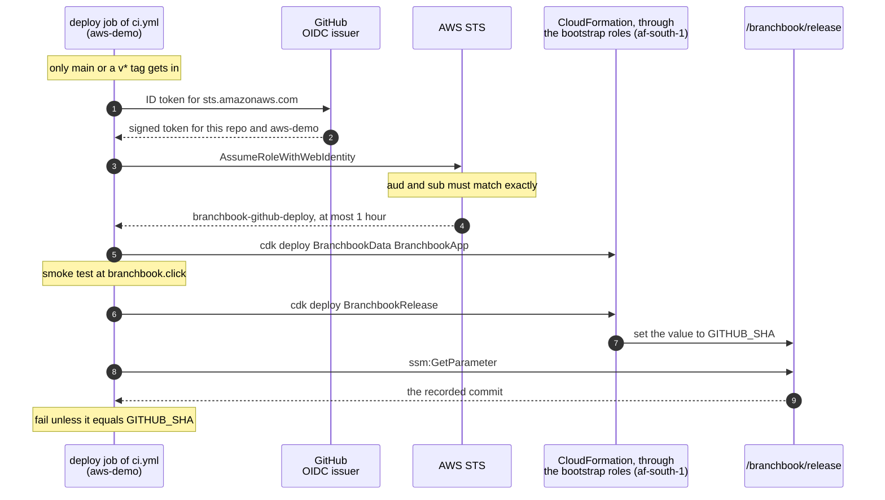

# infra: AWS infrastructure as code

Every resource the pipeline and the application use is defined here with the
[AWS CDK](https://docs.aws.amazon.com/cdk/v2/guide/home.html) in TypeScript. The account, its administrator, the
Cape Town opt-in, the CDK bootstrap and the GitHub environment are one-time manual steps, listed under
[First-time setup](#first-time-setup). The reasoning is in [ADR-0006](../docs/adr/0006-hosted-demo-on-aws-with-cdk.md)
and [ADR-0007](../docs/adr/0007-continuous-deployment-from-main.md).

- [What exists today](#what-exists-today)
- [Automatic deployment](#automatic-deployment)
- [How GitHub reaches AWS without keys](#how-github-reaches-aws-without-keys)
- [Who can change what in AWS](#who-can-change-what-in-aws)
- [Environments: staging and production](#environments-staging-and-production)
- [Configuration](#configuration)
- [The hosted demo](#the-hosted-demo)
- [Commands](#commands), [First-time setup](#first-time-setup) and [Removing it](#removing-it)

## What exists today

*Status: Built: four stacks deployed. The pipeline deploys the hosted demo and the release record on every push to
`main`; the administrator deploys `BranchbookAccount` by hand, and deployed the hosted demo by hand first, on
2026-10-26.*


*Built in code, not yet deployed: the CDK app now defines two environments, `staging` and `production`, selected
with `BRANCHBOOK_ENV`, and the ECR repository `BranchbookRegistry`
([Environments](#environments-staging-and-production)). Production keeps the stack IDs and physical names deployed
on 2026-10-26, and its first deployment replaces no live resource but the ECS task definition. The rest of this
section describes what is deployed today.*

**A.** The administrator runs `cdk deploy` by hand from their own machine for `BranchbookAccount` in `us-east-1`,
the stack that grants the pipeline its access, and did so for the hosted demo's first deployment on 2026-10-26. The
pipeline never deploys `BranchbookAccount`.

1. On every push to `main`, once `ci`'s `api`, `web`, `stack` and `infra` jobs pass, its `deploy` job
   ([ci.yml](../.github/workflows/ci.yml)) enters the GitHub environment `aws-demo` and signs in to AWS through
   OpenID Connect, via AWS STS, as `branchbook-github-deploy`. No access key is stored.
2. The deploy role assumes the CDK bootstrap roles (`cdk-hnb659fds-*`) in `af-south-1`: the image-publishing role
   pushes the ARM64 image built on the runner to the bootstrap ECR repository, and the file-publishing role uploads
   the templates.
3. CloudFormation updates `BranchbookData`, then `BranchbookApp`, and the job smoke-tests https://branchbook.click.
4. CloudFormation updates `BranchbookRelease`, which records `GITHUB_SHA`.
5. The job reads `/branchbook/release` back and fails unless it equals `GITHUB_SHA`.

| Stack and Region | Deployed by | What it creates |
|---|---|---|
| [`BranchbookAccount`](lib/account-stack.ts)<br>`us-east-1` | Administrator, by hand | The GitHub OIDC provider, the role `branchbook-github-deploy`, the budget `branchbook-monthly` and the output `DeployRoleArn` |
| [`BranchbookRelease`](lib/release-stack.ts)<br>`af-south-1` | Pipeline, every push to `main` | The SSM parameter `/branchbook/release`: the last commit the pipeline deployed |
| [`BranchbookData`](lib/data-stack.ts)<br>`af-south-1` | Pipeline, every push to `main` (first by hand, 2026-10-26) | Production's VPC, its RDS for PostgreSQL 17 database and the SMS daily cap's key ([Environments](#environments-staging-and-production)) |
| [`BranchbookApp`](lib/app-stack.ts)<br>`af-south-1` | Pipeline, every push to `main` (first by hand, 2026-10-26) | Production's certificate, WAF, load balancer, Fargate service, schema migration, SMS protect configuration, logs, alarms and DNS record |
| [`BranchbookRegistry`](lib/registry-stack.ts)<br>`af-south-1` | Not yet deployed | The ECR repository `branchbook`: immutable tags, scan on push, the newest 50 images kept |
| `BranchbookStagingData`, `BranchbookStagingApp`, `BranchbookStagingRelease`<br>`af-south-1` | Not yet deployed | Staging's copies of the three stacks, at https://stg.branchbook.click |
| `CDKToolkit`<br>both Regions | Administrator, once per Region | The `cdk bootstrap` stack, qualifier `hnb659fds`: the deploy, file-publishing, image-publishing, lookup and cfn-exec roles, an assets bucket and an ECR repository |

- **Cost.** `BranchbookAccount` and `BranchbookRelease` cost nothing to run; the bootstrap storage costs cents. The
  hosted demo costs about $102 a month while it runs. The budget e-mails at 50, 80 and 100 percent of $110 a month
  ($55, $88 and $110).
- **Why `us-east-1`.** IAM is global, AWS Budgets lives in `us-east-1`, and the stack holds no customer data.
  Everything that holds customer data is in Cape Town.
- **The GitHub side.** The environment `aws-demo`, which admits only the branch `main` and `v*` tags, holds the secret
  `AWS_DEPLOY_ROLE_ARN`, and may hold `BRANCHBOOK_DEMO_ALERT_EMAIL`, not set today. The `infra` job of
  [ci.yml](../.github/workflows/ci.yml) tests and synthesises this app, every stack included, on every push to `main`
  and every pull request, with placeholder inputs and no AWS access.

## Automatic deployment

Every push to `main`, and a manual run of `ci` from `main`, runs the `deploy` job of
[.github/workflows/ci.yml](../.github/workflows/ci.yml) once the `api`, `web`, `stack` and `infra` jobs have passed
([ADR-0007](../docs/adr/0007-continuous-deployment-from-main.md)). The job, on an `ubuntu-24.04-arm` runner:

1. **Signs in** to AWS through OpenID Connect as `branchbook-github-deploy`, in the `aws-demo` environment. Nothing
   reaches AWS if a check failed: the four jobs are required checks on `main`, and `deploy` `needs` them.
2. **Deploys the hosted demo.** `cdk deploy BranchbookData BranchbookApp` with `BRANCHBOOK_ENV=production` and
   `BRANCHBOOK_IMAGE_DIGEST` (which replace `BRANCHBOOK_HOSTED_DEMO=true`; see
   [Environments](#environments-staging-and-production)), which bring the two stacks into the app, and `BRANCHBOOK_DEMO_ALERT_EMAIL` from the environment secret of that name,
   if one is set. CDK works through the `af-south-1` bootstrap roles: the image-publishing role pushes the ARM64
   image built on the runner to the bootstrap ECR repository, the file-publishing role uploads the templates, and the
   deploy role hands each change set to CloudFormation, which applies it as the cfn-exec role.
3. **Smoke-tests** https://branchbook.click with [scripts/smoke.sh](../scripts/smoke.sh), the address read from
   `domain.name` in [config/production.json](config/production.json).
4. **Records the commit.** `cdk deploy BranchbookRelease` writes `GITHUB_SHA` to `/branchbook/release`, only now.
5. **Verifies.** Reads `/branchbook/release` back from AWS and fails unless it equals the pushed commit. A passing
   run ends with the log line `AWS af-south-1 now records commit <sha>`.

To see what is live, read the parameter:

```bash
aws ssm get-parameter --name /branchbook/release \
  --query Parameter.Value --output text --profile branchbook-admin
```

The deploy job step by step, what the read-back proves and what it does not, and how runs queue are in
[docs/delivery.md](../docs/delivery.md#continuous-deployment).

## How GitHub reaches AWS without keys



Everything in this diagram is built. Solid arrows are calls; dashed arrows are their replies.

- **No access key exists anywhere.** The job takes the ARN of `branchbook-github-deploy` from the environment secret
  `AWS_DEPLOY_ROLE_ARN`.
  GitHub proves the job's identity with a short-lived token, and AWS answers with credentials that expire within an
  hour (`maxSessionDuration` in [account-stack.ts](lib/account-stack.ts)).
- **The trust is narrow.** The trust policy requires, with `StringEquals`, the audience `sts.amazonaws.com` and
  GitHub's immutable subject
  `repo:KatlehoKomeke@88820937/Appointment-Booking-System@1423867330:environment:aws-demo`. It carries the numeric
  owner and repository IDs, so forks, other repositories and a repository recreated later under the same name cannot
  match. The IDs are public GitHub identifiers, kept in [cdk.json](cdk.json). The repository's subject setting can be
  read with `gh api repos/KatlehoKomeke/Appointment-Booking-System/actions/oidc/customization/sub`.
- **The environment decides which refs get in.** `aws-demo` admits only the branch `main` and `v*` tags. It has no
  required reviewers, and repository administrators may bypass its rules. Its branch policy is what stops a job on a
  feature branch from declaring the environment and matching the trust. Check it with
  `gh api repos/KatlehoKomeke/Appointment-Booking-System/environments/aws-demo/deployment-branch-policies`.
- **The subject names no workflow.** Any workflow on `main` that declares `aws-demo` can assume the role: today the
  `deploy` job of [ci.yml](../.github/workflows/ci.yml) and
  [aws-connection-check.yml](../.github/workflows/aws-connection-check.yml).
- **The role can do almost nothing itself.** It may assume the roles that `cdk bootstrap` created, which carry out
  deployments, and read the single release parameter. [account-stack.test.ts](test/account-stack.test.ts) fails if
  the stack's IAM policies gain a statement or a bare `*`; it does not inspect managed policies, or inline `Policies`
  written on the role itself.
- **No account ID is ever committed.** The account comes from the credentials in use, the role ARN lives only in the
  environment secret, and both workflows mask the account ID in their public logs.

## Who can change what in AWS

*Status: Built. Everything in this section exists today.*


**A.** By hand, the administrator `branchbook-admin`, an IAM user who signs in with `aws login`, runs the CDK app with
`BRANCHBOOK_ALERT_EMAIL` set, so the app includes `BranchbookAccount`. `cdk deploy` then updates that stack in
`us-east-1` through the `us-east-1` CDK bootstrap roles. Code and workflow enforce that switch. Each environment's
stacks have a switch of their own, `BRANCHBOOK_ENV`, which the pipeline's deploy jobs set, and an administrator sets
to deploy them by hand ([Environments](#environments-staging-and-production)).

1. The job `deploy` in `ci.yml` runs only after `api`, `web`, `stack` and `infra` pass (`needs`), which `main` also
   requires as checks, and declares the GitHub environment `aws-demo`, which only the branch `main` and `v*` tags
   may use (GitHub settings). `aws-connection-check.yml`, run by hand, also declares it.
2. AWS STS accepts GitHub's OIDC token only on an exact match with the role's trust policy (`StringEquals`): `aud` is
   `sts.amazonaws.com`, and `sub` names this repository by ID and the environment `aws-demo` (IAM).
3. The deploy role's sessions last at most 1 hour, and its policy has two statements: `AssumeCdkBootstrapRolesOnly`
   (`sts:AssumeRole` on `cdk-hnb659fds-*`) and `ReadReleaseRecordOnly` (`ssm:GetParameter` on
   `/branchbook/release`) (IAM).
4. `ci.yml` never sets `BRANCHBOOK_ALERT_EMAIL`, so the pipeline's CDK app never holds `BranchbookAccount`; its
   `deploy` job sets `BRANCHBOOK_ENV`, so the app holds that environment's `Release`, `Data` and `App` stacks. Deploying `BranchbookAccount` is not allowed because the stack is not in the app
   ([bin/branchbook.ts](bin/branchbook.ts)). Code and workflow enforce this, not IAM.
5. Through the `af-south-1` bootstrap roles and CloudFormation, the pipeline deploys the three `af-south-1` stacks:
   the hosted demo, and the SSM parameter `/branchbook/release`, which holds the deployed commit.

Each guard carries a badge naming what enforces it:

| Badge | What enforces it | Guards | Who can change it |
|---|---|---|---|
| **IAM** | AWS refuses the call, whatever the workflow asks for | 2, 3 | A deploy that changes IAM: the administrator's, or, through cfn-exec, the pipeline's (see below) |
| **GitHub setting** | GitHub refuses to start the job | 1 | A repository administrator, in the settings |
| **Code and workflow** | The CDK app and `ci.yml` never ask for it | A, 4 | Any commit that reaches `main`: its checks must pass, but no review is required |

**The pipeline does not change its own access, but IAM would not stop it.** `BranchbookAccount` defines the role the
pipeline assumes, so it is part of the CDK app only when `BRANCHBOOK_ALERT_EMAIL` is set: by an administrator on
their own machine, or with the placeholder `alerts@example.com` in the credential-free `infra` job. The `deploy` job
never sets it, so it cannot synthesise that stack, let alone deploy it. That guard lives in the repository,
so a change to the repository can remove it.

**Not prevented by IAM today:**

- `AssumeCdkBootstrapRolesOnly` allows `cdk-hnb659fds-*`, which also matches the `us-east-1` bootstrap roles.
- The cfn-exec role keeps CDK's default `AdministratorAccess`, because the bootstrap commands under
  [First-time setup](#first-time-setup) pass no `--cloudformation-execution-policies`. A stack the pipeline deploys
  can therefore create any resource, IAM included.
- `main` requires its checks to pass but no review ([docs/delivery.md](../docs/delivery.md#known-gaps)), so a
  workflow merged to `main` that set `BRANCHBOOK_ALERT_EMAIL` could deploy `BranchbookAccount`.

What limits this today is the repository, not AWS: it has one collaborator, who is an administrator, and the
`aws-demo` branch policy admits only `main` and `v*` tags.

**Hardening options, not done:**

- Scope `AssumeCdkBootstrapRolesOnly` to the bootstrap roles of `af-south-1`, whose names end in `-af-south-1`.
- Bootstrap with a custom execution policy (`--cloudformation-execution-policies`) or a permissions boundary, so
  cfn-exec cannot create or widen IAM roles.
- Require a review on `main`, and add a `CODEOWNERS` entry for `.github/` and `infra/`.

## Environments: staging and production

*Status: Built in code; not yet deployed. Tests: [environments.test.ts](test/environments.test.ts),
[config.test.ts](test/config.test.ts), [nag.test.ts](test/nag.test.ts),
[schema-migration-handler.test.ts](test/schema-migration-handler.test.ts).*

`BRANCHBOOK_ENV` selects one environment, and only its stacks exist in the app. Both run in `af-south-1`, from the
same image, named by digest in `BRANCHBOOK_IMAGE_DIGEST`.

| | `staging` | `production` |
|---|---|---|
| Stacks | `BranchbookStagingData`, `BranchbookStagingApp`, `BranchbookStagingRelease` | `BranchbookData`, `BranchbookApp`, `BranchbookRelease` (the IDs deployed on 2026-10-26) |
| Names (`resourcePrefix`) | `branchbook-staging/...`, `/branchbook-staging/app` | `branchbook/...`, `/branchbook/app` (unchanged, so nothing live is replaced) |
| Address | https://stg.branchbook.click (same hosted zone) | https://branchbook.click |
| VPC, NAT gateways | `10.41.0.0/16`, one | `10.40.0.0/16`, one per zone (two) |
| Tasks (autoscaling) | 1 to 2 | 2 to 4 |
| Database | Single-AZ, deletion protection off, 3-day backups | Multi-AZ, deletion protection on, 14-day backups |
| Logs (app, WAF, flow logs) | 7 days | 30 days |
| SMS | Simulated; demo numbers only | Real, through AWS End User Messaging, South Africa only, 5 a day to a number |
| WAF limits per address, 5 minutes | 200 bookings and cancellations, 500 lookups, 5,000 requests | 10, 100 and 1,000 |
| CAPTCHA bypass | Requests carrying the synthetic-traffic token | None |

**What each environment runs:**

- **Network** ([data-stack.ts](lib/data-stack.ts)). Three subnet groups per zone: `public` (load balancer and NAT
  gateways), `data` (the database; no internet route) and `app` (the tasks; out through the NAT gateways only). `app`
  was added after the other two, so the subnets deployed on 2026-10-26 keep their ranges. Rejected traffic is logged
  to `/<prefix>/vpc-flow-logs`.
- **Database.** RDS for PostgreSQL 17.11, encrypted, TLS only (`rds.force_ssl=1`), with **IAM database
  authentication**. The service signs in as `branchbook_app`, the role migration V9 creates, with a 15-minute token
  its task role signs (`rds-db:connect` on that user alone); it has no database password. The master credentials,
  `<prefix>/database`, go to the migration task alone.
- **Schema migration** ([schema-migration.ts](lib/schema-migration.ts), [handler](lambda/schema-migration/index.js)).
  Migrations are a deployment step, not app start-up. A one-off task, the same image with
  `BRANCHBOOK_MIGRATE_ONLY=true` and `SPRING_MAIN_WEB_APPLICATION_TYPE=none`, runs Flyway as the master user over a
  plain JDBC URL with `sslmode=verify-full`. A custom resource (CDK's Provider framework) starts it for every new
  image digest and waits; if the task exits non-zero, cannot start or outlives the timeout (15 minutes), the
  resource fails, the deployment fails and rolls back, and the running tasks keep serving. The service depends on it,
  so it is updated only after the migration exits 0. A rollback runs the previous image's migration, which Flyway
  finds nothing to do for.
- **Service** ([app-stack.ts](lib/app-stack.ts)). ARM64 Fargate tasks in the `app` subnets with no public address.
  Their security group admits the load balancer on 8080 and lets them out on 443 (AWS's APIs) and to the database
  on 5432, nothing else. The root file system is read-only, `/tmp` is a task volume, every Linux capability is
  dropped, and ECS replaces a task whose `/livez` fails. The load balancer checks `/readyz`; the management port, 8081,
  is in no target group and no rule. Autoscaling tracks CPU (60 percent) and requests per task (600 a minute). A
  deployment that never becomes healthy is rolled back by the circuit breaker, and one that raises the 5xx alarm by
  the ECS deployment alarm.
- **WAF**, in order: block `/actuator`; block an address over the booking-and-cancellation (`POST
  /api/v1/appointments...`), lookup (`GET /api/v1/appointments/...`) or overall limit; a **CAPTCHA** on every
  booking and cancellation `POST` (immunity 5 minutes), which a request without a token meets as `405` with
  `x-amzn-waf-action: captcha`; then AWS's IP reputation, known bad inputs and common rule groups. A custom resource
  creates the CAPTCHA API key for the environment's domain (`CreateAPIKey`; a new domain creates a new key and
  deletes the old one, and deleting a key already gone is not an error) and reads the account's integration URL
  (`ListAPIKeys`), and the task receives both. On staging only, requests whose `x-branchbook-synthetic` header equals
  the generated secret `branchbook-staging/synthetic-traffic-token` skip the CAPTCHA; the template holds only a
  dynamic reference to it.
- **WAF logs** go to `aws-waf-logs-<prefix>` with the `x-mobile-last4`, `x-branchbook-synthetic`, `referer` and
  `cookie` headers, the query string and the path redacted: the path and the referrer carry appointment references,
  which no log may hold (BR-19). For the same reason the load balancer writes no access logs.
- **Release record** ([release-stack.ts](lib/release-stack.ts)): `/<prefix>/release` holds the commit and
  `/<prefix>/release-image` the image digest, which the pipeline's rollback reads.
- **cdk-nag.** [nag.test.ts](test/nag.test.ts) runs the AWS Solutions rule pack over every stack of both
  environments. Each finding the stacks accept is acknowledged where the resource is defined, with its reason
  (`Validations.of(...).acknowledge`); IAM findings are acknowledged one by one. Any other finding fails the test.

**Variables the task receives.** The settings in the environment's `appEnvironment`, then these, which the stack
computes:

| Variable | Value |
|---|---|
| `DB_URL` | `jdbc:aws-wrapper:postgresql://<endpoint>:5432/branchbook?wrapperPlugins=iam&sslmode=verify-full&sslrootcert=/app/certs/rds-global-bundle.pem` |
| `DB_USER`, `DB_PASSWORD` | `branchbook_app`, and empty: the wrapper signs an IAM token instead |
| `SPRING_DATASOURCE_DRIVER_CLASS_NAME` | `software.amazon.jdbc.Driver` |
| `SPRING_DATASOURCE_HIKARI_MAXIMUMPOOLSIZE` | `service.dbPoolSize` (5) |
| `PUBLIC_BASE_URL` | `https://` and the environment's domain |
| `BRANCHBOOK_SMS_GATEWAY`, `BRANCHBOOK_SMS_RECIPIENT_DAILY_CAP` | From `sms` in the config |
| `BRANCHBOOK_SMS_AWS_REGION`, `BRANCHBOOK_SMS_AWS_PROTECT_CONFIGURATION_ID`, `BRANCHBOOK_SMS_AWS_DRY_RUN` | Only where the gateway is `aws` |
| `BRANCHBOOK_CAPTCHA_SCRIPT_URL`, `BRANCHBOOK_CAPTCHA_API_KEY` | The integration URL followed by `jsapi.js`, and the key (public by design) |
| `BRANCHBOOK_SMS_RECIPIENT_CAP_KEY` | From the secret `<prefix>/sms-cap-key` |

The migration task receives the same `appEnvironment`, `PUBLIC_BASE_URL`, `DB_USER` and `DB_PASSWORD` from
`<prefix>/database`, `DB_URL=jdbc:postgresql://<endpoint>:5432/branchbook?sslmode=verify-full&sslrootcert=...`,
`BRANCHBOOK_MIGRATE_ONLY=true`, `BRANCHBOOK_MIGRATE_ON_START=true`, `BRANCHBOOK_DB_APP_ROLE=branchbook_app`,
`SPRING_MAIN_WEB_APPLICATION_TYPE=none` and a pool of 2.

## Configuration

*Status: Built. [lib/config.ts](lib/config.ts), tested by [config.test.ts](test/config.test.ts).*

Every per-environment value is in [config/staging.json](config/staging.json) and
[config/production.json](config/production.json), and the repository's in [config/registry.json](config/registry.json).
The stacks hold no size, count, limit, threshold, retention period, Region, zone, address range or name of their own;
what they still write out are protocol facts, as named constants (port 8080, PostgreSQL's 5432, the API's paths). Each
field is documented on its interface in `config.ts`.

`config.ts` checks each file before any stack is built, and fails synthesis naming the file and the field:

- Every field must be present, of the right type and in range, and an unknown field is refused, so a misspelling
  never falls back to a default in silence.
- Log retention must be a period CloudWatch offers, WAF windows 60, 120, 300 or 600 seconds, and the task's CPU and
  memory a pair Fargate offers.
- **Connection budget:** the most connections the service can open, `ceil(maxTasks x maxHealthyPercent / 100) x
  dbPoolSize` (every task autoscaling allows, plus a deployment's new ones beside them), plus the migration's pool and
  `connectionHeadroom`, must fit `connectionBudget` (75 on `db.t4g.micro`, whose `max_connections` is about 81 less
  RDS's reserved slots). Production: 8 x 5 + 2 + 10 = 52.
- **Production** must run the database Multi-AZ with deletion protection, keep at least two tasks and a NAT gateway
  per zone, and have no CAPTCHA bypass.
- `appEnvironment` must run `SPRING_PROFILES_ACTIVE=prod` and `BRANCHBOOK_MIGRATE_ON_START=false`, may not turn the
  inbox on unredacted, and may hold neither a variable the stack computes nor anything named like a secret
  (`*PASSWORD`, `*SECRET`, `*TOKEN`, `*_KEY`): secrets come from Secrets Manager.
- The domain must sit in its hosted zone and be at most 20 characters, so `https://` and it fit the confirmation
  SMS (BR-18).

Deploy-time inputs are environment variables:

| Variable | Required | Meaning |
|---|---|---|
| `BRANCHBOOK_ENV` | To build an environment | `staging` or `production` |
| `BRANCHBOOK_IMAGE_DIGEST` | Whenever `BRANCHBOOK_ENV` is set | `sha256:` and 64 hex digits; synthesis without AWS uses `sha256:` and 64 zeros |
| `GITHUB_SHA` | No | The commit the release record names; `local` when unset |
| `BRANCHBOOK_DEMO_ALERT_EMAIL` | No | Where the environment's alarms are e-mailed |
| `BRANCHBOOK_SMS_AWS_DRY_RUN` | No | `true` deploys a task that asks AWS to check each send without sending it |
| `BRANCHBOOK_ALERT_EMAIL` | No | Brings `BranchbookAccount` into the app (administrator only) |
| `BRANCHBOOK_HOSTED_DEMO` | Never | Retired: synthesis fails with a pointer to `BRANCHBOOK_ENV` |

## Observability and fault injection

*Status: Built. [lib/constructs/observability.ts](lib/constructs/observability.ts) and
[lib/constructs/fault-injection.ts](lib/constructs/fault-injection.ts), tested by
[observability.test.ts](test/observability.test.ts) and [canary-script.test.ts](test/canary-script.test.ts). Every
threshold, period and schedule is in the `monitoring`, `canary` and `faultInjection` sections of the environment's
configuration.*

**The app's metrics.** The service's task (never the migration task) runs with
`BRANCHBOOK_METRICS_CLOUDWATCH_ENABLED=true`, `BRANCHBOOK_METRICS_CLOUDWATCH_NAMESPACE=BranchBook/<environment>` and
`BRANCHBOOK_METRICS_CLOUDWATCH_STEP=PT60S`, and its role may call `cloudwatch:PutMetricData` only with that namespace
(an IAM condition). Micrometer names a gauge `<meter>.value`: `outbox.pending.value`, `outbox.oldest.pending.age.value`,
`outbox.failed.value`, `outbox.last.tick.age.value`, and `resilience4j.circuitbreaker.state.value` with the dimensions
`name` and `state`. Each task exports the same series with no task dimension, so the alarms read the **Maximum**: the
worst task's view.

**Alarms**, beside the existing 5xx, no-healthy-task and free-storage alarms, all on the environment's alarm topic:

| Alarm | Metric and statistic | Raised when (production and staging) | Missing data |
|---|---|---|---|
| `OutboxBacklogAge` | `outbox.oldest.pending.age.value`, Maximum, 1 min | over 300 s, once | not a breach |
| `OutboxNewFailures` | `DIFF(outbox.failed.value)`, Maximum, 5 min | 1 or more messages newly FAILED (no OK message) | not a breach |
| `DispatcherStalled` | `outbox.last.tick.age.value`, Maximum, 1 min | over 60 s for 2 minutes | **a breach**: a silent app has no visible dispatcher |
| `SmsCircuitOpen` | `resilience4j.circuitbreaker.state.value` `name=sms,state=open`, Maximum, 1 min | 1 or more | not a breach |
| `ResponseTimeP99` | load balancer `TargetResponseTime`, p99, 5 min | over 1.5 s for 3 periods | not a breach |
| `DatabaseCpu` | RDS `CPUUtilization`, Average, 5 min | over 80% for 3 periods | missing |
| `DatabaseConnections` | RDS `DatabaseConnections`, Maximum, 5 min | over 80% of `connectionBudget` (60 of 75) for 3 periods | missing |
| `DatabaseMemory` | RDS `FreeableMemory`, Minimum, 5 min | under 128 MiB for 3 periods | missing |
| `ServiceCpu` | ECS `CPUUtilization`, Average, 5 min | over 85% for 3 periods | missing |
| `ServiceMemory` | ECS `MemoryUtilization`, Maximum, 5 min | over 85% for 3 periods | missing |
| `CanaryFailing` | Synthetics `SuccessPercent`, Average, 5 min | under 90% for 2 runs in a row | **a breach** |

`outbox.failed` is a level that falls only when retention deletes old messages, so an alarm on the level would stay
raised for days and miss the next failure; the alarm watches its change instead. A booking for the demo number ending
0000, whose simulated delivery fails on purpose, raises `OutboxNewFailures` too.

**Dashboard** `<resourcePrefix>` (`branchbook`, `branchbook-staging`): the alarms' states; requests, 5xx, p50 and p99
response time and healthy tasks; pending, FAILED, oldest-pending age and dispatcher tick age; the SMS breaker; database
CPU, connections, freeable memory and free storage; service CPU and memory, healthy targets and (with Container
Insights) running tasks; WAF's allowed and blocked requests, blocks per rule and CAPTCHAs asked and solved; the
canary's success and duration.

**Canary.** A CloudWatch Synthetics canary on `syn-nodejs-puppeteer-18.0` (CDK 2.274.0's newest constant is 13.0, so
the name is written out) runs [lambda/canary/index.js](lambda/canary/index.js) every 5 minutes: `GET /readyz` must
answer 200 with `"status":"UP"`, and `GET /api/v1/branches/SAN/availability?service=FICA&date=<tomorrow in
Africa/Johannesburg>` 200 with that branch, service, date and a list of slots. GET only, so WAF's CAPTCHA never fires
and nothing is booked. Its reports go to its own bucket: S3-encrypted, all public access blocked, TLS 1.2 or later
only, expired after 14 days (production) or 7 (staging); staging's is emptied and deleted with the stack, production's
is kept.

**Fault injection.** AWS FIS experiment templates, when `faultInjection.enabled` (both environments). A template does
nothing until someone starts an experiment from it, and FIS refuses to start, or stops, an experiment while the 5xx
(`ServerErrors`) or no-healthy-task (`NoHealthyTask`) alarm is raised.

- `<prefix>-stop-one-task`: `aws:ecs:stop-task` on one task of the service, chosen at random (`COUNT(1)`). Expect the
  load balancer to keep serving from the other task and ECS to start a replacement within a few minutes. Staging runs
  one task, so there it shows recovery from zero rather than continuity.
- `<prefix>-database-failover` (Multi-AZ only, so production alone): `aws:rds:reboot-db-instances` with
  `forceFailover=true`. Expect a minute or two of failed database calls while the standby takes over, after which the
  pools reconnect to the same endpoint.

The experiments run as their own role, which FIS may assume only for this account's experiments, and which may stop
only this cluster's tasks and reboot only this database. FIS keeps each experiment's record for 120 days and CloudTrail
records its calls; the experiments are not logged to CloudWatch Logs, which would need `logs:PutResourcePolicy` on any
log group for the role. To run one (an administrator; FIS creates its service-linked role on first use):

```bash
aws fis list-experiment-templates --region af-south-1 \
  --query "experimentTemplates[?tags.Name=='branchbook-stop-one-task'].id" --output text
aws fis start-experiment --region af-south-1 --experiment-template-id <id>
aws fis get-experiment --region af-south-1 --id <experiment id>   # state, and why it stopped if it did
```

Or in the console: AWS FIS, Experiment templates, the template, Start experiment.

## The hosted demo

*Status: Built; first deployed by hand on 2026-10-26, and by the pipeline on every push to `main` since it took over
([Automatic deployment](#automatic-deployment)). This section describes the deployment as it runs today; the hosted
demo becomes the `production` environment ([Environments](#environments-staging-and-production)) on its next
deployment.* The design is in
[ADR-0006](../docs/adr/0006-hosted-demo-on-aws-with-cdk.md), and where the build departs from it is in its
[Notes](../docs/adr/0006-hosted-demo-on-aws-with-cdk.md#notes); the cost line items are on the
[architecture page](https://katlehokomeke.github.io/Appointment-Booking-System/).

The demo runs at https://branchbook.click. The domain was registered through Route 53 on 2026-10-26, and Route 53
created its hosted zone on registration, so no stack owns DNS; the zone's ID is in
[config/production.json](config/production.json) (`domain`). `https://branchbook.click` is 24 characters, inside the 28 the confirmation SMS
allows (BR-18).

Both stacks are in `af-south-1`:

- **[`BranchbookData`](lib/data-stack.ts):** a VPC, `10.40.0.0/16`, across `af-south-1a` and `af-south-1b`, with a
  public and an isolated `/24` subnet in each and no NAT gateway. RDS for PostgreSQL 17.11, the version `make up`
  runs, on `db.t4g.micro` in the isolated subnets: Single-AZ, gp3 storage of 20 GB that may grow to 50, encrypted,
  7-day backups, and `rds.force_ssl=1`, so it refuses any connection without TLS. Its credentials are generated into
  Secrets Manager as `branchbook/database`, and so is `branchbook/sms-cap-key`, the key of the SMS daily cap's ledger
  ([Real SMS](#real-sms)). Deleting the stack leaves a final snapshot; deletion protection is off.
  PostgreSQL's own log is not exported, because a constraint error's `DETAIL` line can quote a mobile number (BR-19).
- **[`BranchbookApp`](lib/app-stack.ts):** an ACM certificate for `branchbook.click`, validated through Route 53; AWS
  WAF; an internet-facing Application Load Balancer; two Fargate tasks, one in each availability zone, so one can
  fail or be replaced while the other serves; an AWS End User Messaging SMS protect configuration that lets the tasks
  text South Africa only ([Real SMS](#real-sms)); application logs in
  `/branchbook/app`, kept 7 days; three CloudWatch alarms; and the Route 53 A alias that points the domain at the load
  balancer.

A reviewer's request takes this path:

1. The browser resolves `branchbook.click` through Route 53, whose alias names the load balancer. DNS answers the
   name; it is not in the data path.
2. AWS WAF, attached to the load balancer, applies its rules in order: it blocks `/actuator` (403); allows 10
   `POST`s to `/api/v1/appointments` and the paths under it, bookings and cancellations together, per IP in 5
   minutes; then applies AWS's managed rule groups `AWSManagedRulesAmazonIpReputationList`,
   `AWSManagedRulesKnownBadInputsRuleSet` and `AWSManagedRulesCommonRuleSet`. Both path rules decode and lowercase
   the path before comparing it (`URL_DECODE`, `LOWERCASE`), so `/%61ctuator` and `/ACTUATOR` are blocked too. It
   asks for no sign-in.
3. The load balancer, in the public subnets, ends HTTPS on port 443 with ELB's recommended TLS 1.3 policy, drops
   invalid header fields and health-checks `/readyz`. Plain HTTP on port 80 is answered with a redirect to HTTPS, and
   HSTS keeps browsers there.
4. One of the two Fargate tasks (ARM64, 0.5 vCPU, 1 GB each), which admit traffic only from the load balancer, serves
   the request on port 8080. Each runs in a public subnet with a public IP, so it reaches ECR, Secrets Manager and AWS
   End User Messaging without a NAT gateway.
5. The task talks to RDS on port 5432 over TLS, directly, with no RDS Proxy; the database admits only the tasks.

The task is configured by environment variables; there are no `prod` or `demo` Spring profiles:

| Variable | Value |
|---|---|
| `DB_URL` | The RDS endpoint and the database `branchbook`, with `sslmode=require` |
| `DB_USER`, `DB_PASSWORD` | From the Secrets Manager secret `branchbook/database`; never in the template |
| `BRANCHBOOK_SMS_RECIPIENT_CAP_KEY` | From the Secrets Manager secret `branchbook/sms-cap-key`, 48 random letters and digits; never in the template. The daily cap's ledger counts each number under an HMAC-SHA256 fingerprint keyed with it |
| `PUBLIC_BASE_URL` | `https://branchbook.click`, the confirmation SMS's `/manage` link |
| `BRANCHBOOK_INBOX_ENABLED` | `false`: the simulated inbox is off, so `/api/v1/messages` answers 404 and the `/messages` page says it is switched off on this deployment. Each booker still sees their own SMS and its status on the confirmation page |
| `BRANCHBOOK_INBOX_REDACT_REFERENCES` | `true`: should the inbox ever be switched on, it shows every appointment reference as `APT-****-****` |
| `BRANCHBOOK_RETENTION_ENABLED` | `true`: an hourly job deletes each booking, with its messages and idempotency keys, once its appointment is over |
| `BRANCHBOOK_SMS_GATEWAY` | `aws`: each SMS goes through AWS End User Messaging SMS ([Real SMS](#real-sms)). The published demo numbers, 082 555 0000 to 082 555 0199, stay on the simulated gateway |
| `BRANCHBOOK_SMS_AWS_REGION` | `af-south-1`, the stack's own Region |
| `BRANCHBOOK_SMS_AWS_PROTECT_CONFIGURATION_ID` | The ID of the stack's protect configuration, which every send names |
| `BRANCHBOOK_SMS_RECIPIENT_DAILY_CAP` | `5`: the most SMS one number is sent in a day, whatever the bookings |
| `BRANCHBOOK_SMS_AWS_DRY_RUN` | `false`. A deploy run with `BRANCHBOOK_SMS_AWS_DRY_RUN=true` sets it to `true`, and AWS then only checks each send and texts no one |
| `MANAGEMENT_ENDPOINTS_WEB_EXPOSURE_INCLUDE` | `health,info`: the task serves no `/actuator/prometheus`, so its meters stay private even if a request slipped past WAF's block |
| `SERVER_FORWARD_HEADERS_STRATEGY` | `native`: the app trusts the load balancer's `X-Forwarded-*` headers, so it sees each request as HTTPS |

Any South African mobile number may book: the demo-numbers-only rule (`BRANCHBOOK_BOOKING_DEMO_NUMBERS_ONLY`) is
off, because the demo now texts the number it is given.

**No sign-in.** Anyone with the address can try the demo: a sign-in prompt in front of a demo is a poor experience
for everyone who opens it, reviewers included
([ADR-0006, Notes](../docs/adr/0006-hosted-demo-on-aws-with-cdk.md#notes)). What limits what a visitor can do is
the deletion of each booking once its appointment is over, the SMS controls under [Real SMS](#real-sms), and WAF's limit on
bookings and cancellations. The inbox is off because, with no sign-in, it would list every booking's reference to
every visitor, and a demo number's last four digits are public, so anyone could open a booking made with one and see
the name typed into it.

A new version starts and passes its health check before the old one stops (minimum 100, maximum 200 percent), and
the deployment circuit breaker rolls back a version that never becomes healthy. The three alarms publish to an SNS
topic: the app answering 5xx to 5 or more requests in 5 minutes, no healthy task for 3 minutes, and the database
with less than 2 GB free. They are e-mailed only if `BRANCHBOOK_DEMO_ALERT_EMAIL` was set at deploy time.

**Cost.** About $102 a month before VAT while it runs, inside the $110 budget. The second task adds about $19.50:
Fargate ARM in Cape Town is $0.04372 per vCPU-hour and $0.0048 per GB-hour, and each task has 0.5 vCPU and 1 GB. The
domain costs about $3 a year. Each SMS is charged on top, up to the account's SMS spend limit ([Real SMS](#real-sms)).

**Teardown date: 2026-11-30**, the end of the review window. Extend it here, with the reason, if the review runs
longer; until then the budget's alerts at $55, $88 and $110 are the backstop.

### Real SMS

*Status: Built. The project owner decided on 2026-10-27 that the hosted demo texts for real.*

**What is texted, and to whom.** Each booking's confirmation SMS, and a cancellation SMS when an appointment is
cancelled, go to the number the booking was made with, through AWS End User Messaging SMS in `af-south-1`. They go
on AWS's shared route, with no origination identity (no sender ID or number of our own). The published demo numbers,
082 555 0000 to 082 555 0199, always stay on the simulated gateway, so a reader who tries the README's examples
never texts a stranger; 082 555 0000 still fails, as it does locally.

**The controls,** all in [lib/app-stack.ts](lib/app-stack.ts) and [lib/sms-countries.ts](lib/sms-countries.ts):

- **South Africa only.** The stack's protect configuration blocks SMS to every one of the 245 countries AWS lists
  except South Africa (`ZA`), and every voice and MMS destination; left alone, it would allow them all. The lists
  are AWS's own answer for `af-south-1` on 2026-10-27, so no code AWS does not know can fail a deploy; refresh them
  from the same call, named in `sms-countries.ts`, if AWS adds a country.
- **One way to send.** The task role may call `sms-voice:SendTextMessage` on that protect configuration and nothing
  else. A send on the shared route, with no origination identity, names only the protect configuration, so the task
  can send through this one alone.
- **Five a day to one number** (`BRANCHBOOK_SMS_RECIPIENT_DAILY_CAP=5`), whatever the bookings and cancellations.
  The app counts each SMS in a ledger in the database, under an HMAC-SHA256 fingerprint of the number, so the ledger
  holds no number. Its key, `branchbook/sms-cap-key`, is generated by the data stack and lives as long as the
  database, so a new task, or a redeployed app stack, keeps the count.
- **Ten bookings and cancellations per address in 5 minutes,** WAF's lowest limit, because each sends a real SMS.
- **No delivery events are logged.** No configuration set records them, because they carry the destination number,
  and no log may hold personal data ([BR-19](../docs/domain-rules.md#br-19)). So `SENT` means AWS accepted the
  message; nothing tells the app whether the handset received it.
- **A dry run first, if wanted.** Deploying with `BRANCHBOOK_SMS_AWS_DRY_RUN=true` in the environment sets the task's
  setting of that name, and AWS only checks each send, which proves the task's permission before anyone is texted
  ([Deploying and updating it](#deploying-and-updating-it)). Keep it brief: while it is on, the app records every
  send as `SENT` although nothing arrives, so redeploy without it after one test booking.

Retention stays on and the inbox stays off, as in the table above.

**The administrator's steps in AWS.** A new account starts in the SMS sandbox:

1. **In the sandbox,** only verified destination numbers, at most 10, receive messages, and the spend limit is 1 USD a
   month. To try it, add your own number as a verified destination number in the AWS End User Messaging SMS console,
   in `af-south-1`, and enter the code AWS texts to it.
2. **To text anyone else,** open an AWS Support case for production access in `af-south-1`, and ask in it for a
   higher monthly spend limit. AWS reviews the request.

Until production access is granted, a text to an unverified number ends `FAILED`: the confirmation page says "Not
delivered", and the booking still stands.

### Deploying and updating it

The pipeline deploys both stacks on every push to `main` ([Automatic deployment](#automatic-deployment)): it builds
the image on an ARM runner and smoke-tests the result before it records the commit. An administrator can run the same
deployment by hand, as the fallback when the pipeline cannot run, or for a dry run. From this folder, signed in as
`branchbook-admin`, with Docker running:

```bash
AWS_PROFILE=branchbook-admin BRANCHBOOK_ENV=production \
BRANCHBOOK_IMAGE_DIGEST=sha256:<the digest in ECR> \
BRANCHBOOK_DEMO_ALERT_EMAIL=<your address> \
  npx cdk deploy BranchbookData BranchbookApp
```

- **`BRANCHBOOK_ENV` and `BRANCHBOOK_IMAGE_DIGEST` are required.** The stacks are in the CDK app only when the
  environment is set, and the digest must be an image already pushed to the `branchbook` repository. No password or
  other secret is supplied at deploy time. `BRANCHBOOK_ENV=staging` deploys `BranchbookStagingData` and
  `BranchbookStagingApp` the same way.
- **`BRANCHBOOK_DEMO_ALERT_EMAIL` is optional.** Without it the alarms still exist, on a topic with no subscriber. The
  pipeline passes the `aws-demo` environment secret of that name, not set today, so the next push to `main` removes a
  subscription a hand deploy added.
- **`BRANCHBOOK_SMS_AWS_DRY_RUN=true` is optional.** It deploys a task that asks AWS to check each send without sending
  it. Deploy again without it, or let the next push to `main` do so, to text for real.
- **No image is built at deploy time.** The tasks pull the image the pipeline built once and pushed to the
  `branchbook` repository, by digest. (Until this change deploys, the live stacks still build the
  [Dockerfile](../Dockerfile) during `cdk deploy`.)
- **To update,** push to `main`. By hand, run the same command from the commit you want live; nothing records a hand
  deploy, `/branchbook/release` names only what the pipeline deployed, and the next push to `main` deploys `main` over
  it.

### Tearing it down

```bash
AWS_PROFILE=branchbook-admin BRANCHBOOK_ENV=production \
BRANCHBOOK_IMAGE_DIGEST=sha256:0000000000000000000000000000000000000000000000000000000000000000 \
  npx cdk destroy BranchbookApp BranchbookData
```

The variables must be set, because the stacks are in the app only when they are; any digest works for a destroy.
Production's database has deletion protection, so destroying `BranchbookData` fails until it is turned off in the
RDS console (staging's has none). The protect configuration goes with
`BranchbookApp`. Four things outlive the stacks:

- **The database's final snapshot.** Delete it by hand, under Snapshots in the RDS console.
- **The log group `/branchbook/app`,** which CloudFormation keeps. Delete it in the CloudWatch console.
- **The domain and its hosted zone,** which no stack owns. The domain renews each year unless auto-renew is turned
  off under Registered domains in Route 53; the hosted zone stays until it is deleted by hand.
- **Any verified destination numbers,** which belong to the account, not a stack. Delete them in the AWS End User
  Messaging SMS console.

**Resolved when the pipeline took over:** the ARM64 image is built on an `ubuntu-24.04-arm` runner, with no QEMU,
because the [Dockerfile](../Dockerfile)'s runtime stage has `RUN` steps; and the release record is written after the
smoke test, so it records only a version that works.

**Resolved on 2026-10-26:** the availability zones are pinned in [bin/branchbook.ts](bin/branchbook.ts), so
synthesis needs no lookup; the App stack's alert address has its own input, `BRANCHBOOK_DEMO_ALERT_EMAIL`; and
`application-prod.yml` and `application-demo.yml` are not needed, because the task sets environment variables.

## Prerequisites

- An AWS account you own and an administrator IAM user for daily work. The [first-time setup](#first-time-setup)
  below walks through it.
- [AWS CLI v2](https://docs.aws.amazon.com/cli/latest/userguide/getting-started-install.html) 2.32 or later (for
  `aws login`) and Node.js 24.

## Commands

All commands run from this folder.

```bash
npm ci              # install the pinned dependencies
npm run lint        # ESLint, including TSDoc on every export
npm run build       # type-check
npm test            # unit tests on the synthesised templates, cdk-nag included
BRANCHBOOK_ALERT_EMAIL=alerts@example.com \
BRANCHBOOK_ENV=production \
BRANCHBOOK_IMAGE_DIGEST=sha256:0000000000000000000000000000000000000000000000000000000000000000 \
  npx cdk synth     # render CloudFormation without touching AWS; repeat with BRANCHBOOK_ENV=staging
```

The lint rules are in [eslint.config.mjs](eslint.config.mjs). They use typescript-eslint, which needs the TypeScript
compiler API that TypeScript 7 does not yet provide, so this package uses TypeScript 6.0, the same as `web/`.

`BRANCHBOOK_ALERT_EMAIL` is where budget alerts go, read from the environment so that no personal address is ever
committed, and `BRANCHBOOK_ENV` asks for one environment ([Configuration](#configuration)). Each brings its stacks
into the app; `BranchbookRegistry` is always in it. Any
placeholder address works for `synth`; use the real one only when deploying. The budget's amount,
`monthlyBudgetUsd` in [cdk.json](cdk.json), lives in `BranchbookAccount`, which the pipeline never deploys: after
changing it, the administrator runs `cdk deploy BranchbookAccount` with `BRANCHBOOK_ALERT_EMAIL` set.

## First-time setup

These steps need you personally, and only happen once.

1. **Create the AWS account (console).** Sign up at https://aws.amazon.com and choose the paid plan, so the account
   never closes automatically; new-account credits still apply. Turn on MFA for the root user.
2. **Create one administrator user, then stop using root (console).** Signed in as root, create the IAM user
   `branchbook-admin` with console access and the `AdministratorAccess` policy, and turn on its MFA. Creating the
   first administrator is the one task root is meant for. IAM Identity Center is the alternative when several people
   need access; for a one-person account an IAM user signed in through `aws login` is simpler and still issues only
   short-lived credentials.
3. **Enable Cape Town (console).** Under Account, then AWS Regions, enable **Africa (Cape Town) af-south-1**. It can
   take a while to activate, and the pipeline deploys there.
4. **Sign the CLI in** while the browser is signed in as `branchbook-admin`:

   ```bash
   aws configure set region af-south-1 --profile branchbook-admin
   aws login --profile branchbook-admin   # opens the browser; choose the branchbook-admin session
   aws sts get-caller-identity --profile branchbook-admin \
     --query Arn --output text            # must end in user/branchbook-admin
   ```

   `aws login` stores temporary credentials and refreshes them; no access key is created. Run it again when the
   session expires.

5. **Bootstrap CDK** in `us-east-1`, the Region of `BranchbookAccount`. This creates the roles, S3 bucket and ECR
   repository CDK deploys through; it trusts no other AWS account:

   ```bash
   npx cdk bootstrap \
     "aws://$(aws sts get-caller-identity --profile branchbook-admin --query Account --output text)/us-east-1" \
     --profile branchbook-admin --tags project=branchbook
   ```

   Bootstrap `af-south-1` the same way: the pipeline deploys there. Neither command passes
   `--cloudformation-execution-policies`, so the cfn-exec role keeps CDK's default `AdministratorAccess`
   ([Who can change what in AWS](#who-can-change-what-in-aws)).

6. **Deploy `BranchbookAccount`:**

   ```bash
   BRANCHBOOK_ALERT_EMAIL=<your address> \
     npx cdk deploy BranchbookAccount --profile branchbook-admin
   ```

7. **Tell GitHub about it (console).** In the repository settings, under **Environments**, create `aws-demo`. Under
   **Deployment branches and tags**, choose **Selected branches and tags**, and add `main` (branch) and `v*` (tag).
   The trust policy names the environment, not a branch, so this rule is what keeps a feature branch out. Check it:

   ```bash
   gh api repos/KatlehoKomeke/Appointment-Booking-System/environments/aws-demo/deployment-branch-policies \
     --jq '.branch_policies[] | "\(.type) \(.name)"'
   ```

   Inside that environment, add the secret `AWS_DEPLOY_ROLE_ARN` with the role ARN. An environment secret is only
   readable by jobs that declare the environment, which is tighter than a repository-wide secret. This copies the ARN
   to the clipboard without printing your account ID:

   ```bash
   aws cloudformation describe-stacks --stack-name BranchbookAccount \
     --region us-east-1 --profile branchbook-admin \
     --query "Stacks[0].Outputs[?OutputKey=='DeployRoleArn'].OutputValue" \
     --output text | tr -d '\n' | pbcopy
   ```

8. **Prove the connection.** Under **Actions**, run **aws-connection-check**. It assumes the role and reports which
   role it obtained, with the account ID masked.

## Removing it

Run these in order, from this folder. Each stack is destroyed through the bootstrap roles of its Region, so the
bootstrap goes last.

1. Tear down the hosted demo, as in [Tearing it down](#tearing-it-down), if it is still running.
2. Destroy the release record:

   ```bash
   npx cdk destroy BranchbookRelease --profile branchbook-admin
   ```

3. Destroy the GitHub trust, the deploy role and the budget. The variable must be set, because the stack is in the
   app only when it is; any placeholder works:

   ```bash
   BRANCHBOOK_ALERT_EMAIL=alerts@example.com \
     npx cdk destroy BranchbookAccount --profile branchbook-admin
   ```

4. Delete `CDKToolkit` in both Regions:

   ```bash
   aws cloudformation delete-stack --stack-name CDKToolkit --region af-south-1 --profile branchbook-admin
   aws cloudformation delete-stack --stack-name CDKToolkit --region us-east-1 --profile branchbook-admin
   ```

   The ECR repository must be empty for the delete to succeed; in `af-south-1` it holds the hosted demo's images,
   so delete them first in the ECR console. CloudFormation keeps each assets bucket
   (`cdk-hnb659fds-assets-<account>-<region>`) on purpose. In the S3 console, empty it, which also removes its old
   versions, then delete it.

5. Delete the `AWS_DEPLOY_ROLE_ARN` secret from the `aws-demo` environment, last. Every later push to `main` fails
   `ci`'s `deploy` job at sign-in; remove that job from `ci.yml` to stop it running.

## Dependency notes

- **Versions are pinned.** `aws-cdk-lib` and `constructs` are pinned exactly, and `package-lock.json` fixes
  everything else. `npm ci` installs exactly what was tested.
- **One override clears a test-only advisory.** `overrides` replaces `argparse` 1 with 2 under `js-yaml`. The old
  `argparse` pulls in `sprintf-js`, which has an unpatched denial-of-service advisory
  ([GHSA-hp3w-g68c-fv3c](https://github.com/advisories/GHSA-hp3w-g68c-fv3c)). `js-yaml` 3 uses `argparse` only for
  its command-line tool, never in the library code Jest's coverage tooling calls, so the override changes no
  behaviour and leaves `npm audit` clean. Remove it once Jest no longer depends on `js-yaml` 3.

## Layout

| Path | Purpose |
|---|---|
| `bin/branchbook.ts` | The CDK app: which stacks exist and where they deploy |
| `config/staging.json`, `config/production.json` | Every per-environment value, and `appEnvironment`, the app's settings |
| `config/registry.json` | The ECR repository's Region, name and how many images it keeps |
| `lib/config.ts` | Reads and checks the configuration; fails synthesis naming the file and field |
| `lib/environment.ts` | Adds one environment's data, app and release stacks to the app |
| `lib/registry-stack.ts` | `RegistryStack`: the ECR repository `branchbook` |
| `lib/schema-migration.ts`, `lambda/schema-migration/` | The custom resource that runs the migration task and fails the deployment if it fails |
| `lib/captcha-api-key.ts` | The custom resources that create the CAPTCHA API key and read the integration URL |
| `lib/nag.ts` | The cdk-nag finding IDs acknowledged in more than one place |
| `lib/account-stack.ts` | `AccountStack`: the GitHub OIDC trust, the deploy role and the budget |
| `lib/release-stack.ts` | `ReleaseStack`: records the deployed commit and image digest in `/<prefix>/release` and `/<prefix>/release-image` |
| `lib/data-stack.ts` | `DataStack`: an environment's VPC, database, SMS daily cap key and (staging) synthetic-traffic token |
| `lib/app-stack.ts` | `AppStack`: an environment's certificate, WAF, load balancer, Fargate service, migration task, SMS protect configuration, alarms and DNS record |
| `lib/constructs/observability.ts`, `lambda/canary/` | The app's metrics export, the alarms, the dashboard and the canary with its script |
| `lib/constructs/fault-injection.ts` | The AWS FIS experiment templates and their role |
| `lib/constructs/nag-arn.ts` | How cdk-nag writes an ARN in a finding's ID, for acknowledgments of ARN-scoped wildcards |
| `lib/sms-countries.ts` | The countries AWS lists for a protect configuration; the hosted demo blocks every one but South Africa |
| `test/account-stack.test.ts` | Unit tests that check the connection's security properties |
| `test/release-stack.test.ts` | Unit tests for the release record the pipeline verifies |
| `test/config.test.ts` | Unit tests for the configuration's checks |
| `test/environments.test.ts` | Unit tests for both environments: network, database, migration order, task hardening, autoscaling, WAF and SMS |
| `test/nag.test.ts` | cdk-nag's AWS Solutions pack over every stack of both environments |
| `test/observability.test.ts` | Unit tests for the metrics export, every alarm, the dashboard, the canary and the FIS templates, per environment |
| `test/canary-script.test.ts` | Unit tests for the canary's date, paths and checks |
| `test/registry-stack.test.ts` | Unit tests for the ECR repository |
| `test/schema-migration-handler.test.ts` | Unit tests for the migration handlers: a failed migration fails the deployment |
| `cdk.json` | Non-sensitive account configuration (repository name and public IDs, GitHub environment, budget) and CDK feature flags |

Next: [docs/delivery.md](../docs/delivery.md) for how a commit gets here; [SECURITY.md](../SECURITY.md) for secrets
and personal information.
