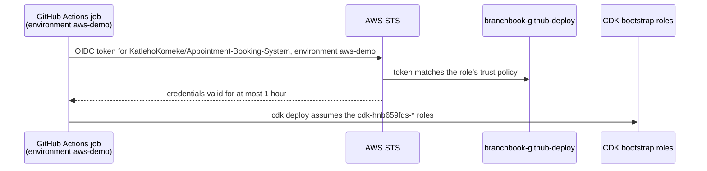

# infra: AWS infrastructure as code

Every AWS resource BranchBook uses is defined here with the [AWS CDK](https://docs.aws.amazon.com/cdk/v2/guide/home.html)
in TypeScript. Nothing is created by hand in the AWS console. The reasoning is in
[ADR-0006](../docs/adr/0006-hosted-demo-on-aws-with-cdk.md).

## What exists today

| Stack | Region | What it creates | Monthly cost |
|---|---|---|---|
| `BranchbookAccount` | us-east-1 | GitHub as an OpenID Connect identity provider; the `branchbook-github-deploy` role; a monthly cost budget with e-mail alerts at 50, 80 and 100 percent | $0 |

The stacks that host the application, `BranchbookDns`, `BranchbookData` and `BranchbookApp` in `af-south-1`
(Cape Town), are added once there is an application to host.

## How GitHub reaches AWS without keys



- **No access key exists anywhere.** GitHub proves the workflow's identity with a short-lived token, and AWS
  answers with credentials that expire within an hour.
- **The trust is narrow.** Only jobs in this repository that declare the `aws-demo` GitHub environment match the
  role's trust policy. Forks and other repositories cannot assume it.
- **The role can do almost nothing itself.** It may only assume the roles that `cdk bootstrap` created, and those
  carry out deployments. A unit test fails if any other permission is added.
- **No account ID is ever committed.** The account comes from the credentials in use, and the role ARN is stored
  as a GitHub secret, so it is masked in the public workflow logs.

## Prerequisites

- An AWS account you own, with MFA on the root user and an administrator user in IAM Identity Center. The
  [first-time setup](#first-time-setup) below walks through it.
- [AWS CLI v2](https://docs.aws.amazon.com/cli/latest/userguide/getting-started-install.html) and Node.js 24.

## Commands

All commands run from this folder.

```bash
npm ci                                                     # install the pinned dependencies
npm run build                                              # type-check
npm test                                                   # unit tests on the synthesised templates
BRANCHBOOK_ALERT_EMAIL=alerts@example.com npx cdk synth    # render CloudFormation without touching AWS
```

`BRANCHBOOK_ALERT_EMAIL` is where budget alerts go. It is read from the environment so that no personal address is
ever committed. Any placeholder works for `synth` and `test`; use your real address only when deploying.

## First-time setup

These steps need you personally, and only happen once.

1. **Create the AWS account.** Sign up at https://aws.amazon.com and choose the paid plan, so the account never
   closes automatically; new-account credits still apply. Turn on MFA for the root user, then stop using it.
2. **Create your administrator.** In IAM Identity Center, create a user with the `AdministratorAccess` permission
   set, and sign in once with it.
3. **Enable Cape Town.** In the console, under Account, then AWS Regions, enable **Africa (Cape Town) af-south-1**.
   It can take a while to activate, and the application stacks will need it.
4. **Sign in from your terminal:**

   ```bash
   aws configure sso --profile branchbook-admin   # once; opens a browser to approve
   aws sso login --profile branchbook-admin       # whenever the session expires
   ```

5. **Bootstrap CDK** in both Regions the project uses. This creates the deployment roles, an S3 bucket and an
   ECR repository that CDK needs:

   ```bash
   npx cdk bootstrap --profile branchbook-admin \
     aws://$(aws sts get-caller-identity --profile branchbook-admin --query Account --output text)/us-east-1
   ```

   Bootstrap `af-south-1` the same way once the Region is enabled.

6. **Deploy the connection:**

   ```bash
   BRANCHBOOK_ALERT_EMAIL=<your address> npx cdk deploy BranchbookAccount --profile branchbook-admin
   ```

   AWS e-mails a subscription confirmation for the budget alerts; accept it. The deploy prints `DeployRoleArn`.

7. **Tell GitHub about it.** In the repository settings:
   - Under **Environments**, create `aws-demo`.
   - Under **Secrets and variables**, then **Actions**, add the repository secret `AWS_DEPLOY_ROLE_ARN` with the
     `DeployRoleArn` value.

8. **Prove the connection.** Under **Actions**, run **aws-connection-check**. It assumes the role and reports which
   role it obtained, with the account ID masked.

## Removing it

```bash
npx cdk destroy BranchbookAccount --profile branchbook-admin
```

This removes the role, the GitHub trust and the budget. Delete the `AWS_DEPLOY_ROLE_ARN` secret afterwards.

## Dependency notes

- **Versions are pinned.** `aws-cdk-lib` and `constructs` are pinned exactly, and `package-lock.json` fixes
  everything else. `npm ci` installs exactly what was tested.
- **One override clears a test-only advisory.** `overrides` replaces `argparse` 1 with 2 under `js-yaml`. The old
  `argparse` pulls in `sprintf-js`, which has an unpatched denial-of-service advisory
  ([GHSA-hp3w-g68c-fv3c](https://github.com/advisories/GHSA-hp3w-g68c-fv3c)). `js-yaml` 3 uses `argparse` only for
  its command-line tool, never in the library code Jest's coverage tooling calls, so the override changes no
  behaviour and leaves `npm audit` clean. Remove it once Jest no longer depends on `js-yaml` 3.

## Layout

| Path | Purpose |
|---|---|
| `bin/branchbook.ts` | The CDK app: which stacks exist and where they deploy |
| `lib/account-stack.ts` | `AccountStack`: the GitHub OIDC trust, the deploy role and the budget |
| `test/account-stack.test.ts` | Unit tests that prove the stack's security properties |
| `cdk.json` | Non-sensitive configuration (repository, environment, budget) and CDK feature flags |
