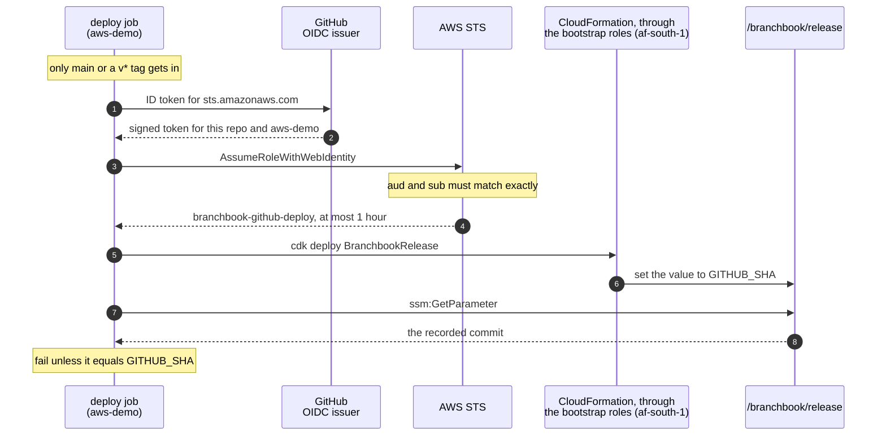

# infra: AWS infrastructure as code

Every resource the pipeline and the application use is defined here with the
[AWS CDK](https://docs.aws.amazon.com/cdk/v2/guide/home.html) in TypeScript. The account, its administrator, the
Cape Town opt-in, the CDK bootstrap and the GitHub environment are one-time manual steps, listed under
[First-time setup](#first-time-setup). The reasoning is in [ADR-0006](../docs/adr/0006-hosted-demo-on-aws-with-cdk.md)
and [ADR-0007](../docs/adr/0007-continuous-deployment-from-main.md).

- [What exists today](#what-exists-today)
- [Automatic deployment](#automatic-deployment)
- [How GitHub reaches AWS without keys](#how-github-reaches-aws-without-keys)
- [Who can change what in AWS](#who-can-change-what-in-aws)
- [Planned: the hosted demo](#planned-the-hosted-demo)
- [Commands](#commands), [First-time setup](#first-time-setup) and [Removing it](#removing-it)

## What exists today

*Status: Partly built: two stacks deployed; the hosted demo after M6.*


**A.** The administrator deploys `BranchbookAccount` in `us-east-1` by hand with `cdk deploy`. The pipeline never
deploys this stack.

1. On every push to `main`, the `deploy` job in [deploy.yml](../.github/workflows/deploy.yml) enters the GitHub
   environment `aws-demo` and signs in to AWS through OpenID Connect, via AWS STS, as `branchbook-github-deploy`.
   No access key is stored.
2. The deploy role assumes the CDK bootstrap roles (`cdk-hnb659fds-*`) in `af-south-1`.
3. CloudFormation updates the `BranchbookRelease` stack.
4. The job reads `/branchbook/release` back and fails unless it equals `GITHUB_SHA`.

| Stack and Region | Deployed by | What it creates |
|---|---|---|
| [`BranchbookAccount`](lib/account-stack.ts)<br>`us-east-1` | Administrator, by hand | The GitHub OIDC provider, the role `branchbook-github-deploy`, the budget `branchbook-monthly` and the output `DeployRoleArn` |
| [`BranchbookRelease`](lib/release-stack.ts)<br>`af-south-1` | Pipeline, every push to `main` | The SSM parameter `/branchbook/release`: the last deployed commit |
| `CDKToolkit`<br>both Regions | Administrator, once per Region | The `cdk bootstrap` stack, qualifier `hnb659fds`: the deploy, file-publishing, image-publishing, lookup and cfn-exec roles, an assets bucket and an ECR repository |

- **Cost.** `BranchbookAccount` and `BranchbookRelease` cost nothing to run; the bootstrap storage costs cents. The budget e-mails at 50, 80 and
  100 percent of $90 a month ($45, $72 and $90).
- **Why `us-east-1`.** IAM is global, AWS Budgets lives in `us-east-1`, and the stack holds no customer data.
  Everything that will hold customer data goes to Cape Town.
- **The GitHub side.** The environment `aws-demo`, which admits only the branch `main` and `v*` tags, holds the secret
  `AWS_DEPLOY_ROLE_ARN`. The [infra](../.github/workflows/infra.yml) workflow tests and synthesises this app on every
  change to `infra/`, with no AWS access.

## Automatic deployment

Every push to `main`, and any manual run of the workflow from `main`, runs
[.github/workflows/deploy.yml](../.github/workflows/deploy.yml)
([ADR-0007](../docs/adr/0007-continuous-deployment-from-main.md)):

1. **Test.** Lint, type-check and unit-test the CDK app; nothing reaches AWS if this fails. These are the only
   checks that gate the deploy: the application's CI ([ci.yml](../.github/workflows/ci.yml)) runs separately and is
   not consulted ([docs/delivery.md](../docs/delivery.md#known-gaps)).
2. **Deploy.** Sign in to AWS through OpenID Connect as `branchbook-github-deploy`, then `cdk deploy
   BranchbookRelease`, the only workload stack so far. CDK works through the `af-south-1` bootstrap roles: the
   file-publishing role uploads the template, and the deploy role hands the change set to CloudFormation, which
   applies it as the cfn-exec role.
3. **Verify.** Read `/branchbook/release` back from AWS and fail unless it equals the pushed commit. A passing run
   ends with the log line `AWS af-south-1 now records commit <sha>`.

To see what is live, read the parameter:

```bash
aws ssm get-parameter --name /branchbook/release \
  --query Parameter.Value --output text --profile branchbook-admin
```

The deploy job step by step, what the read-back proves and what it does not, and how runs queue are in
[docs/delivery.md](../docs/delivery.md#continuous-deployment).

## How GitHub reaches AWS without keys



Everything in this diagram is built. Solid arrows are calls; dashed arrows are their replies.

- **No access key exists anywhere.** The job takes the ARN of `branchbook-github-deploy` from the environment secret
  `AWS_DEPLOY_ROLE_ARN`.
  GitHub proves the job's identity with a short-lived token, and AWS answers with credentials that expire within an
  hour (`maxSessionDuration` in [account-stack.ts](lib/account-stack.ts)).
- **The trust is narrow.** The trust policy requires, with `StringEquals`, the audience `sts.amazonaws.com` and
  GitHub's immutable subject
  `repo:KatlehoKomeke@88820937/Appointment-Booking-System@1423867330:environment:aws-demo`. It carries the numeric
  owner and repository IDs, so forks, other repositories and a repository recreated later under the same name cannot
  match. The IDs are public GitHub identifiers, kept in [cdk.json](cdk.json). The repository's subject setting can be
  read with `gh api repos/KatlehoKomeke/Appointment-Booking-System/actions/oidc/customization/sub`.
- **The environment decides which refs get in.** `aws-demo` admits only the branch `main` and `v*` tags. It has no
  required reviewers, and repository administrators may bypass its rules. Its branch policy is what stops a job on a
  feature branch from declaring the environment and matching the trust. Check it with
  `gh api repos/KatlehoKomeke/Appointment-Booking-System/environments/aws-demo/deployment-branch-policies`.
- **The subject names no workflow.** Any workflow on `main` that declares `aws-demo` can assume the role: today
  [deploy.yml](../.github/workflows/deploy.yml) and [aws-connection-check.yml](../.github/workflows/aws-connection-check.yml).
- **The role can do almost nothing itself.** It may assume the roles that `cdk bootstrap` created, which carry out
  deployments, and read the single release parameter. [account-stack.test.ts](test/account-stack.test.ts) fails if
  the stack's IAM policies gain a statement or a bare `*`; it does not inspect managed policies, or inline `Policies`
  written on the role itself.
- **No account ID is ever committed.** The account comes from the credentials in use, the role ARN lives only in the
  environment secret, and both workflows mask the account ID in their public logs.

## Who can change what in AWS

*Status: Built. Everything in this section exists today.*


**A.** By hand, the administrator `branchbook-admin`, an IAM user who signs in with `aws login`, runs the CDK app with
`BRANCHBOOK_ALERT_EMAIL` set, so the app includes `BranchbookAccount`. `cdk deploy` then updates that stack in
`us-east-1` through the `us-east-1` CDK bootstrap roles. Code and workflow enforce that switch.

1. The job `deploy` in `deploy.yml` declares the GitHub environment `aws-demo`, which only the branch `main` and `v*`
   tags may use (a GitHub setting). `aws-connection-check.yml`, run by hand, also declares it.
2. AWS STS accepts GitHub's OIDC token only on an exact match with the role's trust policy (`StringEquals`): `aud` is
   `sts.amazonaws.com`, and `sub` names this repository by ID and the environment `aws-demo` (IAM).
3. The deploy role's sessions last at most 1 hour, and its policy has two statements: `AssumeCdkBootstrapRolesOnly`
   (`sts:AssumeRole` on `cdk-hnb659fds-*`) and `ReadReleaseRecordOnly` (`ssm:GetParameter` on
   `/branchbook/release`) (IAM).
4. `deploy.yml` never sets `BRANCHBOOK_ALERT_EMAIL`, so the pipeline's CDK app holds only `BranchbookRelease`.
   Deploying `BranchbookAccount` is not allowed because that stack is not in the app
   ([bin/branchbook.ts](bin/branchbook.ts)). Code and workflow enforce this, not IAM.
5. Through the `af-south-1` bootstrap roles and CloudFormation, the pipeline deploys `BranchbookRelease` in
   `af-south-1`: the SSM parameter `/branchbook/release`, which holds the deployed commit.

Each guard carries a badge naming what enforces it:

| Badge | What enforces it | Guards | Who can change it |
|---|---|---|---|
| **IAM** | AWS refuses the call, whatever the workflow asks for | 2, 3 | A deploy that changes IAM: the administrator's, or, through cfn-exec, the pipeline's (see below) |
| **GitHub setting** | GitHub refuses to start the job | 1 | A repository administrator, in the settings |
| **Code and workflow** | The CDK app and `deploy.yml` never ask for it | A, 4 | Any commit that reaches `main` |

**The pipeline does not change its own access, but IAM would not stop it.** `BranchbookAccount` defines the role the
pipeline assumes, so it is part of the CDK app only when `BRANCHBOOK_ALERT_EMAIL` is set: by an administrator on
their own machine, or with the placeholder `alerts@example.com` in the credential-free `infra` workflow. The deploy
workflow never sets it, so it cannot synthesise that stack, let alone deploy it. That guard lives in the repository,
so a change to the repository can remove it.

**Not prevented by IAM today:**

- `AssumeCdkBootstrapRolesOnly` allows `cdk-hnb659fds-*`, which also matches the `us-east-1` bootstrap roles.
- The cfn-exec role keeps CDK's default `AdministratorAccess`, because the bootstrap commands under
  [First-time setup](#first-time-setup) pass no `--cloudformation-execution-policies`. A stack the pipeline deploys
  can therefore create any resource, IAM included.
- `main` requires no review or passing check ([docs/delivery.md](../docs/delivery.md#known-gaps)), so a workflow
  pushed to `main` that set `BRANCHBOOK_ALERT_EMAIL` could deploy `BranchbookAccount`.

What limits this today is the repository, not AWS: it has one collaborator, who is an administrator, and the
`aws-demo` branch policy admits only `main` and `v*` tags.

**Hardening options, not done:**

- Scope `AssumeCdkBootstrapRolesOnly` to the bootstrap roles of `af-south-1`, whose names end in `-af-south-1`.
- Bootstrap with a custom execution policy (`--cloudformation-execution-policies`) or a permissions boundary, so
  cfn-exec cannot create or widen IAM roles.
- Protect `main`, and add a `CODEOWNERS` entry for `.github/` and `infra/`.

## Planned: the hosted demo

*Status: Planned, after M6.* The design is in [ADR-0006](../docs/adr/0006-hosted-demo-on-aws-with-cdk.md); the cost
line items are on the [architecture page](https://claude.ai/artifact/X4b1pc9RSCboanuXBSn6oX). None of these stacks
exists in the CDK app yet.

All three will deploy to `af-south-1`:

- **`BranchbookDns`:** a Route 53 hosted zone for `branchbook.co.za`, which is not registered yet.
- **`BranchbookData`:** a VPC across two availability zones, with public and isolated `/24` subnets and no NAT
  gateway; RDS for PostgreSQL 17 on `db.t4g.micro`, Single-AZ, encrypted, with 7-day backups, in the isolated
  subnets; its credentials generated into Secrets Manager.
- **`BranchbookApp`:** AWS WAF; an HTTPS Application Load Balancer with an ACM certificate; one ARM64 Fargate task
  (0.5 vCPU, 1 GB); application logs kept 7 days; three CloudWatch alarms that e-mail through an SNS topic.

A reviewer's request will take this path:

1. The browser resolves `branchbook.co.za` through Route 53. DNS answers the name; it is not in the data path.
2. AWS WAF, attached to the load balancer, asks for the basic-auth demo gate (401 without it), allows 30 booking
   `POST`s per IP in 5 minutes, and blocks `/actuator` (403).
3. The load balancer ends HTTPS on port 443 and health-checks `/readyz`.
4. The Fargate task, which admits traffic only from the load balancer, serves the request on port 8080.
5. The task talks to RDS on port 5432 over TLS, directly, with no RDS Proxy.

It will cost about $82 a month before VAT while it runs. The teardown date is recorded here when the stacks are
first deployed.

**Open points**, each removed when it is resolved:

- The App stack's alert address needs an input other than `BRANCHBOOK_ALERT_EMAIL`, which also switches
  `BranchbookAccount` into the app.
- The ARM64 image needs an `ubuntu-24.04-arm` runner or QEMU, because the [Dockerfile](../Dockerfile)'s runtime stage
  has `RUN` steps.
- The release record must be written after the smoke test, so that it records only a version that works.
- `application-prod.yml` and `application-demo.yml` do not exist yet.
- The demo-gate credential will sit in the synthesised WAF rule and CloudFormation template
  ([SECURITY.md](../SECURITY.md#planned-for-the-hosted-demo-after-m6)).
- The availability zones must be pinned, so that synthesis needs no context lookup.

## Prerequisites

- An AWS account you own and an administrator IAM user for daily work. The [first-time setup](#first-time-setup)
  below walks through it.
- [AWS CLI v2](https://docs.aws.amazon.com/cli/latest/userguide/getting-started-install.html) 2.32 or later (for
  `aws login`) and Node.js 24.

## Commands

All commands run from this folder.

```bash
npm ci              # install the pinned dependencies
npm run lint        # ESLint, including TSDoc on every export
npm run build       # type-check
npm test            # unit tests on the synthesised templates
BRANCHBOOK_ALERT_EMAIL=alerts@example.com \
  npx cdk synth     # render CloudFormation without touching AWS
```

The lint rules are in [eslint.config.mjs](eslint.config.mjs). They use typescript-eslint, which needs the TypeScript
compiler API that TypeScript 7 does not yet provide, so this package uses TypeScript 6.0, the same as `web/`.

`BRANCHBOOK_ALERT_EMAIL` is where budget alerts go. It is read from the environment so that no personal address is
ever committed. Any placeholder works for `synth` and `test`; use your real address only when deploying.

## First-time setup

These steps need you personally, and only happen once.

1. **Create the AWS account (console).** Sign up at https://aws.amazon.com and choose the paid plan, so the account
   never closes automatically; new-account credits still apply. Turn on MFA for the root user.
2. **Create one administrator user, then stop using root (console).** Signed in as root, create the IAM user
   `branchbook-admin` with console access and the `AdministratorAccess` policy, and turn on its MFA. Creating the
   first administrator is the one task root is meant for. IAM Identity Center is the alternative when several people
   need access; for a one-person account an IAM user signed in through `aws login` is simpler and still issues only
   short-lived credentials.
3. **Enable Cape Town (console).** Under Account, then AWS Regions, enable **Africa (Cape Town) af-south-1**. It can
   take a while to activate, and the pipeline deploys there.
4. **Sign the CLI in** while the browser is signed in as `branchbook-admin`:

   ```bash
   aws configure set region af-south-1 --profile branchbook-admin
   aws login --profile branchbook-admin   # opens the browser; choose the branchbook-admin session
   aws sts get-caller-identity --profile branchbook-admin \
     --query Arn --output text            # must end in user/branchbook-admin
   ```

   `aws login` stores temporary credentials and refreshes them; no access key is created. Run it again when the
   session expires.

5. **Bootstrap CDK** in `us-east-1`, the Region of `BranchbookAccount`. This creates the roles, S3 bucket and ECR
   repository CDK deploys through; it trusts no other AWS account:

   ```bash
   npx cdk bootstrap \
     "aws://$(aws sts get-caller-identity --profile branchbook-admin --query Account --output text)/us-east-1" \
     --profile branchbook-admin --tags project=branchbook
   ```

   Bootstrap `af-south-1` the same way: the pipeline deploys there. Neither command passes
   `--cloudformation-execution-policies`, so the cfn-exec role keeps CDK's default `AdministratorAccess`
   ([Who can change what in AWS](#who-can-change-what-in-aws)).

6. **Deploy `BranchbookAccount`:**

   ```bash
   BRANCHBOOK_ALERT_EMAIL=<your address> \
     npx cdk deploy BranchbookAccount --profile branchbook-admin
   ```

7. **Tell GitHub about it (console).** In the repository settings, under **Environments**, create `aws-demo`. Under
   **Deployment branches and tags**, choose **Selected branches and tags**, and add `main` (branch) and `v*` (tag).
   The trust policy names the environment, not a branch, so this rule is what keeps a feature branch out. Check it:

   ```bash
   gh api repos/KatlehoKomeke/Appointment-Booking-System/environments/aws-demo/deployment-branch-policies \
     --jq '.branch_policies[] | "\(.type) \(.name)"'
   ```

   Inside that environment, add the secret `AWS_DEPLOY_ROLE_ARN` with the role ARN. An environment secret is only
   readable by jobs that declare the environment, which is tighter than a repository-wide secret. This copies the ARN
   to the clipboard without printing your account ID:

   ```bash
   aws cloudformation describe-stacks --stack-name BranchbookAccount \
     --region us-east-1 --profile branchbook-admin \
     --query "Stacks[0].Outputs[?OutputKey=='DeployRoleArn'].OutputValue" \
     --output text | tr -d '\n' | pbcopy
   ```

8. **Prove the connection.** Under **Actions**, run **aws-connection-check**. It assumes the role and reports which
   role it obtained, with the account ID masked.

## Removing it

Run these in order, from this folder. Each stack is destroyed through the bootstrap roles of its Region, so the
bootstrap goes last.

1. Destroy the release record:

   ```bash
   npx cdk destroy BranchbookRelease --profile branchbook-admin
   ```

2. Destroy the GitHub trust, the deploy role and the budget. The variable must be set, because the stack is in the
   app only when it is; any placeholder works:

   ```bash
   BRANCHBOOK_ALERT_EMAIL=alerts@example.com \
     npx cdk destroy BranchbookAccount --profile branchbook-admin
   ```

3. Delete `CDKToolkit` in both Regions:

   ```bash
   aws cloudformation delete-stack --stack-name CDKToolkit --region af-south-1 --profile branchbook-admin
   aws cloudformation delete-stack --stack-name CDKToolkit --region us-east-1 --profile branchbook-admin
   ```

   The ECR repository must be empty for the delete to succeed; nothing pushes images to it today. CloudFormation
   keeps each assets bucket (`cdk-hnb659fds-assets-<account>-<region>`) on purpose. In the S3 console, empty it, which
   also removes its old versions, then delete it.

4. Delete the `AWS_DEPLOY_ROLE_ARN` secret from the `aws-demo` environment, last. Every later push to `main` fails
   the deploy job at sign-in; `gh workflow disable deploy` stops it running.

The App and Data stacks, and their teardown date, are added here when those stacks exist.

## Dependency notes

- **Versions are pinned.** `aws-cdk-lib` and `constructs` are pinned exactly, and `package-lock.json` fixes
  everything else. `npm ci` installs exactly what was tested.
- **One override clears a test-only advisory.** `overrides` replaces `argparse` 1 with 2 under `js-yaml`. The old
  `argparse` pulls in `sprintf-js`, which has an unpatched denial-of-service advisory
  ([GHSA-hp3w-g68c-fv3c](https://github.com/advisories/GHSA-hp3w-g68c-fv3c)). `js-yaml` 3 uses `argparse` only for
  its command-line tool, never in the library code Jest's coverage tooling calls, so the override changes no
  behaviour and leaves `npm audit` clean. Remove it once Jest no longer depends on `js-yaml` 3.

## Layout

| Path | Purpose |
|---|---|
| `bin/branchbook.ts` | The CDK app: which stacks exist and where they deploy |
| `lib/account-stack.ts` | `AccountStack`: the GitHub OIDC trust, the deploy role and the budget |
| `lib/release-stack.ts` | `ReleaseStack`: records the deployed commit in `/branchbook/release` |
| `test/account-stack.test.ts` | Unit tests that check the connection's security properties |
| `test/release-stack.test.ts` | Unit tests for the release record the pipeline verifies |
| `cdk.json` | Non-sensitive configuration (repository name and public IDs, environment, budget) and CDK feature flags |

Next: [docs/delivery.md](../docs/delivery.md) for how a commit gets here; [SECURITY.md](../SECURITY.md) for secrets
and personal information.
