# BranchBook web app

The React app customers use to book and look up branch appointments, and to cancel them if Tier 2 is built
([Scope](../README.md#scope)). In production it is not deployed on
its own: the Dockerfile builds it and places the output inside the Spring Boot jar, which serves the app and the API
from one origin ([docs/architecture.md, section 2](../docs/architecture.md#2-system-context-and-containers)).

**Status (M6):** built to the [UI design](#ui-design): the five booking steps, the confirmation page with the SMS's
live delivery status, `/manage` and the simulated inbox, with the landing page, the privacy notice, a not-found page
and an error page. Each page but the landing page loads when it is first opened, and the confirmation page offers to
book the same service again. From Tier 2, the appointment page cancels an appointment until it starts, and the inbox
retries a message the dispatcher gave up on; neither is drawn yet (see the end of the [UI design](#ui-design)).
Playwright tests the flow end to end in a real browser ([e2e/](../e2e/README.md)).

## Stack

React 19 and TypeScript (strict) on Vite, with React Router for the routes, TanStack Query for the API cache and
polling, and react-hook-form with zod for the forms. Styles are CSS Modules over the design tokens. Vitest with
Testing Library runs the tests in jsdom against a fake API in MSW, which is a test dependency only, so no service
worker ships. Each library is pinned to a release at least two weeks old. Exact versions are in
[package.json](package.json) and the lockfile, and the main ones in the root [README](../README.md#versions).

## Commands

Node 24 is required (the repository's [.nvmrc](../.nvmrc) selects it). Run these from `web/`:

| Command | What it does |
|---|---|
| `npm ci` | Installs the exact dependency versions from the lockfile |
| `npm run dev` | Starts the dev server on http://localhost:5173 with hot reload |
| `npm test` | Runs the unit tests once (`npm run test:watch` keeps them running) |
| `npm run lint` | Lints, failing on any warning |
| `npm run typecheck` | Type-checks the app and its configuration |
| `npm run format` | Formats with Prettier (`npm run format:check` only checks) |
| `npm run build` | Type-checks, then writes the production build to `dist/` |
| `npm run generate:api` | Regenerates `src/api/schema.d.ts` from [docs/openapi.yaml](../docs/openapi.yaml) |
| `npm run check:api` | Fails if `src/api/schema.d.ts` is not what `generate:api` would write |

The dev server forwards `/api`, `/actuator`, `/readyz` and `/livez` to the API on port 8080, so the app talks to
one origin in development as in production. Start the API with `make dev-api` from the repository root.

## Talking to the API

[src/api/client.ts](src/api/client.ts) is the only way the app calls the API. It is
[openapi-fetch](https://openapi-ts.dev/openapi-fetch/) typed by `src/api/schema.d.ts`, which
[openapi-typescript](https://openapi-ts.dev/) generates from the committed contract
([ADR-0005](../docs/adr/0005-committed-openapi-contract.md)). A path, parameter or field the API does not have is a
type error:

```ts
const day = await unwrap(
  api.GET('/api/v1/branches/{code}/availability', {
    params: { path: { code: 'RUS' }, query: { service: 'HOME', date: '2026-10-31' } },
  }),
);
day.slots[0]?.startsAt; // string, with the branch's +02:00 offset
day.closedReason; // 'CLOSED_DAY' | 'PUBLIC_HOLIDAY' | null
```

`unwrap` returns the body of a success and throws an `ApiProblem` for an error response, carrying the status, the
stable `code` (typed as the union of the codes the contract lists) and the `correlationId`. Screens choose their wording from `code`, never from the problem's `detail`.
A network failure is not an `ApiProblem`, so a screen can tell "offline" from "refused".

[src/api/queries.ts](src/api/queries.ts) wraps the calls in TanStack Query hooks, and
[src/api/problemCopy.ts](src/api/problemCopy.ts) holds the customer copy for every code. The confirmation page and
the inbox poll every 2 s while a message is PENDING. Booking sends an `Idempotency-Key` that survives a refresh and
changes with the details, and retries a `503 TRY_AGAIN` once, with the same key, after `Retry-After`.

`schema.d.ts` is generated and committed, never edited by hand; ESLint and Prettier skip it, and `npm run
check:api` (in CI and `make test`) fails if regenerating it would change anything. After an API change, `make contract` in the repository root refreshes the contract
and this file together.

openapi-typescript 7.13.0 declares TypeScript 5 as its peer, while the app uses TypeScript 6. The `overrides` entry
in [package.json](package.json) makes it use the app's TypeScript. openapi-typescript only prints the file through
the compiler's API, and the type check and the client's tests run against what it prints.

## Quality gates

The `web` job of CI checks the generated API types, then runs lint, the type check, the format check, the tests and
the build, on every push to `main` and every pull request ([docs/delivery.md](../docs/delivery.md)). The tests run
twice, under `TZ=UTC` and `TZ=America/New_York`, because appointment times must render in South African Standard
Time on any device ([docs/architecture.md, section 8](../docs/architecture.md#8-time)).

The lint configuration, [eslint.config.js](eslint.config.js), enforces:

- **Documentation:** every exported component, hook, function and type has a TSDoc comment
  ([CONTRIBUTING.md](../CONTRIBUTING.md#typescript-web-and-infra)).
- **Type safety:** typescript-eslint's strict, type-aware rules.
- **Accessibility:** the strict rule set of `eslint-plugin-jsx-a11y-x`. This is the es-tooling fork of
  `eslint-plugin-jsx-a11y`, chosen because the original does not yet support ESLint 10
  ([jsx-eslint/eslint-plugin-jsx-a11y#1075](https://github.com/jsx-eslint/eslint-plugin-jsx-a11y/issues/1075)),
  and ESLint 9 reached end of life on 2026-08-06.

## Layout

```text
web/
├── index.html         the single page; marked noindex because the bank is fictional
├── public/            files served as they are (the favicon)
└── src/
    ├── main.tsx       loads the font and the global styles, and mounts the app
    ├── App.tsx        the router and the API cache around routes.tsx
    ├── routes.tsx     every page, inside the shell, with the error page
    ├── ui/            the design tokens, global styles, the shell and the shared components
    ├── booking/       the five steps at /book: the URL state, session storage, the idempotency key, each step
    ├── pages/         landing, confirmation, manage, inbox, privacy, not found, error
    ├── api/           the typed client, the query hooks and the copy by code; schema.d.ts is generated
    ├── lib/           SAST formatting, the cellphone parser, safe session storage, zod's settings
    └── test/          the fake API (MSW), its fixtures from the seed data, and the render helpers
```

## Security

The API sends a strict Content Security Policy (`default-src 'self'`), so the app must never rely on inline
scripts, inline `<style>` elements or third-party origins. Fonts, images and scripts are bundled and served from
the same origin: the design's font, Nunito Sans, is self-hosted rather than loaded from Google Fonts, and no font
is inlined as a `data:` URI ([Building it](#building-it)). zod parses without compiling
([src/lib/zodConfig.ts](src/lib/zodConfig.ts)), because its compiler first probes for `new Function`, which the
policy refuses, and the browser reports every probe as a violation. A real-browser pass over every screen at 390
and 1280 px, on the jar under this policy, reports none.

## UI design

The screens are designed before they are built. Mockups of the main Tier 1 screens and states, drawn phone first at
390 px, fix the look, the copy and the behaviour that milestones M4 to M6 build and test. The states not drawn yet, some
of them Tier 1, are listed at the end of this section. One booking runs through
most of them: a FICA update at Sandton Summit Mall on Tuesday 27 October 2026 at 09:30 SAST, booked with
082 555 0101. The failed delivery is a second booking at 10:00 the same morning, sent to a number ending in `0000`,
which the simulated gateway always fails ([ADR 0003](../docs/adr/0003-transactional-outbox-for-confirmations.md)); the
inbox adds a third, at Umhlanga Ridge. The branches, services, documents and public holidays on them are the seeded
reference data, the slot rules are the ones the API enforces, the error copy is the copy in
[docs/errors.md](../docs/errors.md), and every person and number is synthetic.

The images below are exported from the design canvas, which is not public, so this section is the design's record in
the repository. The [architecture page](https://claude.ai/artifact/X4b1pc9RSCboanuXBSn6oX) describes the front end in
words: its routes, components, state and API calls. Where the two differ, this section records the design.

### Screens

#### Booking an appointment

<table>
<tr>
<td width="16%"><a href="../docs/assets/ui/01-landing.png">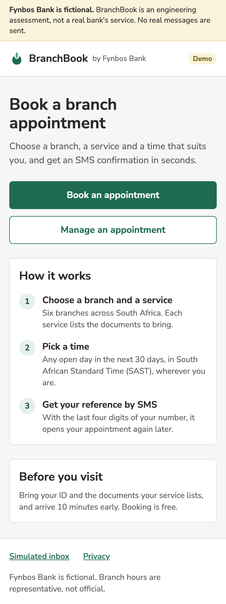</a></td>
<td width="16%"><a href="../docs/assets/ui/02-branch.png">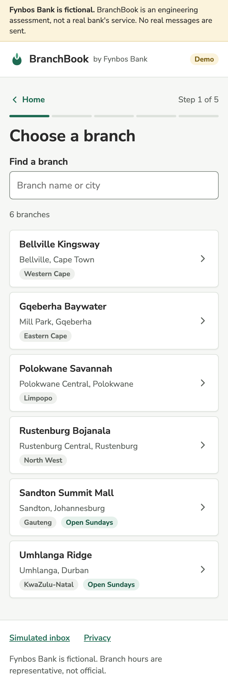</a></td>
<td width="16%"><a href="../docs/assets/ui/03-service.png">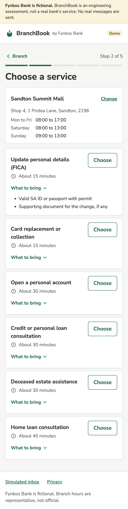</a></td>
<td width="16%"><a href="../docs/assets/ui/04-date-time.png">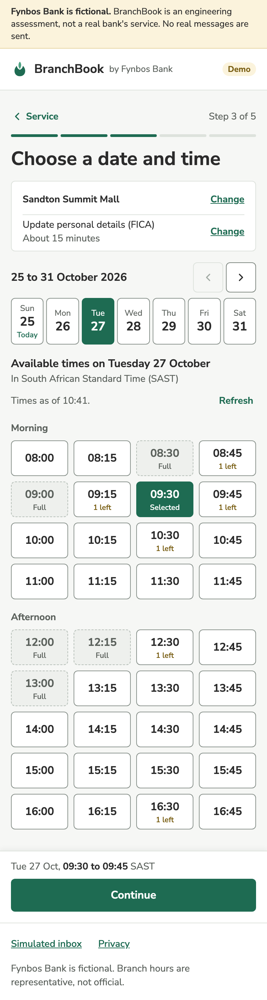</a></td>
<td width="16%"><a href="../docs/assets/ui/05-details.png">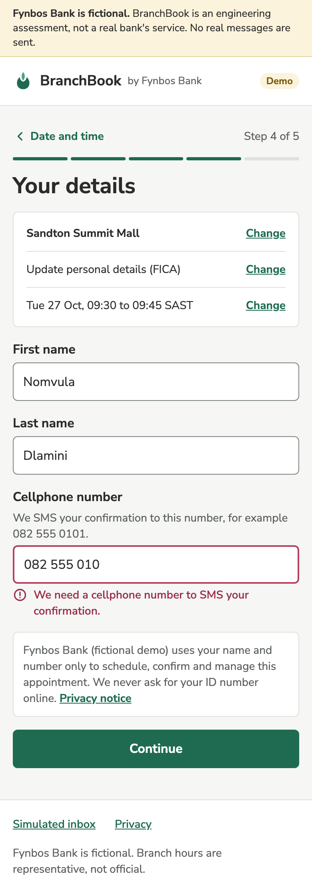</a></td>
<td width="16%"><a href="../docs/assets/ui/06-review.png">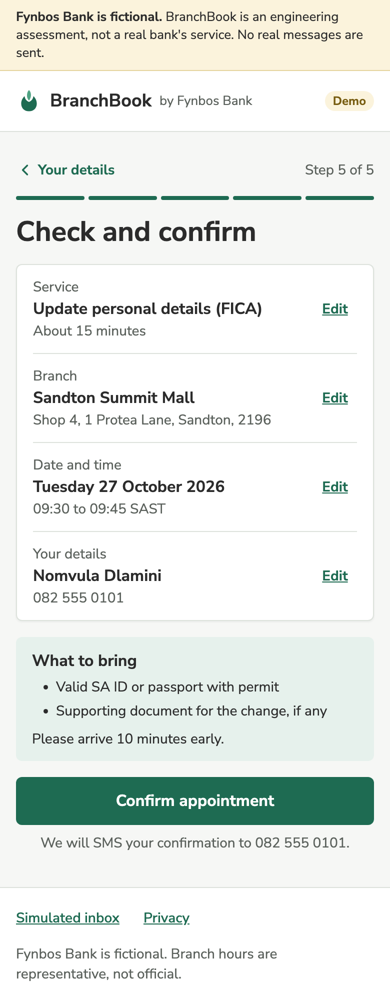</a></td>
</tr>
<tr>
<td>Landing<br><code>/</code></td>
<td>1 Branch<br><code>/book</code></td>
<td>2 Service<br><code>branch=SAN</code></td>
<td>3 Date and time<br><code>service=FICA</code></td>
<td>4 Your details<br><code>step=details</code></td>
<td>5 Review<br><code>step=review</code></td>
</tr>
</table>

The five steps share one route, `/book`. Its query string holds the branch, service, date, time (`slot`) and step, so
Back and a refresh land on the same step: `?branch=SAN` opens step 2, adding `&service=FICA` opens step 3, and Continue
adds `step=details`, then `step=review`. The name and number stay in the tab's session storage, never in the URL.

- **Landing.** What BranchBook is, one action to book and one to manage, how it works and what to bring.
- **Branch.** The six branches, filtered by name or city while typing, with a live count. Choosing one moves on.
- **Service.** The branch's address and hours, then each service with its duration, a "What to bring" list and its
  own Choose button, so the documents can be read without choosing the service.
- **Date and time.** The 30 dates the server says are bookable, seven at a time, and that day's times in SAST. A full
  time is shown but cannot be chosen, and a time with one seat left says so. Choosing a time does not move on by
  itself: the choice is repeated above Continue.
- **Your details.** First name, last name and a South African cellphone number, each checked when it is left. The
  privacy notice sits under the fields; there is no consent checkbox.
- **Review.** Every fact once, each with an Edit link back to its step, and one button that books.

#### When the plan changes

<table>
<tr>
<td width="16%"><a href="../docs/assets/ui/07-date-time-holiday.png">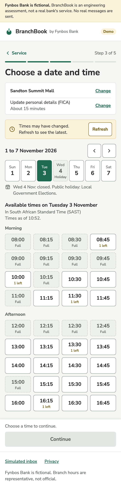</a></td>
<td width="16%"><a href="../docs/assets/ui/08-slot-taken.png">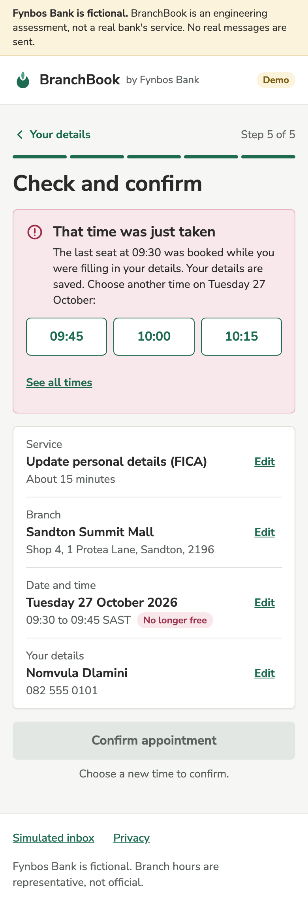</a></td>
<td width="16%"></td><td width="16%"></td><td width="16%"></td><td width="16%"></td>
</tr>
<tr>
<td>A public holiday, stale times</td>
<td>The time was just taken</td>
<td></td><td></td><td></td><td></td>
</tr>
</table>

- **A closed day.** Wednesday 4 November 2026 is the Local Government Elections, a public holiday, so its date cannot
  be chosen. The tile says "Holiday", the line under the strip gives the reason, and the date's accessible name
  carries it too. A day the branch does not trade is shown the same way, as "Closed".
- **Stale times.** After ten minutes without activity, a banner says the times may have changed and offers Refresh.
- **The time was just taken.** When the last seat goes while the customer fills in their details (409 `SLOT_FULL`),
  the review step offers up to three later times on the same day, and a link to all times. The details are kept, and
  Confirm waits until a new time is chosen.

#### After booking

<table>
<tr>
<td width="16%"><a href="../docs/assets/ui/09-confirmation-sending.png">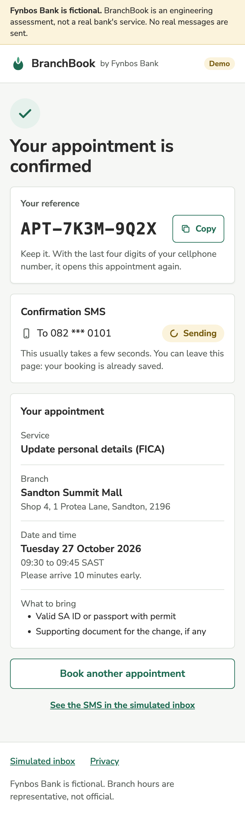</a></td>
<td width="16%"><a href="../docs/assets/ui/10-confirmation-sent.png">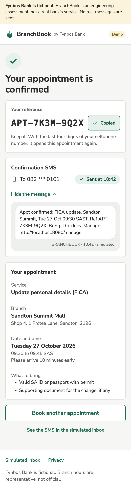</a></td>
<td width="16%"><a href="../docs/assets/ui/11-confirmation-failed.png">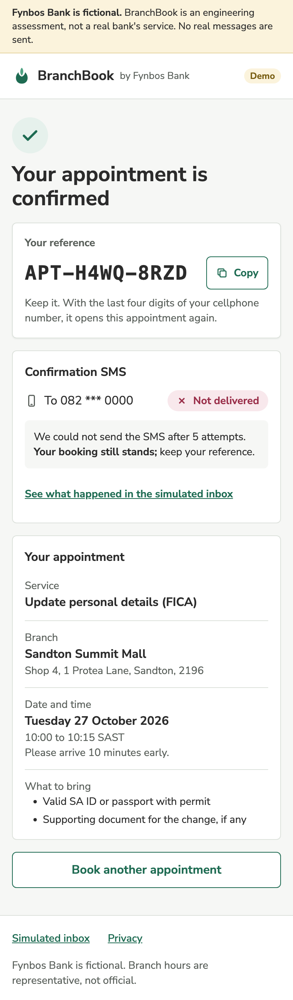</a></td>
<td width="16%"><a href="../docs/assets/ui/12-manage.png">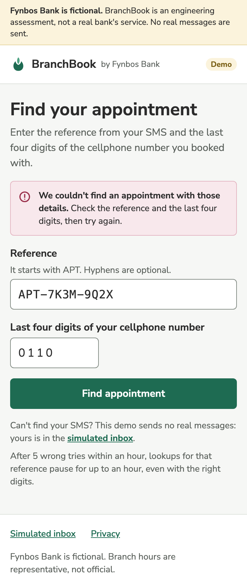</a></td>
<td width="16%"><a href="../docs/assets/ui/13-inbox.png">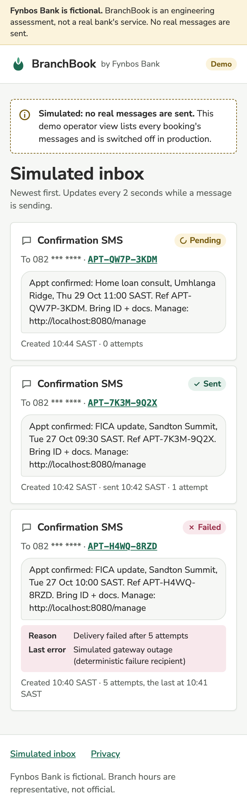</a></td>
<td width="16%"><a href="../docs/assets/ui/14-privacy.png">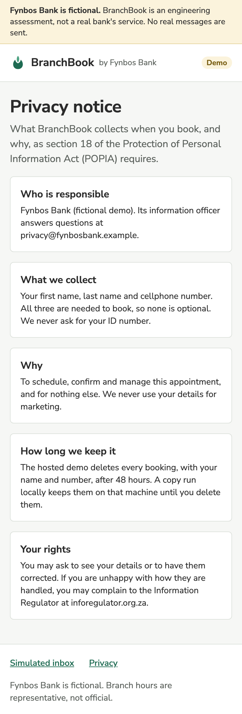</a></td>
</tr>
<tr>
<td>Confirmed, SMS sending<br><code>/appointments/APT-7K3M-9Q2X</code></td>
<td>SMS sent</td>
<td>SMS not delivered</td>
<td>Manage, no match<br><code>/manage</code></td>
<td>Simulated inbox<br><code>/messages</code></td>
<td>Privacy notice<br><code>/privacy</code></td>
</tr>
</table>

- **Confirmation.** A real page, not a toast: the reference large with a Copy button, the SMS's delivery status, which
  moves from Sending to Sent by itself within a few seconds, the appointment in the same order as the review step, and
  what to bring. Once the SMS is sent, its text can be read.
- **Not delivered.** When delivery fails five times and the dispatcher gives up, the page says so calmly: the booking
  still stands, and the customer keeps the reference.
- **Manage.** The reference from the SMS and the last four digits of the cellphone number. A wrong reference and wrong
  digits get the same answer, so the page cannot be used to discover references.
- **Simulated inbox.** Every message the outbox has produced, newest first, with its status, attempts and last error,
  under a banner saying it is a demo operator view, switched off in production, where every message is simulated.
- **Privacy notice.** The POPIA section 18 notice: Fynbos Bank (fictional demo) as the responsible party, the three
  fields collected and why, the hosted demo's deletion of each booking once its appointment is over, and the customer's rights,
  including a complaint to the Information Regulator.

Every page opens with the fictional-bank banner and the header, and ends with links to the inbox and the privacy
notice.

### Foundations

<a href="../docs/assets/ui/15-foundations.png">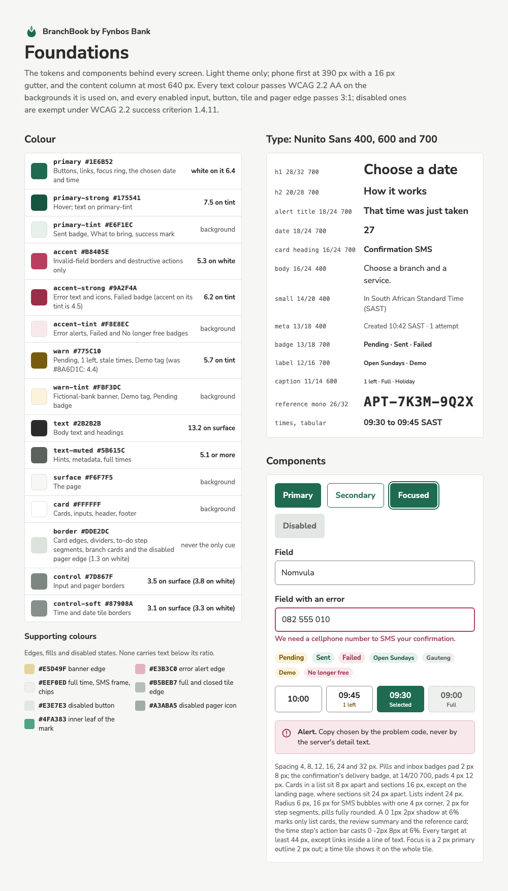</a>

#### Colour

Light theme only; dark mode is a recorded non-goal. Each ratio is WCAG 2.2 contrast against the background the colour
is used on: text needs 4.5:1, and the edge of an input, button, tile or pager needs 3:1 unless the control is disabled.

| Token | Value | Used for | Contrast |
|---|---|---|---|
| `primary` | `#1E6B52` | Buttons, links, the focus ring, the chosen date and time | White on it 6.4:1 |
| `primary-strong` | `#175541` | Hover, and text on `primary-tint` | 7.5:1 on `primary-tint` |
| `primary-tint` | `#E6F1EC` | The Sent badge, "What to bring", the success mark | Background |
| `accent` | `#B8405E` | Invalid-field borders and destructive actions only | 5.3:1 on white |
| `accent-strong` | `#9A2F4A` | Error text and icons, the Failed badge, text on `accent-tint` | 6.2:1 on `accent-tint` |
| `accent-tint` | `#F8E8EC` | Error alerts, the Failed and "No longer free" badges | Background |
| `warn` | `#775C10` | Pending, "1 left", stale times, the Demo tag | 5.7:1 on `warn-tint` |
| `warn-tint` | `#FBF3DC` | The fictional-bank banner, the Demo tag, the Pending badge | Background |
| `text` | `#2B2B2B` | Body text and headings | 13.2:1 on `surface` |
| `text-muted` | `#5B615C` | Hints, metadata, full times | 5.1:1 or more on every background it meets |
| `surface` | `#F6F7F5` | The page | Background |
| `card` | `#FFFFFF` | Cards, inputs, the header and footer | Background |
| `border` | `#DDE2DC` | Card edges, dividers, the step segments still to come, the branch cards (links that their text identifies, not their edge) and a disabled pager's edge | 1.3:1 on white; never the only thing that identifies a control |
| `control` | `#7D867F` | Input and pager borders | 3.5:1 on `surface`, 3.8:1 on white |
| `control-soft` | `#87908A` | Time and date tile borders | 3.1:1 on `surface`, 3.3:1 on white |

Supporting colours, for edges, fills and disabled states: `#E5D49F` (the banner's edge), `#E3B3C0` (an error alert's
edge), `#EEF0ED` (full times, the SMS frame and chips; `text-muted` on it is 5.5:1), `#B5BEB7` (the edge of a full
time or closed date), `#E3E7E3` (a disabled button; `text-muted` on it is 5.1:1), `#A3ABA5` (a disabled pager's
icon) and `#4FA383` (the inner leaf of the mark).

#### Type

Nunito Sans at 400, 600 and 700, falling back to the system sans-serif. Numbers that line up use tabular figures. The
reference is set in the system monospace, so every character has the same width and is easy to read back one by one;
its 31-character alphabet already leaves out characters that look alike
([BR-11](../docs/domain-rules.md#br-11)).

| Style | Size and line height | Weight | Example |
|---|---|---|---|
| Page heading | 28/32 px | 700 | Choose a date and time |
| Section heading | 20/28 px | 700 | How it works |
| Alert title | 18/24 px | 700 | That time was just taken |
| Date | 18/24 px | 700 | 27, the day in a date tile |
| Card heading | 16/24 px | 700 | Confirmation SMS |
| Body | 16/24 px | 400 | Choose a branch, a service and a time that suits you. |
| Small | 14/20 px | 400 | In South African Standard Time (SAST) |
| Meta | 13/18 px | 400 | Created 10:42 SAST, 1 attempt |
| Badge | 13/18 px | 700 | Pending, Sent, Failed; 14/20 px for the delivery status on the confirmation page |
| Label | 12/16 px | 700 | Open Sundays, Demo |
| Caption | 11/14 px | 600 | 1 left, Full, Holiday |
| Reference | 26/32 px monospace | 700 | APT-7K3M-9Q2X |

#### Space, shape and layout

- Spacing steps of 4, 8, 12, 16, 24 and 32 px. Pills and inbox badges are padded 2 px by 8 px, and the confirmation
  page's delivery status 4 px by 12 px.
- Cards in a list sit 8 px apart and sections 16 px, except on the landing page, whose sections sit 24 px apart. Lists
  are indented 24 px.
- Corners of 6 px, 16 px for an SMS bubble with one 4 px corner, 2 px for the step segments, and fully rounded pills.
- A shadow of `0 1px 2px` at 6% opacity marks only cards in a list, the review summary and the reference card; the
  time step's action bar casts `0 -2px 8px` at 6%.
- One column with a 16 px gutter on a phone, at most 640 px wide on a larger screen.
- Every target is at least 44 by 44 px, except links inside a line of text, and every primary button is 48 px high.

### Components and states

| Component | States designed | Notes |
|---|---|---|
| App shell | One layout on every page | The banner first, then the header (the leaf mark, "BranchBook", "by Fynbos Bank" and a Demo tag), the page, and a footer with the inbox and privacy links |
| Button | Primary, secondary, focused, disabled | The focus ring is a 2 px `primary` outline, 2 px out from the edge |
| Field | Default, with a hint, invalid | An invalid field gets a 2 px `accent` border, `aria-invalid` and its error linked by `aria-describedby`; the hint sits above the input and the error below it |
| Stepper | Done, current, to come | A Back link naming the previous step, "Step 3 of 5" and five segments; the current step carries `aria-current="step"` |
| Booking so far | From step 3 | The earlier choices, each with a Change link |
| Date strip | Open, today, chosen, closed | Seven dates a page under the week's range, with Previous 7 days and Next 7 days, which are disabled at the edges of the server's window |
| Time tile | Free, 1 left, selected, full | Morning and Afternoon groups, four to a row |
| Badge | Pending, Sent, Failed, Open Sundays, province, Demo, No longer free | Always words, never colour alone |
| Alert | Error, status | Errors use `role="alert"`; the stale-times banner sits in a `role="status"` region that is present, and empty, until the times go stale; the inbox banner is plain text, since it never changes |
| Delivery status | Sending, Sent at a time, Not delivered | A polite live region, so a screen reader hears the change |
| Reference | Copy, Copied | Monospace; after copying, the button reads Copied and a status region, present and empty before, says the reference was copied |
| Message | An SMS as a phone bubble | On the confirmation page and in the inbox |

### Accessibility

- **Times are native radio buttons** in a `fieldset` whose `legend` names the day and the time zone. The browser gives
  one tab stop, the arrow keys and the announcement, so no keyboard handling is written by hand. The tile around the
  focused radio shows the focus ring, and the visible word "Selected" is hidden from screen readers, which already say
  "checked".
- **Dates are buttons** with `aria-pressed`, each with a full name, for example "Wednesday 4 November, closed: public
  holiday, Local Government Elections". A closed date is disabled.
- **Focus moves to each step's heading** when the step changes, and the page title follows, for example `Step 3 of 5:
  Date and time - BranchBook`.
- **Every action is the right element.** Submitting a form, confirming, choosing an alternative time and paging the
  dates are buttons; going to another page is a link. Continue on the time step is a button in both states, disabled
  until a time is chosen, and adds `step=details` to the URL.
- **Short labels are completed for screen readers.** "Change" is read as "Change branch", "Edit" as "Edit service",
  "Choose" as "Choose update personal details (FICA)", and an alternative time as "09:45 SAST instead".
- **Nothing is said by colour alone.** Full times, the last seat, the selected time and every status carry words.
- **Icons are decorative** and hidden from screen readers; the date pager, the only icon-only control, has labels.
- The skip link is the first focusable element and appears when it receives focus. Every page has one `h1` and the
  language `en-ZA`. Its landmarks are the banner as an `aside` (complementary), then `header` (banner); `main`, which
  on the booking steps starts with a `nav` named "Booking steps"; and `footer` (contentinfo), with a `nav` named
  "Footer". Sections with a heading or a label are named regions.

### Copy

- **No real bank is named in the app.** Every page opens with "Fynbos Bank is fictional. BranchBook is an engineering
  assessment, not a real bank's service. The hosted demo texts the number you give, so use only your own; the demo
  numbers 082 555 0000 to 082 555 0199 are never texted." The non-affiliation statement lives in the root
  [README](../README.md).
- **Times are always South African Standard Time** on a 24-hour clock, written "09:30 to 09:45 SAST".
- **Dates put the day first.** A summary reads "Tuesday 27 October 2026"; a heading under the week's range drops the
  year, "Tuesday 27 October"; and where space is short, in the action bar and the SMS, it reads "Tue 27 Oct".
- **The customer's word is "cellphone".** A number appears in full only while the customer enters and checks it, on
  the details and review steps, before it is sent; the API returns it only masked. Once booked, the person who booked
  it, and anyone who has just proved the last four digits on
  `/manage`, sees it masked as `082 *** 0101`; everyone else, the inbox included, sees `082 *** ****`.
- **Error copy is chosen by code, never from the server's text,** and is the copy in
  [docs/errors.md](../docs/errors.md). None reveals another booking. Examples: `SLOT_FULL` reads "That time was just
  taken"; `APPOINTMENT_NOT_FOUND` reads "We couldn't find an appointment with those details.", whichever part was
  wrong; a number that is not a South African cellphone reads "We need a cellphone number to SMS your confirmation."
- **Failure is stated calmly, with what still holds:** "We could not send the SMS after 5 attempts. Your booking still
  stands; keep your reference."
- **Demo surfaces say so.** The Demo tag; the simulated inbox and its banner, "Demo operator view.", which says every
  message there is simulated, as on any local run; a line on `/manage` saying the demo numbers are never texted, so
  their SMS is read on the appointment page or, on a local run, in the simulated inbox; and the privacy notice, which
  names AWS End User Messaging in Cape Town as the operator that sends each SMS on the hosted demo, at most five a day
  to one number.

### Decisions that differ from the first plan

The first written plan for the front end set colours, the slot grid and the radio pattern before any screen was drawn.
Drawing the screens changed these.

| The plan said | The design does | Why |
|---|---|---|
| Warning text in `#8A6D1C` | `#775C10` | `#8A6D1C` is 4.4:1 on its own tint, below the 4.5:1 that text needs |
| Error text in `accent`, `#B8405E` | `accent-strong`, `#9A2F4A`, with `accent-tint` behind it | `#B8405E` on the tint is only 4.5:1; `#9A2F4A` gives 6.2:1 |
| Borders in `#DDE2DC` | `control` for inputs and pagers, `control-soft` for tiles | `#DDE2DC` is 1.3:1 on white, and the edge of an input, pager or tile needs 3:1 |
| Section headings at 22 px | 20/28 px, with 18 px alert titles and 16 px card headings | Three heading sizes the screens actually need, each a step apart |
| Two columns of times on a phone | Four columns, in Morning and Afternoon | A 15-minute service has 36 times on a weekday: 18 rows in two columns, 9 in four, and each tile is still wider than 70 px |
| A custom radio group with a roving tab index | Native radio buttons in a `fieldset` | The browser gives the same keyboard and screen-reader behaviour, with no custom code to test |
| Choosing a time moves on to the details step | Continue moves on, and the step is in the URL (`step=details`) | The customer sees the choice before leaving the grid, and Back returns to it |
| After a 409, back to the time grid | The alternatives on the review step, with a link to all times | The customer picks a new time in one tap and confirms again; nothing else is lost |
| A banner naming the real bank the app is not affiliated with | A banner that names no real bank | The app never names a real bank; the root [README](../README.md) states the non-affiliation |
| The wordmark "Fynbos Bank" | "BranchBook by Fynbos Bank", with a leaf mark and a Demo tag | The product's name comes first, as in the app shell today |

Not designed yet, though built from the designed parts: cancelling (Tier 2), a secondary "Cancel appointment" in
`accent` under the appointment that opens an inline step naming it and saying the time is released and the step cannot
be undone, with "Yes, cancel it" and "Keep my appointment" (Escape keeps it too), then a calm cancelled state: a
"Cancelled" badge, when it was cancelled, the cancellation SMS's delivery status, and a confirmation it stopped shown
as "Not sent" rather than failed; retrying a message (Tier 2), a compact Retry on a failed message in the inbox,
named for that message, whose answer is said in a status region in its card; a reference the inbox redacts, shown as
plain text rather than a link; and, from Tier 1, asking for the last four digits when
the confirmation page is opened in a new tab; the `/manage` lock after five wrong tries, whose `429` can also carry
`Retry-After: 1` while another lookup of the same reference is still being checked
([docs/errors.md](../docs/errors.md)); the duplicate and overlap alerts; the messages for a time too soon to book, a
branch that is not found and a service the branch does not offer; the server-error and try-again states; loading
skeletons, empty and offline states; the not-found page; and the layout for screens wider than a phone.

### Building it

- The tokens are CSS custom properties in [src/ui/tokens.css](src/ui/tokens.css), named `--colour-` and the token,
  for example `--colour-primary` and `--colour-control-soft`.
- Nunito Sans is self-hosted through `@fontsource/nunito-sans`, latin subset only. The mockups load it from Google
  Fonts, but the app's Content Security Policy allows no other origin, and fonts only from the app's own files, so
  Vite's `build.assetsInlineLimit` never turns a font into a `data:` URI.
- Styles live in CSS Modules, and no component sets a `style` attribute. The mockups' inline styles are a drawing
  convenience, not the implementation.
- The states not designed yet are built from the designed parts: a not-found page and an error page inside the
  shell, loading lines, the offline and try-again copy from the code table, and, when the confirmation page is
  opened in a new tab, a short form asking for the last four digits.
- Each image here is exported from the design canvas: phone boards at twice their size, Foundations at its own. When
  the design changes, the board is exported again under the same file name, and this section changes with it.
